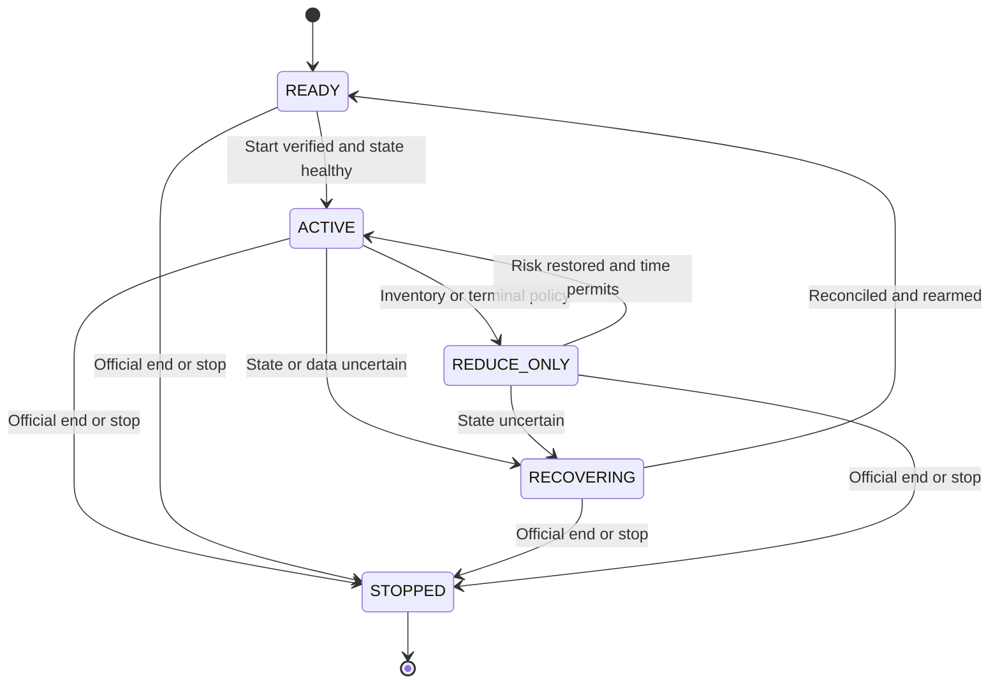

# Optiver x Bona Fide Delft: Complete Team Context

**12 November 2026 · English team handover and competition playbook**

This single-document edition contains the complete handbook and working templates. The companion GitHub package also contains the research scripts and numerical evidence tables. The separate research-data archive supplies original raw inputs for offline reproduction.

## Contents

- [Overview](#overview)
- [Chapter 01](#chapter-01)
- [Chapter 02](#chapter-02)
- [Chapter 03](#chapter-03)
- [Chapter 04](#chapter-04)
- [Chapter 05](#chapter-05)
- [Chapter 06](#chapter-06)
- [Chapter 07](#chapter-07)
- [Chapter 08](#chapter-08)
- [Chapter 09](#chapter-09)
- [Chapter 10](#chapter-10)
- [Research tools](#research-tools)
- [Evidence files](#evidence-files)
- [Instructions for permitted coding assistants](#assistant-context)
- [Template: Readme](#template-readme)
- [Template: Decision Log](#template-decision-log)
- [Template: Experiment Card](#template-experiment-card)
- [Template: Final Run Card](#template-final-run-card)
- [Template: Incident Card](#template-incident-card)
- [Template: Rules Sheet](#template-rules-sheet)

---

## overview

**Overview**

**Event:** 12 November 2026 · **Language:** English · **Platform:** Optibook / Python  
**Purpose:** give every teammate and permitted coding assistant the same factual context, research evidence, implementation priorities, and operating procedure.

### Start here

The team needs a working, observable trading system, an honest explanation of its edge, and disciplined execution during the final 20-minute round. The strongest current recommendation is to test a simple, inventory-aware passive quoting baseline, measure its actual fills and adverse selection, and promote only improvements that survive fresh evidence. This is a proposed experimental direction, not an already profitable strategy.

**The most consequential research result:** the recovered diagnostic contains **212,509 order-book snapshots and 8,955 public trades**. None of the four non-control directional signal families, at any tested instrument/horizon combination, had a positive hypothetical crossing edge in both chronological partitions with at least 30 observations in each. The apparently attractive small-sample results are insufficient grounds for an aggressive trading bot. [E3; see the data audit]

**The most consequential operational rule:** the organizers will reset positions and PnL after approximately 21:00 local time and then run a 20-minute competition. **The team must start its algorithm after the reset.** Treat the organizer's actual reset/start announcement as authoritative; 21:00 is approximate. [E1]

### Confirmed event snapshot

| Item | Current evidence |
| --- | --- |
| Instruments | `AMD`, `AVGO`, `CRWV`, `MU`, `NBIS`, `NVDA`, `SNDK`, `VRT` |
| Position limit | Maximum 100 lots long or short **per instrument** |
| Research inputs | Historical orders, public trades, and order-book snapshots are available in the supplied environment |
| Actual recovered diagnostic | Public trades and pricebooks; **no raw orders file** |
| Practice | Until approximately 21:00 on the event date; practice resets may occur |
| Final | Positions and PnL reset; 20-minute scored competition; team initiates its algorithm |
| Judging | PnL, trading approach, risk taken, novelty, and potentially other considerations; weights not published in supplied slides |
| Account ownership | One coordinated live execution owner; recovered event context reports one connection per team account |
| Research access | `HistoricalDataLoader` can be used without constructing an `Exchange` connection |
| Unresolved | Fees, exact message limits, terminal valuation, AI/external-code policy, submission/presentation requirements, and any later organizer clarifications |

Sources and confidence levels are explained in [context and rules](#chapter-01) and the [source register](#chapter-10). The photographs supplied by Bernie were inspected directly. Older preparation documents are superseded wherever those photographs or the actual dataset provide better evidence.

### Reading paths

| Available time / responsibility | Read |
| --- | --- |
| Everyone, first 10 minutes | This README; context/rules; first section of the strategy playbook; final-round checklist |
| Strategy owner | Strategy playbook; full data audit; experiment card template |
| Execution and risk owner | Execution/risk chapter; final-round checklist; incident card |
| Research and evaluation owner | Data audit; curated evidence CSVs; validation standards; experiment log |
| Integration or team lead | Team operating plan; decision log; release checklist; judging narrative |
| A permitted AI assistant | `AGENTS.md`, the relevant chapter, current rule sheet, and the exact code/config it is asked to review |
| Full preparation context | `MASTER_CONTEXT.md`, the assembled single-document edition of the handbook |

### Documentation map

| File | What it explains |
| --- | --- |
| [01 — Context and rules](#chapter-01) | Recovered preparation, authoritative event facts, superseded assumptions, and remaining decisions |
| [02 — Strategy playbook](#chapter-02) | Fair value, passive quoting, inventory, execution costs, adverse selection, candidate signals, and concrete decision rules |
| [03 — Actual data and research audit](#chapter-03) | What was run, exact data coverage, signal results, reproducibility, limitations, and next experiments |
| [04 — Execution and risk](#chapter-04) | API semantics, order state, capacity, partial fills, reconciliation, failure recovery, and final-round mechanics |
| [05 — Team operating plan](#chapter-05) | Roles, work allocation, milestones, Git workflow, acceptance criteria, and time budgets |
| [06 — Final-round checklist](#chapter-06) | Before reset, after reset, during the 20 minutes, and at the finish |
| [07 — Prior competitions and resources](#chapter-07) | What public winners and participants actually disclosed, with evidence limits |
| [08 — Reading map and learning exercises](#chapter-08) | All 20 sources from the earlier preparation, priority readings, and worked checks |
| [09 — Judging and handover](#chapter-09) | Evidence-based explanation, likely questions, final report structure, and continuity |
| [10 — Sources and provenance](#chapter-10) | Source authority, evidence dates, recovered artifacts, and what remains unavailable |
| [Templates](#template-readme) | Rules, experiments, decision records, incidents, and final results |
| [Research](#research-tools) | Recovered research tool, reproduction instructions, and separation from live execution |
| [Evidence](#evidence-files) | Machine-readable summaries and sensitivity checks |

### The next five actions

1. Assign one execution owner, one research owner, and one integration/evaluation owner. Combine roles if necessary; do not assume a particular team size is permitted.
2. Fill the rule sheet's open fields from the organizer or installed environment. Focus on fees, limits, the actual final-start procedure, terminal inventory, and permitted tools.
3. Establish a baseline that reads valid books, reconciles positions and orders, respects worst-case outstanding exposure, and records private fills. Start a small permitted practice experiment promptly once these controls work.
4. Compare a neutral passive baseline against one bounded improvement on fresh practice data. Keep code, limits, sizes, and evaluation windows comparable. Measure conditional fill quality, not just price prediction.
5. Freeze a version, rehearse restart and cancellation/reconciliation, and prepare the short explanation. Keep an operator watching through the reset and final start.

### What this package is

This is a consolidated handover of the relevant retrievable preparation, supplied event materials, actual diagnostic outputs, and explicit new recommendations. It is not a verbatim transcript of every past conversation. It does not contain a deployed trading bot or evidence of a successful scored run. The research script is a diagnostic; any live algorithm must still be implemented and validated in the official environment.

The package is ready to place in a GitHub repository. Use a private team repository while event-material sharing permissions remain unresolved. Keep credentials, account configuration, raw participant data, licensed books, and local execution logs outside version control. The package contains derived research evidence and source descriptions, rather than redistributing the original books or event photographs.

**Evidence labels:** `Confirmed` = supplied event source; `Observed` = inspected data/code; `Recommended` = a proposed decision; `Open` = unresolved; `Historical` = another event or older preparation. A recommendation becomes a team decision only when it is recorded with an owner and evidence.

---

## chapter-01

**Chapter 01**

### 1. Mission and current strategic position

The event is **Optiver x Bona Fide Delft, 12 November 2026**, also advertised as an Optiver Coding Challenge / Mini Hackathon. The supplied mission is to investigate historical market activity for a small stock universe, understand its dynamics, and use that research to build a profitable trading strategy. The implementation environment is Python and Optibook. [E1, E2, E4]

The eight supplied symbols are `AMD`, `AVGO`, `CRWV`, `MU`, `NBIS`, `NVDA`, `SNDK`, and `VRT`. Their names alone do not establish the simulator's economic relationships, real-world price feeds, common factors, fundamental values, or instrument convertibility. Treat the supplied market and its rules as the problem definition. [E1; interpretation]

Preparation originally explored several possible Optibook formats: single-asset market making, dual listings, options, ETFs, news, and predictive datasets. Those were branches to prepare for before the problem was known. The current materials support a historical-data-driven stock trading challenge. No supplied source establishes a guaranteed dual-listing identity, basket conversion, option payoff, or news-based mechanism for this edition. Consequently, the active plan centers on data quality, stock fair-value estimation, order execution, inventory, and experiment design. [E1–E4]

The goal is to improve the team's probability of producing the strongest defensible submission. No recovered evidence supports a guaranteed winning strategy or a numerical probability of winning.

### 2. How the preparation developed

| Stage | Material recovered | What to retain now |
| --- | --- | --- |
| Initial preparation, 11 November | A 15-page preparation guide, public event research, comparable competitions, and a reading map of 20 supplied finance sources | Microstructure, executable prices, inventory, validation, team discipline; conditional branches remain reference material |
| Deeper preparation, 11–12 November | A 14-page winner/case-study dossier and user-supplied Optibook API/common types | Distinguish official results from participant claims; implement actual SDK semantics |
| Event briefing, 12 November | Photographs of mission, risk, fair-value, competition, and recommendation slides | Actual symbols; ±100 lots; approximate practice cutoff; reset and 20-minute final; qualitative judging criteria |
| Early event tooling | `optibook_market_scout.py` | A read-only scout that still opens `Exchange`; it must not compete with the live owner for the account connection |
| Supplied notebook | Setup, instrument metadata, orders, fills, PnL, and `HistoricalDataLoader` examples | Official paths and method semantics; distinguish historical research from a live account connection |
| Historical research tooling | `optibook_research.py` and an earlier research-kit ZIP | A diagnostic that uses the historical loader without opening `Exchange` or sending orders |
| Completed historical run | `diagnostico_optibook.zip`, uploaded on 12 November | Inspectable raw trades/books, report, metadata, summary, and signal screen |
| This handover | Source reconciliation, offline reproduction, sensitivity checks, strategy/engineering/operations chapters | A common reference that prevents stale assumptions and unsupported claims from propagating |

The two older PDFs are preparation artifacts, not official rules. The original set of 20 books was previously reviewed through contents and selected passages; this handover preserves that reading map without claiming a fresh cover-to-cover audit. [E4, E5]

### 3. Rules confirmed from the supplied slides

| Rule | Operational meaning | Evidence |
| --- | --- | --- |
| Universe contains the eight named stocks | Validate instruments against the current runtime and keep the active configuration explicit | Mission photographs, `IMG_3362` / `IMG_3363` |
| Maximum 100 lots long or short per instrument | Treat `-100 <= q_i <= 100` as the hard filled-position limit; also reserve capacity for outstanding and uncertain orders | Risk photographs, `IMG_3364` / `IMG_3365` |
| Practice until approximately 21:00 today | Use the live organizer announcement for the actual cutoff | Competition photograph, `IMG_3367` |
| Positions and PnL reset before the final | Archive practice evidence, begin a new final-run ledger epoch, and reconcile the actual post-reset state; do not treat practice balances or positions as current | `IMG_3367` |
| Final competition lasts 20 minutes | Use elapsed time from the official competition start, separate from bot launch; a restart does not create another 20 minutes | `IMG_3367` |
| Team is responsible for starting its algorithm after reset | Assign a named operator and rehearse the procedure | `IMG_3367` |
| PnL matters, along with approach, risk, and novelty | Produce measured performance and a clear explanation; do not optimize an invented weighted score | `IMG_3367` |
| Start simple, iterate, get connected/trading early in practice, and ask for help | Prefer small, controlled experiments once core controls work; avoid spending the whole event refining an untested model | Recommendation photograph, `IMG_3368` |

The competition slide describes AirPods 5 for members of the winning team and speakers for runners-up. This supersedes the earlier public advertisement's possible iPhone incentive; it has no effect on trading design. It does not establish a team-size limit. [E1, E4]

The relevant local clock is Delft time. On this date Delft and Madrid share CET (UTC+1). Store machine timestamps in UTC and display the competition countdown against the organizer's stated start. The historical dataset timestamps are UTC, not local time.

### 4. What the supplied platform material establishes

The event notebook uses `Exchange()` with configuration-derived access and illustrates the synchronous client. It demonstrates instrument metadata, order-book access, order insertion/deletion/amendment, public trade ticks, private fills, positions/cash, and `get_pnl()`. It also supplies `HistoricalDataLoader` for trades, orders, and pricebooks. [E2]

Relevant distinctions:

- An accepted order is not a confirmed fill. The insert response and the fill record answer different questions.
- IOC means an unfilled remainder does not rest. It does not promise all-or-nothing execution.
- Cancel on disconnect removes resting orders; it does not liquidate inventory.
- A process that only reads through `Exchange` still consumes a live connection. The older scout is not safe to start casually alongside the trader.
- Historical-loader research is a separate access path; the recovered diagnostic used it without an `Exchange` connection.
- Last-trade marked PnL is not guaranteed liquidation value, and the method's marking behavior does not establish the judges' terminal rule.
- The generic client supports instrument types beyond this event's stocks. The presence of options/news fields is not evidence those features are active here.
- Broad API validators such as prices up to 1,000,000 or volumes up to 100,000 are not useful quote levels, position limits, or permission to submit those sizes.

See the execution chapter for the exact recovered signatures, response semantics, and reconciliation requirements. Do not treat any copied tutorial order as a safe production order merely because its syntax is valid.

### 5. Reconciliation of old and new assumptions

| Earlier assumption / example | Current treatment |
| --- | --- |
| Instruments and final duration were unknown | Resolved by the event slides: eight stocks and a 20-minute post-reset final |
| A generic FAQ showed ±300 | Superseded for this event by ±100 per instrument |
| Other mini-hackathons allowed four people | Does not prove the current team-size rule |
| Dual listing might be the challenge | No identity is established for this universe; do not create a synthetic equivalence |
| News/LLM methods helped other winners | Retain as historical context; current event evidence has not established an actionable news feed |
| A high positive predictive metric might justify trading | Must survive executable prices, costs, latency, fills, limits, and fresh evidence |
| A historical run completed successfully | Confirms a data/analysis pipeline, not profitability |
| The requested interval was 30 minutes | Actual observed books span approximately 28 minutes 39 seconds and stop about 80.7 seconds before the requested end |
| The historical loader supports orders | The actual recovered diagnostic ZIP contains no raw orders dataset |
| The final begins at exactly 21:00 | The slide says approximately; the actual organizer signal controls |
| A read-only market scout is operationally harmless | It opens the account connection and can interfere with the sole live owner |

### 6. Questions that still change implementation

These are concrete missing fields to resolve once with an organizer or the running environment, then record in `templates/rules_sheet.md`. They are not reasons to stop all preparation.

| Question | Why the answer changes the system | Interim behavior |
| --- | --- | --- |
| What fees or rebates apply to each execution? | Changes the minimum profitable edge and maker/taker comparison | Historical zero-fee results remain conditional; reserve an explicit fee field |
| How is final inventory valued or liquidated? | Determines ending policy and whether residual exposure is penalized | Maintain manageable inventory and preserve the ability to close; do not assume forced liquidation |
| What are message/order limits and burst rules? | Determines polling, cancel/replace frequency, and emergency capacity | Use a conservative budget and measured pacing; obtain exact limits |
| Are there extra gross/net/notional or outstanding-order limits? | Per-symbol ±100 alone may be insufficient | Apply conservative local caps and do not infer missing global rules |
| What are each instrument's tick, lot size, and price bands? | Determines valid prices, sizes, units, and guards | Read metadata; do not infer ticks from median spread |
| How exactly does the reset affect live connections, orders, histories, and caches? | Determines restart and ledger-clearing sequence | Stop new submissions, wait for announced reset, reconcile, and start explicitly |
| What code/submission/presentation is required and when? | Determines what must be frozen and handed in | Prepare a commit, config, run command, logs, and short explanation |
| Are AI, internet, prewritten code, and external packages allowed? | Determines permitted workflows | Use materials according to the event's actual rules; keep the trading loop independent of AI |
| Can event data, code, and materials be shared publicly? | Determines repository visibility and included files | Use team-private collaboration and summarized sources |
| Are there precise judging weights or tie-breakers? | Determines the optimization target | Report PnL, exposure, drawdown, approach, and novelty separately |

### 7. What “complete context” means in this handover

The package preserves the relevant retrievable event preparation, its changes over time, the original problem's concrete constraints, the actual research results, and explicit proposed next steps. It does not fill gaps with invented meeting details, teammate names, hidden scoring weights, measured latency, transaction fees, a proven alpha, or final competition results. It also excludes unrelated personal history: the group needs the competition context and working decisions.

Source authority is: current organizer clarification, supplied event slides, installed event SDK and supplied notebook, observed data, earlier preparation, then external analogies. Record any later rule change with its source and time so the whole team makes the same update.

---

## chapter-02

**Chapter 02**

### 1. The decision we should make now

**Recommended starting point:** a small passive quoting experiment with a neutral midpoint reference, inventory-aware prices/sizes, reliable execution, and actual-fill diagnostics. Next, test one bounded fair-value improvement or one execution improvement. Keep the aggressive directional module disabled until fresh evidence supports its complete entry/exit economics.

This recommendation follows from the actual diagnostic: the tested directional signals do not show robust positive crossing edge across both chronological partitions at the stated minimum observation count. It does not follow that all aggressive strategies fail, or that passive market making is profitable. Passive execution has different costs and fill selection, which must be measured. [E3; full audit in Chapter 03]

The strategy should answer five questions in order:

1. **What do we estimate the instrument is worth, at what horizon, and using what information?**
2. **At what prices could we actually buy or sell, and how likely is a passive fill?**
3. **What happens to value conditional on us getting that fill?**
4. **How much risk can the account take after every outstanding order executes in the worst direction?**
5. **How will the position be reduced, and will that plan remain feasible near the final deadline?**

A forecasting idea that cannot answer questions 2–5 is a research hypothesis. A correct order-management system with no profitable mechanism is an engineering baseline. The team needs both, but should build and evaluate them separately.

### 2. Shared notation and units

| Symbol | Meaning | Unit |
| --- | --- | --- |
| `b`, `a` | Best bid and best ask | Price units per lot under the simulator's contract convention |
| `Vb`, `Va` | Displayed quantities at those prices | Lots |
| `m = (a+b)/2` | Midpoint | Price |
| `s = a-b` | Full displayed spread | Price |
| `delta` | Runtime-confirmed minimum price increment | Price |
| `q` | Filled inventory; positive long, negative short | Lots |
| `B`, `S` | Remaining buy/sell quantities, including uncertain exposure reservations | Lots |
| `f` | Our estimated fair value for a specified horizon | Price |
| `h` | Intended quote half-width | Price |
| `ell` | Decision-to-entry latency assumption or measurement | Seconds |
| `H` | Holding or evaluation horizon | Seconds |
| `c` | Fee per side, if charged in price units per lot | Price per lot |

If the simulator uses multipliers or another fee convention, convert explicitly. Do not mix price units, ticks, basis points, account PnL, or percentages. The recovered median spreads are observations, not tick sizes. [E2, E3]

### 3. Fair value is an estimate, not the price available to trade

The midpoint is a convenient local reference. It is generally neither the price for an immediate purchase nor the price for an immediate sale. A marketable buy consumes the ask side; a marketable sell consumes the bid side. For more than the available best-level quantity, compute a depth-weighted execution price.

An aggressive long candidate needs the expected **future executable exit bid** to exceed its expected entry ask, fees, slippage, and an uncertainty margin. A forecast that the midpoint will rise by 0.03 is not enough when the round trip costs 0.20 in spread before fees. The same reasoning applies with sides reversed for a short.

For a one-lot long under the historical screen's simplified assumptions:

```text
entry at t + ell
exit at t + ell + H
crossing_edge_long = future_bid - entry_ask - 2 * fee_per_side
crossing_edge_short = entry_bid - future_ask - 2 * fee_per_side
```

These are hypothetical price-unit edges, not a complete strategy's PnL. Rows describe different hypothetical rules evaluated on shared, often overlapping market data. They are not independent experiments. Do not sum the signal-screen rows as if one account traded all of them. [E3]

#### Worked example from the supplied fair-value slide

The slide gives an estimated fair value of **100.60** for example stock ABC and displays offers of **15 at 100.30**, **50 at 100.40**, and **110 at 100.50**. These are teaching numbers, not an active instrument or a guaranteed fair value. [E1]

If inventory is zero and no buys are outstanding, the event limit permits at most 100 additional lots. Buying 100 would consume 15 + 50 + 35 lots if those offers were still present:

```text
cost = 15*100.30 + 50*100.40 + 35*100.50 = 10,042
average execution price = 100.42
estimated value = 100*100.60 = 10,060
model-marked edge before fees = 18
```

That 18 is an estimate relative to the assumed fair value. It is not realized profit. The fair value could be wrong, the offers could disappear, only part could fill, and liquidation could cost a spread or more. If current inventory is +75 with no outstanding buys, capacity is only 25: 15 at 100.30 plus 10 at 100.40 would cost 2,508.50 and have model-marked edge 6.50. Existing buy reservations reduce the capacity further.

The practical lesson is to combine valuation, executable depth, and risk capacity before selecting size. Do not buy every visible offer below an uncertain model value up to the hard limit.

### 4. What passive market making actually earns

A passive bid can buy below the midpoint and a passive ask can sell above it. The apparent spread capture is compensation for uncertainty, waiting, adverse selection, and inventory exposure. It is not free profit.

Let `d = +1` for a buy fill and `d = -1` for a sell fill, `p` the fill price, and `m_fill` the valid midpoint at the fill reference time. Define:

```text
spread_component = d * (m_fill - p)
subsequent_move(H) = d * (m_after_H - m_fill)
markout(H) = d * (m_after_H - p)
           = spread_component + subsequent_move(H)
```

A buy at 99.90 when midpoint is 100.00 appears to capture 0.10. If midpoint becomes 99.60, its markout is -0.30. This is how a bot can get many fills and lose despite quoting a positive spread.

Markout is a diagnostic, not realized account PnL. It uses a reference mark and does not automatically subtract the cost of closing the position. Use time-causal marks, separate buy and sell results, apply fees consistently, and retain volume-weighted and unweighted summaries.

The relevant research question is **expected value conditional on being filled**. The distribution of all market observations differs from the distribution of moments when someone chooses to trade against our quotes. Optiver's own research discussion emphasizes this counterfactual and the limitations of treating historical touches as guaranteed fills. [R10 in Chapter 07]

### 5. Baseline design, step by step

#### 5.1 Select a small initial trading universe

Use the actual summary as a shortlist, then measure live execution. NVDA had the most trades in the sample, 1,636, and a median spread of 0.10; AMD and AVGO had median spreads of 0.20 and material activity. These facts make them sensible candidates for an initial **comparison**, not proven winners. MU and VRT had unusually large median top-level quantities around 3,000; joining such a queue may produce few fills, while improving its price gives away edge. [E3]

Start with one or two instruments so the operator can inspect behavior and the team can attribute results. Add symbols only after evaluating their fill quality, inventory cost, and message burden. Eight listed instruments do not imply that all eight should be quoted continuously.

#### 5.2 Start with a transparent reference

Set `f = m` for the neutral baseline. This is not a fundamental valuation model; it is an interpretable benchmark against which an extra signal can be measured. Require a nonempty, noncrossed, sufficiently fresh book and valid instrument metadata. If those requirements fail, produce no new risk-increasing quote for that instrument.

#### 5.3 Penalize inventory in prices and sizes

One transparent proposal uses:

```text
center = f - inventory_skew_ticks * tick_size * q / soft_inventory_scale
raw_bid = center - half_width
raw_ask = center + half_width
```

All coefficients are team-chosen parameters, not Optiver rules or calibrated outputs from this diagnostic. Positive inventory moves the center down, discouraging additional buys and encouraging sales. Negative inventory does the reverse. Separate quote sizes can further reduce the risk-increasing side.

Use a **soft inventory threshold** below the ±100 hard limit. The soft threshold is where the system reduces new exposure; the hard limit is a constraint that must never be breached. A one-lot quote and a soft threshold of roughly 10–20 lots can be an initial practice setting if the team chooses it, but these numbers require evaluation and are not a profit-maximizing recommendation. Account for all live and uncertain orders even at small sizes.

When inventory reaches the soft threshold, suppress the risk-increasing side or materially reduce its size. Continue only a controlled risk-reducing side if market/state quality allows. Escalate to bounded aggressive reduction only under an explicit inventory, loss, time, or failure policy. Canceling a quote does not reduce filled inventory.

#### 5.4 Choose width according to the behavior being tested

The simplest baseline joins the best bid/ask where a meaningful margin around the reference exists. A more explicit rule sets `half_width` from a minimum tick-based width and an uncertainty/short-horizon volatility component. Do not tune both reference and width in the same first experiment.

Wider quotes improve nominal edge per fill but often reduce fills. Narrower quotes can attract more trades while increasing adverse selection. Optimize measured net performance under comparable risk, not spread width alone, fill count alone, or an arbitrary target win rate.

Measure short-horizon volatility in price units over the relevant quote/holding interval. A daily volatility number copied from a real stock has no established relationship to this simulated market. If using an exponentially weighted estimate, document its sampling interval, half-life, missing-data policy, warm-up, and reset behavior.

#### 5.5 Round, validate, and reserve

For passive intent, round the bid down and the ask up to the runtime tick grid, then check the result again. A passive-intended bid must be strictly below the observed best ask, and a passive-intended ask strictly above the observed best bid; equality is already marketable. Also check against the team's own outstanding orders. Change or suppress an invalid quote according to an explicit rule. These checks at decision time cannot guarantee passive execution after the market moves before order arrival. “Limit” does not mean “passive”: a marketable limit order can execute immediately. [E2]

Integer tick indices avoid accumulating floating-point rounding errors. After rounding, enforce price bands, quote order, self-crossing rules, maximum size, worst-case capacity, and message budget. If a candidate fails these checks, record the rejection reason rather than silently altering it in several unrelated places.

#### 5.6 Avoid replacing orders without purpose

Refreshing on every book event consumes messages and can lose queue priority. Replacing too slowly leaves stale quotes. Compare the new desired price to the current order and use a documented change threshold or age condition. Keep emergency cancellations ahead of routine quote refreshes. Do not guess which methods count against the exchange's rate limiter; confirm that rule.

If the public book includes our own orders, a large quote can distort our measured imbalance. Remove our known contribution only when the book/order views and inclusion semantics make that adjustment reliable. Otherwise flag contamination, cap the signal, and avoid a feedback loop where our quote creates the signal that expands the quote.

### 6. Candidate signal improvements

#### 6.1 Best-level imbalance and microprice

For valid positive displayed depth:

```text
OBI = (Vb - Va) / (Vb + Va)
microprice = (a*Vb + b*Va) / (Vb + Va)
microprice - midpoint = (spread / 2) * OBI
```

Thus OBI and this microprice are the same information transformed by the spread. They are not two independent votes. With bid 99, ask 101, and depth 90/10, midpoint is 100, OBI is 0.8, and microprice is 100.8.

A bounded improvement could be:

```text
f = midpoint + clip(alpha * (microprice - midpoint), -max_shift, +max_shift)
```

Compare it to `alpha = 0` with the rest of the system fixed. `max_shift` is in price units, not lots. Use held-out or new practice observations to set or assess it. Current data does not justify interpreting strong OBI as an instruction to cross the spread. The actual OBI screen and its sensitivity checks are in Chapter 03.

#### 6.2 Aggressive trade flow

The recovered screen uses the preceding five seconds of signed public trade volume, divided by total volume in that window. The supplied convention is aggressive buys on `bid` and aggressive sells on `ask`. Verify the field's semantics; do not interpret an aggressor's side as the side of the resting order it consumed. [E2, E3]

Flow can help describe short-term buying/selling pressure. It can also be a response to a price move that already happened. Its incremental value must be assessed after timestamp alignment and realistic execution delay. A large volume window is not automatically a large information advantage.

#### 6.3 Momentum and reversion

The recovered screen compares the midpoint with its value five seconds earlier. Momentum follows the sign; reversion reverses it. Neither family establishes a robust crossing edge in the current audit. Do not rescue a negative result by choosing a different horizon after repeatedly inspecting validation without reserving new data.

A reversion strategy needs a credible reference and a horizon over which deviations tend to contract. A moving average is an estimate, not a contractual redemption price. Cap position, define when the hypothesis has failed, and avoid increasing size solely because the deviation grew.

#### 6.4 Cross-instrument information

A possible later hypothesis is whether one instrument's past move improves another's forecast after accounting for the second instrument's own recent move. Fit only using earlier data, use synchronized causal timestamps, and check incremental executable edge. Similar company names or visual chart similarity are insufficient.

Even a statistically useful relationship leaves convergence, hedge, and basis risk. A zero sum of lots across two differently priced instruments is not neutral notional exposure. A beta hedge is estimated and can change; a per-symbol limit remains binding after hedging.

#### 6.5 Order-flow imbalance is a different object

Snapshot OBI measures current displayed depth. Order-flow imbalance describes changes caused by arrivals, cancellations, and executions over an interval. The current raw archive has no orders file, and order-event semantics must be understood before reconstructing that process. Do not rename snapshot OBI as OFI or infer reliable cancellation counts from sparsely sampled book differences. [E3]

### 7. When an aggressive order is reasonable

There are two distinct purposes:

| Purpose | Required justification | Evaluation |
| --- | --- | --- |
| Seek predicted profit | Forecast survives full entry/exit spread, fees, latency, depth, and uncertainty on fresh data | Actual realized result, markout, and exposure relative to a benchmark |
| Reduce an existing risk | Carrying the position violates a documented risk/time policy or has worse expected cost than an immediate reduction | Risk reduced, slippage incurred, residual position, and whether the action stayed within bounds |

The second can intentionally realize a loss. That is not evidence the first has alpha. Tag the reason for each aggressive order so the team can distinguish trading profits from inventory-control costs.

Use a price-bounded IOC for a deliberate immediate attempt when supported. Observe actual fills and the unfilled residual. The notebook's very low/high liquidation limits are teaching examples with explicit warnings; they are not suitable default competition settings. [E2]

### 8. A practical experiment ladder

| Experiment | What changes | What must remain fixed | Keep only if |
| --- | --- | --- | --- |
| B0: neutral passive baseline | First controlled operation | Small universe, small size, reliable risk accounting | It produces interpretable fills/logs without state/limit failures |
| B1: bounded microprice shift | Reference signal only | Width, size, inventory policy, measurement method | Fresh actual-fill evidence improves net economics at comparable exposure |
| B2: inventory response | One skew or soft-limit parameter | Signal and base width | Inventory tails/carrying cost improve without destroying net result |
| B3: refresh policy | Quote age or change threshold | Signal/size/limits | Fewer stale losses or messages without excessive missed fills |
| B4: instrument selection | One instrument added/removed | Policy and risk per active instrument | Its marginal result and operational cost justify inclusion |
| B5: selective aggressive signal | One predeclared signal/horizon | Explicit risk/fees/slippage model | New data supports executable edge and live fills corroborate it |

Do not force every rung before the final. A stable B0 or B1 with credible evidence is preferable to an unfinished combination. Record negative and inconclusive experiments; they explain why the final system is as simple as it is.

Practice blocks occur in a changing market. A sequential A/B comparison is not a randomized controlled trial. Log market regime, spread, activity, and inventory at block boundaries; use repeated alternation only if time and operational cost allow. Avoid changing code while the same account is still executing the previous experiment.

### 9. Decisions under weak evidence

The recovered sample is short. Many displayed snapshots are correlated views of one market, not independent experiments. Thirty nonoverlapping observations is only a reporting threshold, not a statistical guarantee. An average can be dominated by one jump, and a favorable validation row selected from many candidates is no longer a clean untouched test. [E3]

When uncertainty is high, reduce complexity, size, and claims. Choose the next experiment for information value: can it distinguish a broken execution mechanism from an unprofitable pricing mechanism? For example, zero fills may mean a queue problem; negative post-fill markouts may mean adverse selection; profitable marks with large inventory may mean directional luck.

If the team is behind on the practice leaderboard, do not increase risk merely to chase the displayed number. The final starts from reset, human judges also consider risk, and practice market conditions may change. Use practice losses to find failures that can be corrected before the scored round.

### 10. Conditional branches retained from preparation

These branches preserve context but are inactive unless the actual problem establishes their prerequisites.

| Branch | Trigger required | Essential distinction |
| --- | --- | --- |
| Exact dual listing or basket arbitrage | Explicit equivalent payouts/conversion/settlement and usable execution | Buy ask, sell bid; account for partial fills, inventory by instrument, and conversion limits |
| Statistical pairs | Causal evidence of a relationship that survives later data and costs | Correlation is not a guaranteed payoff identity |
| Options/futures | Those instruments and terms are actually present | Read expiry, strike, underlying, multiplier, Greeks, and price bands; delta neutral leaves other risks |
| News | A permitted timely feed with a demonstrated connection to simulated prices | Arrival timestamps, inference delay, missing news, and price reaction matter |
| Larger ML model | Enough independent data, evaluation time, and measurable baseline advantage | Prediction quality must translate into net trading performance; inference must not stall risk management |
| Participant-specific patterns | Stable permitted identities with actual populated data | The recovered buyer/seller columns are empty; identity-based tactics have no support here |

### 11. What the team should be able to explain

Before promoting a strategy, every owner should be able to state its mechanism in one sentence, identify the price and quantity it will submit in a worked example, explain its maximum possible position with outstanding orders, name the assumption most likely to fail, and show the experiment that led to the current configuration.

If that explanation depends on a large unexplained stack of indicators, a historical winner's reputation, or the largest number found in a parameter sweep, simplify the system until the explanation is testable.

---

## chapter-03

**Chapter 03**

**Evidence date: 12 November 2026. This chapter separates recovered results, additional offline checks, and proposed experiments.**

### 1. The decision the team should make now

The recovered diagnostic does **not** establish a profitable aggressive trading strategy. Among the 128 non-control instrument/signal/horizon combinations, none has positive average crossing edge in both the training and validation intervals with at least 30 observations in each. The only combination with positive means in both intervals is VRT order-book imbalance at a 30-second horizon, based on only 7 training and 12 validation observations. Its validation mean is just 0.008333 price units per hypothetical lot. Treat that as insufficient evidence, not a winner to deploy.

Several order-book imbalance tests predict a small movement in the expected direction, but that movement is generally too small to pay the cost of crossing the spread at entry and exit. This distinction suggests a productive next experiment: compare a small, inventory-aware passive quoting baseline with the same baseline using one bounded imbalance adjustment. The historical screen does not simulate passive fills, so it cannot tell us whether either version is profitable. Only execution-aware validation and actual practice fills can answer that.

Our practical research sequence is therefore:

1. Prove that the system observes current state, reconciles fills, obeys limits, and records reliable measurements.
2. Run a small passive baseline on a deliberately limited set of instruments.
3. Compare the baseline with one bounded signal change, keeping risk and execution settings fixed.
4. Promote an improvement only if it survives fresh data, realistic costs, and a clear attribution of where the improvement came from.
5. Keep aggressive entries disabled as an alpha strategy until their complete expected edge clears execution costs. Aggressive risk reduction remains a separate, explicitly costed action.

Sources: recovered `diagnostico_optibook.zip`, especially `metadata.json`, `summary.csv`, and `signal_screen.csv`; recovered `optibook_research.py`; independent offline reproduction described below. These are direct project artifacts, not an external claim about real securities markets.

### 2. Exactly what was collected

| Item | Verified value | Interpretation |
|---|---|---|
| Requested start | 2026-11-12 17:03:20.715896 UTC | 18:03:20.715896 CET in Delft and Madrid |
| Requested end | 2026-11-12 17:33:20.715896 UTC | 18:33:20.715896 CET |
| Earliest observed book | 2026-11-12 17:03:20.954666844 UTC | First returned book, not the requested boundary |
| Latest observed book | 2026-11-12 17:31:59.993202268 UTC | Approximately 80.723 seconds earlier than the requested end |
| Observed book span | Approximately 28 minutes 39.039 seconds | A requested 30-minute window is not 30 minutes of complete returned observations |
| Training/validation boundary | 2026-11-12 17:23:24.281641640 UTC | 70% of the observed book time span |
| Raw book snapshots | 212,509 | Across all eight instruments |
| Raw trades | 8,955 | Across all eight instruments |
| Invalid snapshots after deduplication | 13 | Kept as invalid observations; not replaced with an earlier valid book |
| Duplicate instrument/timestamp book rows | 0 | No such duplicates detected in this archive |
| Duplicate trade ID/session pairs | 0 | Additional offline audit |
| Exchange session IDs | One | `2026-11-11T12:28:39.801042+00:00`; no session-ID break observed |
| Historical orders file | Absent | The archive contains books and trades; the mission's availability of orders does not mean this run downloaded them |
| Buyer/seller fields | 100% missing in both columns | Counterparty identity and participant persistence cannot be studied from this archive |
| Recorded endpoint errors | None | Does not explain the missing final approximately 81 seconds |
| Exchange connection opened | False | Metadata and code agree that this research uses the historical loader |
| Orders sent | 0 | The script is a diagnostic, not a trading bot |

One session identifier does not prove that no administrative change or position reset occurred without a change of that identifier. Before combining later downloads, compare session identifiers, known reset times, schemas, and market behavior. Do not silently concatenate pre-reset and post-reset observations as if they came from the same regime.

The two global counts are data volume, not independent sample sizes. After causally sampling a one-second grid, separating training and validation, purging boundary-crossing labels, and spacing hypothetical trades, a signal/horizon may have only a few dozen observations.

`book_features_sample.csv` is the final 1,000 flattened book rows from the combined dataset. It is a diagnostic sample, not a uniform sample across time or instruments, and not the complete feature history. Reconstruct the full grids from the raw files when reproducing the signal screen.

### 3. Instrument-level facts and their practical meaning

The following figures are directly recovered from `summary.csv`. Spreads are price units; basis points are relative to each instrument's midpoint. Top-of-book depth is the median visible quantity at the best price, not guaranteed fill capacity at the time we submit an order.

| Instrument | Book snapshots | Trades | Usable one-second observations | Usable fraction | Median spread | Median spread, bps | Median best-bid size | Median best-ask size |
|---|---:|---:|---:|---:|---:|---:|---:|---:|
| AMD | 33,864 | 1,017 | 1,709 / 1,718 | 99.48% | 0.20 | 12.41 | 22 | 17 |
| AVGO | 38,171 | 1,162 | 1,708 / 1,718 | 99.42% | 0.20 | 9.47 | 20 | 15 |
| CRWV | 21,986 | 1,167 | 1,699 / 1,718 | 98.89% | 0.20 | 14.60 | 20 | 18 |
| MU | 21,699 | 1,106 | 1,703 / 1,717 | 99.18% | 0.20 | 27.59 | 3,003 | 3,002 |
| NBIS | 20,706 | 1,094 | 1,706 / 1,717 | 99.36% | 0.20 | 20.83 | 13 | 16 |
| NVDA | 39,939 | 1,636 | 1,712 / 1,717 | 99.71% | 0.10 | 7.26 | 26 | 24 |
| SNDK | 17,458 | 976 | 1,711 / 1,718 | 99.59% | 0.20 | 32.95 | 24 | 31 |
| VRT | 18,686 | 797 | 1,706 / 1,719 | 99.24% | 0.20 | 28.69 | 3,003 | 3,004 |

**NVDA is useful for an execution smoke test:** it has the most observed trades, the most book snapshots, the highest usable-grid fraction, and the smallest median spread. Those are operational reasons to inspect it first, not evidence that its passive strategy has the highest expected profit. More activity can also mean more competition and faster adverse selection.

**AMD and AVGO are useful passive-experiment candidates:** both have substantial observed activity, a median spread of 0.20, and relatively small median displayed queues at the best prices. This provides a concrete reason to measure their actual fills and post-fill movement. It does not justify assuming that joining the best quote will fill, or that improving by one tick remains profitable.

**MU and VRT require special queue awareness:** their median best-level depths are around 3,000 lots. A one-lot quote joining that level may sit behind a large queue. A large visible queue can facilitate aggressive risk reduction while making passive entry less likely. It is not a reason to quote a large quantity. The team's ±100-lot position cap is much smaller than the displayed level sizes.

**NBIS deserves caution for the imbalance overlay:** its imbalance signal changes direction between the training and validation intervals at several horizons. Retain it in the data inventory, but do not enable the same signal coefficient on every instrument merely for symmetry.

**The actual runtime instrument metadata remains authoritative.** The research script deliberately does not infer `tick_size`, lot multipliers, position limits, or price bands from historical price increments. A median spread of 0.20 is not a tick size. Determine whether one-tick improvement is possible from the official tick and the current spread.

### 4. How the original screen works

#### 4.1 Books and the causal time grid

For each instrument, the script parses the JSON bid and ask levels. It chooses the highest bid and the lowest ask and sums quantities at identical best prices. It rejects malformed, empty, crossed, locked, or otherwise unusable books. A locked book has bid equal to ask; this diagnostic excludes it, which is an analytical choice rather than a statement that every locked market is intrinsically invalid.

It then creates one decision timestamp per second, starting at the first complete second after the first book and ending at the last complete second before the final book. Every decision uses the most recent book whose exchange timestamp is at or before the decision time, subject to a maximum age of two seconds. This is a backward as-of join. It never fills a missing decision with a book from the future.

Keeping invalid snapshots in the event sequence is important: if an empty or unusable book occurs, the code does not simply skip it and pretend an earlier valid book remained executable. Nevertheless, exchange timestamps do not tell us exactly when our live process received the update. The causal offline join avoids one form of lookahead, but it does not model feed latency or the delay between observation and a live decision.

#### 4.2 Signals tested before any model fitting

The original script fits no predictive model. It tests six fixed rules for each instrument at four horizons.

| Signal name | Definition at decision time | Direction of a nonzero trade |
|---|---|---|
| `obi_0.5` | Best-level imbalance has absolute value strictly greater than 0.5 | Positive imbalance means long; negative means short |
| `flow_5s_0.4` | Signed aggressive volume divided by total aggressive volume in the previous five seconds has absolute value strictly greater than 0.4 | Follow the sign of net aggressive flow |
| `momentum_5s` | Current midpoint minus the midpoint five seconds earlier is nonzero | Follow the sign of the change |
| `reversion_5s` | Same five-second midpoint change | Trade against the change |
| `control_long` | Always positive | Long control, useful for detecting market drift |
| `control_short` | Always negative | Short control, useful for detecting market drift |

The flow convention in the recovered code is `aggressor_side='bid'` for an aggressive buy and `'ask'` for an aggressive sale. Preserve this convention only while it agrees with the actual historical-data API specification. Do not reinterpret it from the everyday phrase "trade at the bid," which can refer to the passive price side instead.

The signed-flow window is `(t-5 seconds, t]`. Missing or invalid flow information produces a neutral signal, not a guessed direction. Momentum uses a five-row lag on the one-second grid. Where the current or lagged midpoint is missing, the signal is neutral.

#### 4.3 Timing, labels, and hypothetical transaction prices

The settings were:

- One-second decision grid.
- Two-second maximum book age.
- One-second assumed execution delay.
- Holding horizons of 1, 5, 10, and 30 seconds after hypothetical entry.
- Zero assumed fee per side, explicitly not verified.
- A warning threshold of 30 observations, explicitly not a statistical significance test.

For a signal at time `t`, assumed delay `L`, and horizon `H`, the hypothetical long trade uses:

`long_edge = bid(t + L + H) - ask(t + L) - 2 × fee_per_side`

The corresponding short trade uses:

`short_edge = bid(t + L) - ask(t + L + H) - 2 × fee_per_side`

The code selects the long or short value from the signal's sign. This is a one-lot, top-of-book, aggressive round trip. It accounts for paying the entry and exit spreads through the quoted prices. It does not establish that those prices would still be available after submitting real orders, and it does not model volume larger than the available depth.

`mean_signed_mid_move` is a different statistic:

`signal_sign × [mid(t + L + H) - mid(t)]`

It measures movement from decision time, including the assumed one-second delay. It is not entry-to-exit PnL. A favorable move during that delay may be unavailable to the trader because entry occurs later. Do not subtract a generic spread from this midpoint number and label the remainder a verified trading edge.

#### 4.4 Time split, purging, and non-overlap

The first 70% of the observed time span is the training interval. The final 30% is validation. A training example is dropped if its hypothetical exit reaches or passes the boundary. This prevents training labels from borrowing returns from validation.

Within each instrument, horizon, and phase, the script samples candidate decision times every `L + H + 1` seconds before filtering by the signal. With `L=1` and `H=5`, decisions are spaced seven seconds apart. This prevents overlapping round trips within that one test. It does not make returns independent; neighboring examples can remain exposed to the same trend or volatility burst. It also does not make different instruments or different signal tests independent.

There are `8 × 6 × 4 = 192` instrument/signal/horizon combinations and 384 phase rows. Excluding the two always-directional controls leaves 128 candidate combinations. Looking across all validation results to choose a favorite is itself a form of tuning. A fresh, later interval is needed for an honest subsequent check.

### 5. The most useful exact results

#### 5.1 Promising-looking examples that do not pass a deployment gate

All edges below are price units per hypothetical lot, not dollars of total profit, returns on capital, or a portfolio result.

| Instrument and rule | Horizon | Training n | Training mean crossing edge | Validation n | Validation mean crossing edge | Decision |
|---|---:|---:|---:|---:|---:|---|
| AVGO imbalance | 30 s | 15 | +0.140000 | 9 | -0.011111 | Best training mean among non-control tests; tiny samples and negative validation |
| VRT imbalance | 30 s | 7 | +0.071429 | 12 | +0.008333 | Positive in both phases, but far too little evidence and negligible validation margin |
| AMD reversion | 30 s | 28 | -0.003571 | 12 | +0.133333 | Validation-only improvement does not establish a repeatable edge |
| CRWV reversion | 30 s | 28 | -0.139286 | 8 | +0.837500 | A large validation mean with eight observations is especially vulnerable to exceptional moves |
| MU imbalance | 10 s | 30 | -0.096667 | 24 | +0.112500 | Changes sign between phases; validation sample below warning threshold |
| VRT imbalance | 5 s | 61 | -0.124590 | 44 | +0.015909 | Negative training; positive validation is highly outlier-sensitive |
| NVDA imbalance | 10 s | 58 | -0.132759 | 30 | -0.063333 | More data, but both crossing means are negative |

#### 5.2 Why imbalance is still a reasonable research candidate

At a five-second holding horizon, several instruments show a small positive signed midpoint move in both phases while their aggressive round-trip edges remain negative:

| Instrument | Train n | Train signed midpoint move | Train crossing edge | Validation n | Validation signed midpoint move | Validation crossing edge |
|---|---:|---:|---:|---:|---:|---:|
| AMD | 104 | +0.056250 | -0.135577 | 32 | +0.070313 | -0.084375 |
| AVGO | 99 | +0.046465 | -0.152525 | 50 | +0.117000 | -0.040000 |
| MU | 72 | +0.022222 | -0.144444 | 44 | +0.010227 | -0.127273 |
| NVDA | 97 | +0.049485 | -0.129897 | 49 | +0.053061 | -0.077551 |
| SNDK | 89 | +0.024719 | -0.178652 | 39 | +0.047436 | -0.112821 |
| VRT | 61 | +0.046721 | -0.124590 | 44 | +0.172727 | +0.015909 |

This is evidence to test whether an imbalance-aware quote has better fill quality than a neutral quote. It is not permission to turn the signal into immediate market orders. Passive fills occur conditionally: the market may choose to trade against our quote precisely when our valuation is stale. The unconditional midpoint association may disappear, or reverse, among the subset of quotes that actually fill.

NBIS illustrates why one universal coefficient is questionable. At a five-second horizon its training signed midpoint move is +0.037952, while validation is -0.094444; crossing means are -0.139759 and -0.255556 respectively. This is a reason to withhold or disable its imbalance overlay pending fresh evidence.

#### 5.3 Additional offline checks performed for this handover

The audit independently loaded the raw compressed CSVs and reran the original analysis functions. All 384 result rows reproduced the stored observation counts, mean and median crossing edges, signed midpoint means, and long/short counts to numerical tolerance. The reported pandas `FutureWarning` concerns future dtype behavior in `fillna`; it did not prevent the current run or change this reproduction. It is not an exchange error.

Two deliberately limited diagnostics were then applied to the existing imbalance rule at the five-second horizon. They are **additional exploratory checks on already observed data**, not a new untouched holdout and not a search for a more favorable threshold.

**Sampling-offset check.** The same non-overlapping sample was shifted through all seven possible one-second offsets. For every instrument, the training crossing mean stayed negative at every offset. Some validation results changed sign substantially. VRT's validation mean ranged from -0.183333 to +0.023913; AVGO's from -0.165854 to +0.142553. These offsets share the same underlying data and must not be pooled as seven independent experiments. Selecting the best offset would be another overfitting step.

**Outlier check.** The original VRT five-second validation result has 44 observations, only three positive edges, and a median of -0.10. Its largest observation is +3.40. Excluding that one observation changes the mean from +0.015909 to -0.062791. This does not justify deleting an inconvenient observation from the official result; it demonstrates that the apparent average benefit is fragile.

For NVDA at the same horizon, the original validation mean is -0.077551, and removing its largest positive observation changes it to -0.114583. Its training crossing means across the seven offsets range from -0.148980 to -0.113861; validation ranges from -0.142553 to -0.051220. A favorable midpoint signal and a profitable crossing strategy remain different propositions.

A six-block chronological check used fixed five-minute windows from the first whole observed second, with exits required to remain inside each block. The final window is shorter because the data end early. For NVDA, all six crossing means remained negative. For VRT, all six remained negative. Small samples and different sampling origins mean block values will not average mechanically to the original phase values. These checks strengthen the reason to avoid treating a positive isolated cell as a stable aggressive strategy.

Curated audit tables: `evidence/signal_comparison.csv`, `evidence/obi_5s_blocks.csv`, `evidence/obi_5s_sampling_offsets.csv`, and `evidence/obi_5s_outlier_sensitivity.csv`. The original observations remain unchanged.

### 6. A precise passive-baseline experiment

#### 6.1 Define the components separately

Let `b` and `a` be the best observed bid and ask; `Vb` and `Va` their displayed sizes; `m=(a+b)/2`; `s=a-b`; `q` the executed inventory; and `tau` the verified tick size.

`I = (Vb - Va) / (Vb + Va)`

`microprice = (a × Vb + b × Va) / (Vb + Va)`

`microprice - m = (s / 2) × I`

The last equation shows that top-level imbalance and this microprice displacement contain the same snapshot information. Including both as if they were independent votes double-counts the signal. Actual order-flow imbalance measures changes in supply and demand through time and is a different feature; the current archive screen did not implement that full event-based feature.

Define a neutral baseline fair value `f=m`. Define one experimental variant as:

`f = m + alpha × (microprice - m)`

Choose the trial value of `alpha` before the trial, keep it bounded, and compare it with `alpha=0`. The data do not supply an optimal value. For a first controlled test, an illustrative small coefficient such as 0.25 is an experimental choice, not a discovered constant. A quote tick may erase this adjustment, so record the actual rounded quotes; do not attribute a performance change to a signal that never changed an order.

Apply the inventory adjustment separately:

`reservation_price = f - k_inventory × q`

Here `k_inventory` has price-per-lot units. A positive inventory lowers the reservation price, discouraging additional buying and encouraging selling. A negative inventory raises it. Do not use one unscaled numerical coefficient across assets with different prices, tick sizes, or volatility simply because all symbols share a ±100-lot limit.

Construct desired bid and ask around that reservation price with a half-width that covers costs, adverse-selection uncertainty, and inventory tolerance. A simple formula is a control surface for experiments, not a calibration proof:

`desired_bid = floor_to_tick(reservation_price - half_width)`

`desired_ask = ceil_to_tick(reservation_price + half_width)`

After rounding, recheck the spread, current opposite-side quotes, price bands, size limits, and outstanding-order reservations. A passive limit order can become marketable if the market moves before it arrives. The supplied insert_order signature supports limit and ioc, with no documented post-only argument. A passive-intended bid must be strictly below the observed ask and an ask strictly above the observed bid, also avoiding the team's own orders. Use a conservative non-crossing margin and observe actual executions; a market move before arrival can still make a limit order marketable.

#### 6.2 What changes and what stays fixed in an experiment

The first comparison should hold the following fixed: instrument set, lot size, inventory budgets, quote lifetime policy, stale-data rule, execution implementation, and evaluation duration. Change only the signal adjustment. If several components change together, a better outcome cannot be attributed to imbalance.

Keep one live account owner. A second strategy can calculate shadow quotes from the same snapshots without sending orders; this helps compare decisions but is not an executable PnL test because its fills are unknown. Never compare the live strategy's real fills with the shadow strategy's assumption that every touched quote fills.

Sequential trials are affected by changing market conditions and other teams' bots. Use short, predeclared trial blocks, retain an unchanged baseline configuration, and record which market regime each trial encountered. An A/B/A sequence can reveal a gross deterioration, but a few minutes of each remains weak statistical evidence. Do not repeatedly switch until one run happens to look good.

#### 6.3 What to measure after each actual fill

For a fill at price `p` with sign `d=+1` for a buy and `d=-1` for a sell, compute:

`signed_mid_markout(H) = d × [mid(fill_time + H) - p]`

This measures the fill against the later midpoint. It is useful for detecting adverse selection, but it is not liquidation profit. A buy can have positive midpoint markout and still lose after crossing the future bid to exit.

Also compute executable exit marks, with depth awareness:

- Bought lot: future executable bid minus fill price minus actual costs.
- Sold lot: fill price minus future executable ask minus actual costs.
- Larger inventory: use the volume-weighted value of sufficient available levels; do not value every lot at the top quote when its quantity is too small.

Log fill time, receipt time, signal at decision time, quote age, order size, filled size, inventory before/after, realized cash change, midpoint markout, and executable exit mark. Preserve both profitable and unprofitable fills. If the data feed misses a future mark, record it as missing rather than silently treating it as zero.

Useful summaries include: actual PnL under the official marking rule; inventory marked at executable liquidation prices; fill count and fill rate; mean and lower-tail markouts; time at soft limits; maximum absolute inventory; cancel/reject rates; stale-data pauses; and the fraction of gains attributable to directional inventory drift.

#### 6.4 A promotion gate the whole team can apply

Promote the signal variant only if the team can answer all of these questions:

1. Was it tested on data or practice time not used to choose it?
2. Did it alter actual quotes after rounding and execution controls?
3. Are the results based on real fills or a defensible execution model?
4. Are fees, spread costs, quote delays, and inventory disposal represented?
5. Is the gain present in more than one short period and not explained by one extreme trade?
6. Does it improve the relevant performance measure without creating unacceptable inventory tails or operational errors?
7. Can the execution owner revert immediately to the stable configuration?

A failed gate can mean "keep researching" rather than "the idea is impossible." It means the available evidence is insufficient to risk the final version on that modification.

### 7. Which strategies to postpone, and the reason for each

| Idea | Why it is currently unsupported | Evidence that would change the decision |
|---|---|---|
| Aggressive imbalance trades | Crossing costs generally exceed the observed signal; isolated positives are unstable | Fresh, execution-aware, cost-adjusted positive results with enough independent events |
| Universal momentum or reversion | Training crossing means are negative across the tested variants | A predeclared rule surviving a later regime and an actual execution check |
| Cross-stock arbitrage | Distinct stock tickers have no demonstrated conversion or payoff identity | Explicit contract equivalence, or a separately validated statistical relationship with residual risk |
| Sector-neutral pairs trades | Correlation is not mean reversion; exposure in lots is not exposure in price sensitivity | Stable residual definition, chronological estimation, realistic leg execution and stop criteria |
| Counterparty-following | Buyer and seller identities are absent in the downloaded trades | Documented, persistent participant identifiers and permitted use |
| Passive backtest from book touches | A displayed/touched price does not establish our queue position or fill | Matching-engine semantics, order-event reconstruction, or actual own-fill logs |
| News or external real-stock prediction | No causal mapping from real-world news to this simulated session has been demonstrated | Event-provided news with known timing and a tested price-response mechanism |
| Large neural model | The current usable time span is short, the metric is execution-sensitive, and integration time is scarce | Substantially more relevant data, a stable baseline, and evidence that complexity adds out-of-sample value |
| Size proportional to validation mean | The means are noisy and selected across many tests | A stable uncertainty-aware estimator and risk/impact validation |

These are prioritization decisions for this event and dataset, not general claims that the methods cannot work elsewhere.

### 8. Reproducing the research

The recovered invocation itself is not in the archive. The effective settings are fully recorded in `metadata.json`. The following command reproduces the analytical settings against the downloaded files, using a new output directory and the team's Python environment:

```bash
/opt/venv/bin/python research/optibook_research.py \
  --offline /absolute/path/to/unpacked/diagnostico_optibook \
  --start 2026-11-12T17:03:20.715896+00:00 \
  --end 2026-11-12T17:33:20.715896+00:00 \
  --horizons 1 5 10 30 \
  --latency-s 1 \
  --max-age-s 2 \
  --fee-per-side 0 \
  --min-observations 30 \
  --out runs/reproduced_20261112
```

Use the actual local path to the unpacked archive. The output directory must not already exist; the script refuses to mix sessions. The `--start` and `--end` values preserve the recorded request metadata in offline mode; offline mode reads the supplied files and does not filter their rows to those arguments. Therefore, point it at the correct archive and verify its observed boundaries.

For a permitted fresh historical download in the official event workspace, omit `--offline` and use either explicit UTC boundaries or `--minutes 30`. The script then constructs `HistoricalDataLoader`, not `Exchange`. It calls `get_trades_df` and `get_pricebooks_df`; `--include-orders` additionally requests `get_orders_df`, but does not turn those orders into a reconstructed matching-engine history.

```bash
/opt/venv/bin/python research/optibook_research.py \
  --minutes 30 \
  --horizons 1 5 10 30 \
  --latency-s 1 \
  --max-age-s 2 \
  --fee-per-side 0 \
  --out runs/new_window_001
```

Zero fees in these examples reproduce the recovered assumption. Replace the argument with the verified fee in price units per lot per side when known, or record sensitivity scenarios. A fee of `c` per side lowers every hypothetical round-trip edge by `2c`; it cannot rescue a negative zero-fee crossing result. If fees depend on maker/taker status, instrument, or notional, the simple constant-fee parameter is inadequate and the evaluation must be extended before making claims about net returns.

The English translation included with the handover changes explanatory prose only. CLI option names, output filenames, CSV column names, numeric formulas, defaults, and network behavior are preserved. It passed Python compilation, an AST comparison confirming unchanged structure, identifiers, and numeric values, and an offline reproduction matching the original eight-row summary, 384-row signal screen, and 1,000-row feature sample to a numerical tolerance of 1e-12. It is not a new validated trading strategy.

### 9. Limits the team must remember when presenting results

The diagnostic observes one short period in a competition whose participants can change their strategies. The final reset and a different set of active bots may change the data-generating process. It is possible to have hundreds of thousands of book events and still have weak evidence about a 20-minute strategy.

No confidence interval, multiple-testing correction, or robust estimate of independent samples was produced by the original script. The minimum-observation label is only a warning. Do not describe an `EXPLORATORY_ONLY` row as statistically significant.

The code models a deterministic one-second delay, not the distribution of actual feed, process, network, matching, and response delays. Live measurements should determine whether that approximation is conservative or optimistic. Faster execution is not automatically better if it increases cancellation traffic or quotes on unreliable state.

The screen uses the book observed at a future timestamp as a hypothetical aggressive execution price. It omits order competition, partial fills, market impact, rejection, and shared inventory limits. The observed future quote may no longer be available by the time a real order would reach the exchange. The original results are therefore a cost-aware signal screen, not an executable replay.

The screen excludes examples without usable future books. If missing data are concentrated in unusual market states, that filter can bias the apparent results. Report coverage and investigate outages rather than treating a high average usable fraction as proof that every important state was captured.

There is no verified strategy PnL in this archive. The team can accurately say: "We inspected 212,509 book snapshots and 8,955 trades, tested fixed causal signals with purged chronological validation and crossing costs, rejected unsupported aggressive variants, and used the remaining directional evidence to design a controlled passive-execution experiment." Any stronger claim must be supported by a later actual run and its logs.

---

## chapter-04

**Chapter 04**

### 1. What this chapter assumes—and what it does not

The supplied event material specifies eight instruments—`AMD`, `AVGO`, `CRWV`, `MU`, `NBIS`, `NVDA`, `SNDK`, and `VRT`—with a position limit of **100 lots long or short in each instrument**. The original rules slides confirm practice until approximately 21:00 local time, a final reset of positions **and PnL**, and a subsequent 20-minute competition. **The team is responsible for starting its algorithm after that reset.** Profit and loss, trading approach, amount of risk, and novelty matter; numerical weights are not stated. Treat the announced start and end signals as authoritative rather than starting an assumed timer at exactly 21:00. The slides also warn that practice includes regular resets. [Supplied event slides: IMG_3365, IMG_3367, IMG_3368]

The recovered environment notes specify `/opt/venv/bin/python`, automatic credentials in `Exchange()`, one connection for the team, polling for private trades and positions, and cancel-on-disconnect behavior. Disconnecting removes outstanding orders; it **does not close existing positions**. These are recovered event-context statements, not independently reverified live platform observations in this document.

The supplied event notebook, full synchronous API reference, and common-type source have been inspected. The method semantics below are grounded in those supplied snapshots. Their original web pages could not be fetched during this preparation; the installed client and organizers' current rules remain the authority if the running version differs. Actual rate limits, per-instrument tick sizes, current price bands, and final scoring treatment still need to be read from that environment or confirmed by the organizers. The generic Python interface accepting quantities between 1 and 100,000 does not permit a 100,000-lot position in this competition. A generic accepted price range likewise does not override an instrument's tick size or current price band.

No exact hedge, conversion, common settlement value, or fixed price relationship has been established between the eight symbols. A long position in one and a short position in another can reduce a measured factor exposure, but it does not cancel either instrument's position limit or guarantee a profitable round trip.

### 2. The operational objective

A strategy should produce decisions that can be executed, measured, stopped, and reproduced. A sophisticated signal running on an unreliable position ledger is not an improvement. The execution system's non-negotiable properties are:

1. It always knows which process is authorized to send orders.
2. Every potential fill is included in the appropriate risk scenario.
3. It distinguishes intent, acceptance, execution, and final cancellation.
4. It stops increasing exposure when account state or market data is uncertain.
5. A teammate can identify the running commit, configuration, mode, and account exposure immediately.

The proposed baseline architecture is one synchronous order-owning process, with bounded background logging and separate offline research. Do not add threads or asynchronous execution simply to appear sophisticated. First measure whether the basic implementation is actually too slow for the observed exchange.

### 3. One order owner, many contributors

Only the designated trader process should instantiate and connect the live `Exchange`. Research should operate on historical files, a historical loader that does not claim the live connection, or logs exported by the order owner. A second teammate opening a live notebook can disconnect the main process or create conflicting behavior.

In the recovered preparation files, `market_scout_source.py` opens an `Exchange` connection even though its analysis is read-only. Running it alongside the live trader can therefore interfere with the account. By contrast, the historical research script uses `HistoricalDataLoader` without a live `Exchange`. “Read-only” describes what a script intends to do, not whether connecting it can disturb another process. The event notebook also begins by connecting `Exchange`, so do not rerun its setup cell casually during a live run.

Use a process lock in the shared environment, a visible status file, and an explicit handover procedure. A local lock prevents duplicate processes on that host; it does not prevent a second machine from opening the same account. The team must coordinate ownership across machines. If a lead process becomes unreachable, do not automatically create another trader until the previous owner's status and the exchange's connection behavior are understood.

Recommended responsibilities:

| Component | Responsibility | Must not do |
|---|---|---|
| Exchange adapter | Normalize verified client responses, send approved requests, expose receipt times | Invent missing fills or silently retry an uncertain order |
| Account reconciler | Maintain positions, cash, private fills, live orders, and unresolved requests | Assume an accepted order has executed |
| Market-data cache | Store books, timestamps, validity, and local receipt age | Treat an unchanged book as proof of fresh data |
| Strategy | Propose target bid/ask prices and quantities | Call the exchange directly |
| Risk controller | Approve, shrink, or reject proposals against hard and internal limits | Offset possible buy fills against possible sell fills |
| Order manager | Compare target orders with current orders; enforce cancellation and rate budgets | Replace a live order without reserving the old order's remaining risk |
| Monitor | Report mode, PnL, limits, health, and failures | Block order handling with large file writes |

A small implementation can place these components in one process and a handful of functions. Logical separation matters more than a large class hierarchy.

#### Exact API map from the supplied reference

The following are documented client methods, not pseudocode. Argument values must still be validated against the running instrument and account state.

| Method | Documented result or effect | Operational implication |
|---|---|---|
| `Exchange(...)` | Client object; `max_nr_trade_history=100` by default | Constructing a research client is unnecessary when the historical loader suffices |
| `connect()` | Connects; one connection per username | A shared team username has one connection owner |
| `is_connected()` | Boolean connection state | Connection state alone does not prove book or account freshness |
| `disconnect()` | Disconnects from the exchange | This method exists in the supplied API; do not infer otherwise from shortened FAQ wording |
| `get_instruments()` | Dictionary of all instrument definitions | Read the actual `tick_size` and type |
| `get_tradable_instruments()` | Definitions excluding paused or expired instruments | Do not quote a symbol solely because it appears in the full instrument list |
| `get_last_price_book(instrument_id)` | Last received `PriceBook` | It is a received state, not a guarantee that a fresh server snapshot has just been requested |
| `insert_order(instrument_id, *, price, volume, side, order_type='limit')` | `InsertOrderResponse(success, order_id, error_reason)` | `side` is `'bid'` for buy or `'ask'` for sell; supported types are `'limit'` and `'ioc'`; response has no executed-volume field |
| `get_outstanding_orders(instrument_id)` | Dictionary keyed by order ID containing own outstanding limit orders | Use it with reconciled fills and positions; an IOC remainder does not become a resting order |
| `amend_order(instrument_id, *, order_id, volume)` | `AmendOrderResponse(success, error_reason)` | No price argument is documented |
| `delete_order(instrument_id, *, order_id)` | `DeleteOrderResponse(success, error_reason)` | Check success and reconcile fills around cancellation |
| `delete_orders(instrument_id)` | Cancels all outstanding orders on that instrument; returns `None` | Do not treat a nonexistent bulk success flag as evidence; verify remaining account state |
| `get_positions()` | Instrument-to-integer-position dictionary | These are absolute positions, not position changes |
| `get_positions_and_cash()` | Per-instrument dictionary with `'volume'` and `'cash'` | Useful for per-instrument accounting; still reconcile orders separately |
| `get_cash()` | Total cash from previous trades | Cash alone is not PnL when inventory remains |
| `get_pnl(valuations=None)` | Cash plus inventory valuation; default reference is last public trade tick | Missing custom marks fall back to ticks; a nonzero position without either cannot be valued |
| `get_trade_history(instrument_id)` | Capped private trades since this client began | Does not recover the complete account history from before connection |
| `get_trade_tick_history(instrument_id)` | Capped public trades since this client began | Does not provide complete historical exchange data |
| `poll_new_trades(instrument_id)` | Private trades since this method's previous call for the instrument | One collector should consume and distribute these events |
| `poll_new_trade_ticks(instrument_id)` | Public ticks since this method's previous call for the instrument | A monitoring call can change what a later strategy poll receives |

Centralize each `poll_new_*` call and fan out the returned batch to strategy, ledger, and logs. Otherwise the logger may consume events before the strategy sees them. Default history capacity is small relative to a busy market; export the required data during the run rather than expecting to reconstruct everything later. The reference uses inconsistent parameter names in some history prose; the constructor's supplied signature is `max_nr_trade_history`, so inspect that actual signature before configuring it.

The supplied `OrderStatus` field descriptions contain generic “traded” wording even though `get_outstanding_orders` explicitly returns outstanding orders. Verify residual-volume behavior with a one-lot or partial-fill practice test instead of blindly treating a descriptive string as an execution record. `Trade` supplies `trade_id`, `order_id`, side, quantity, price, instrument, and timestamp; use private trade identities consistently to avoid duplicate ledger application.

The event notebook documents a separate `HistoricalDataLoader` with `get_trades_df(start, end)`, `get_orders_df(start, end)`, and `get_pricebooks_df(start, end)`, as well as typed-object alternatives. DataFrame timestamps are nanoseconds since epoch; book sides are JSON strings of `[price, volume]` pairs. A load call is limited to one day; longer ranges can be downloaded to cache with `download_all` and loaded day by day. These historical methods do not require the notebook's earlier live `Exchange` connection. [Supplied event notebook and synchronous API reference]

### 4. Position limits: the exact calculation

For an instrument with hard limit `L = 100`, define:

- `q`: the reconciled executed position.
- `B`: remaining quantity of every buy order that could still fill, including live orders and unresolved buy requests.
- `S`: remaining quantity of every sell order that could still fill, including live orders and unresolved sell requests.
- `x`: proposed additional buy quantity.
- `y`: proposed additional sell quantity.

The two independent worst-case conditions are:

```text
q + B + x <= L
q - S - y >= -L
```

Therefore:

```text
buy_capacity  = max(0, L - q - B)
sell_capacity = max(0, L + q - S)
```

Use integer lots and the smaller of hard capacity, internal risk capacity, strategy size, and valid order-size constraints. Do not net `B` against `S`: an adverse move may fill all your buys and none of your sells. Do not check only `abs(q) < 100`: that ignores the orders already in the market.

#### Worked example

Suppose `q = +80`, with an outstanding 15-lot buy and a 30-lot sell. The maximum additional buy is `100 - 80 - 15 = 5`. The 30-lot sell creates no extra guaranteed buy capacity.

If five lots of the buy execute, the correct state becomes `q = +85` with ten lots remaining. The additional buy capacity is still five. The executed five lots must move from outstanding exposure to executed inventory. They must not remain in both categories in the stable reconciled state.

If the system requests cancellation of the remaining ten lots, those lots continue to count until cancellation is confirmed or authoritative terminal state establishes that they can no longer fill. Sending a new 15-lot buy immediately after the cancellation request can exceed the limit if the old order fills first.

#### In-flight reservations and identity

Reserve risk **before** sending a request. Assign an internal request identifier and map it to the exchange's order identifier after acceptance. The reservation then becomes the live-order record; it is not an additional live order. Keep a lifecycle such as:

```text
RESERVED -> SENT -> LIVE/PARTIALLY_FILLED -> TERMINAL
                  -> REJECTED
                  -> UNKNOWN
```

`UNKNOWN` means the exchange may have received the request even if the local caller timed out. Preserve the risk reservation and reconcile before sending another order with the same intent. Unless verified idempotency exists, blind retrying can place two orders.

Cancellation changes a live order to `CANCEL_PENDING`; it does not immediately free capacity. A terminal order may still require fill reconciliation because a fill can occur immediately before the cancellation succeeds.

#### Consistent snapshots matter

Positions and outstanding orders may be fetched at different instants. A position response from before a fill combined with an order response from after the fill can understate exposure. Prefer a consistent event ledger if the client supplies enough information. Otherwise reconcile repeatedly, sequence private-fill polling carefully, and pause new exposure if a coherent state cannot be established.

Use a single authoritative treatment of executed quantities. Do not both increment the position for a fill and then add a fresh absolute position response to it. Either reconcile the ledger against the absolute snapshot or set the position to that snapshot while tracking only events not yet included in it.

If an execution is ambiguous, a conservative temporary over-reservation is acceptable; an underestimated position is not. A more advanced implementation may represent uncertain inventory as `[q_min, q_max]`, approving buys against `q_max` and sells against `q_min`. This is safe only if the uncertainty interval and pending-order reservations cover each possible fill consistently. Do not introduce interval logic during the final minutes if the team cannot verify it.

### 5. Internal limits and portfolio exposure

The exchange's ±100 limit is a last boundary, not a target operating position. Choose an internal soft limit that leaves room for adverse fills, delayed observations, and controlled exits. Its value is a team configuration choice; it is not a recovered event rule.

For example, a deliberately small pilot might quote one lot on one validated instrument, then increase only after the team has verified fills, cancellation, reconciliation, and measured execution quality. A later 30-lot or 50-lot internal cap would still require empirical justification. Neither number is a recommendation to trade that size immediately.

Monitor exposure in several units:

```text
net_lots       = sum(q_i)                  # descriptive only across different assets
gross_notional = sum(abs(q_i) * mark_i * multiplier_i)
net_notional   = sum(q_i * mark_i * multiplier_i)
```

Verify contract multipliers rather than assuming them. Equal lots across symbols need not imply equal currency risk. A portfolio that is long eight related stocks can have a large common-factor exposure while respecting every individual limit. Estimate covariance or factor exposure only from suitable data, and remember that a 30-minute sample provides weak estimates of rare joint moves.

Keep distinct controls for each instrument's position, total risk, order message budget, and data health. A limit on gross notional cannot substitute for the exchange's individual lot limits.

### 6. Orders, fills, and cancellation semantics

An order request expresses an intent. An acceptance response means the exchange accepted that intent under its rules. Neither statement guarantees execution.

For a limit order, distinguish original quantity, cumulative filled quantity, and remaining quantity. For an immediate-or-cancel order, partial execution is possible. If a ten-lot IOC buys four lots and cancels the rest, inventory changes by four, not ten. Do not hedge ten lots on the assumption that the first request completely filled.

A successful IOC response may not itself contain all the information needed to reconcile the actual fill. Verify the installed client's response fields and use the account's private trades and positions. Public trades tell you that someone traded; they do not reliably establish your own executed quantity.

The supplied API defines `amend_order(instrument_id, *, order_id, volume)`: it changes volume and exposes no price parameter. Use the documented cancel-and-replace path to move a quote unless the installed version explicitly provides another supported operation. Reserve the old quote until terminal confirmation and account for the additional message cost and queue-priority consequences.

At the application layer, maintain one active target per side per instrument unless the team explicitly implements and tests multiple price levels. Otherwise a requoting loop can unintentionally accumulate a ladder of old orders.

Prevent your own bid and ask from crossing. If an aggressive exit would trade against your own resting order, cancel or adjust the conflicting order according to verified exchange behavior. Do not rely on undocumented self-trade prevention.

### 7. Validating prices and books

Before using a book, require valid instrument identity, finite positive prices, positive displayed depth, and a meaningful bid/ask relationship. An empty side does not support the usual midpoint, microprice, or passive two-sided quoting calculation. A locked or crossed book deserves a defined handling policy rather than a division or negative-spread accident.

Verify the instrument tick and round in tick units. For passive quotes:

```text
bid = floor(raw_bid / tick) * tick
ask = ceil(raw_ask / tick) * tick
```

After rounding, recheck spread, bounds, intended edge, and whether the order would cross. A floating-point representation such as `0.30000000000000004` should not create an off-tick request. Use integer ticks internally where practical.

For an aggressive exit, use a bounded executable limit derived from the book and the maximum acceptable slippage. Passive rounding rules alone are not an execution policy. A displayed top level may contain fewer lots than the intended exit size; inspect depth or send smaller controlled quantities. The visible book can change before the order arrives.

The supplied notebook contains an educational liquidation snippet with a sell limit of `0.10` and a buy limit of `100000.00`. Its own explanation warns that liquidation may be expensive and may fail to reach zero inventory. Do not adopt those broad limits as the final-round exit policy. Replace them with an instrument-valid, depth-aware price bound; reconcile each partial execution and any remaining exposure.

Track distinct times where available:

1. Exchange event timestamp.
2. Local receipt timestamp.
3. Decision timestamp.
4. Request submission and response timestamps.

Use monotonic local time for elapsed durations. Wall clocks can jump or disagree. An unchanged price does not establish that the feed is fresh; equality comparisons may omit timestamps. Conversely, no new exchange event can be legitimate in a quiet market. Define staleness using the source's actual update semantics and connection health, not an arbitrary assumption that every symbol must change every second.

If market-data or account freshness fails, stop opening new risk. Cancel existing quotes when feasible and route any deliberate inventory reduction through a policy that still has enough valid information to price it. “Kill switch” is not permission to send unbounded marketable orders into an unknown book.

### 8. Rate limits are a scarce execution resource

Read the actual event limit and its counting rules. Determine whether inserts, amendments, cancellations, and queries share a budget; whether the limit is rolling or fixed-window; and what happens when it is exceeded. Do not infer this event's limit from another Optibook competition.

Use a central request budget so independent strategies cannot each consume the entire allowance. Reserve operational capacity for cancellations and risk reduction. If the platform counts requests differently from the local budget, adjust using observed rejections and organizer guidance rather than increasing request frequency blindly.

Avoid changing a quote for every tiny midpoint move. A requote threshold can require a meaningful change in ticks, size, inventory, or data validity. Excessive cancel-and-replace consumes bandwidth and can sacrifice queue position. Too little requoting leaves stale prices exposed. Select this trade-off with fill quality and markouts, not message count alone.

Instrument selection is also an engineering choice: eight symbols with four operations per update may exhaust the budget. Compute the intended request rate before enabling all eight. Prioritize instruments supported by the best evidence and the most reliable execution.

### 9. A bounded control loop

The following is interface-neutral pseudocode. Names such as `reconcile_account` describe functions the team would implement; they are not asserted Optibook SDK methods.

```python
while mode != STOPPED:
    if operator_stop_requested() or official_round_has_ended():
        execute_documented_stop_protocol_and_record_unresolved_state()
        break

    account = reconcile_account_with_deadline()
    market = read_validated_cached_books()
    health = assess_health(account, market, request_budget)

    if health.requires_recovery:
        mode = RECOVERING
        request_cancellation_of_known_quotes_within_budget()
        preserve_all_unresolved_risk_reservations()
        bounded_wait()
        continue

    if final_round_has_not_been_verified_started():
        mode = READY
        bounded_wait()
        continue

    mode = ACTIVE
    targets = strategy_targets(market, account, frozen_configuration)
    targets = apply_internal_position_and_portfolio_policy(targets)
    actions = compare_targets_with_live_and_pending_orders(targets)

    for action in prioritize_cancels_risk_reduction_then_new_quotes(actions):
        if not request_budget.allows(action):
            continue
        if not risk_gate.approves(action, account, pending_ledger):
            continue
        reservation = reserve_potential_fill_before_sending(action)
        result = send_once_with_deadline(action)
        reconcile_request_result_without_blind_retry(reservation, result)

    emit_small_buffered_status_record()
    check_round_end_and_operator_commands()
```

Bound every wait, query, retry, and log buffer. A disconnected loop must not spin at full CPU or send an unbounded retry storm. An exception handler should preserve the error and transition to a defined state; `except: pass` hides both bugs and unresolved risk.

### 10. Modes and recovery



The diagram describes recommended application modes, not exchange-supported order flags. The official deadline applies in every mode.

Use visible modes with limited transitions:

| Mode | Behavior | Exit condition |
|---|---|---|
| `READY` | Connected only by the authorized owner; reconcile and observe; no new orders | Verified round start and healthy account |
| `ACTIVE` | Execute frozen strategy within all controls | Health failure, operator command, or terminal phase |
| `REDUCE_ONLY` | Reduce exposure under the chosen terminal or risk policy | Target exposure reached or information becomes unreliable |
| `RECOVERING` | Reconcile uncertain orders and positions; no new speculative exposure | A coherent authoritative state is restored |
| `STOPPED` | No new requests; outcome recorded | Explicit operator restart |

“Reduce only” describes the team's intent unless the exchange provides and documents a server-enforced reduce-only flag. Implement it against actual exposure and outstanding orders. A nominal sell can increase short exposure if intervening fills have already brought a long position through zero.

On reconnection, fetch current positions, outstanding orders, cash/PnL information, and available private trade history. Assume neither zero inventory nor that every pending request failed. Cancel-on-disconnect may clear old orders, but the exact disconnection moment and preceding fills still matter. Because trade buffers can be limited, historical completeness cannot be assumed. If the available history cannot reconstruct the ledger, use authoritative current account state and start a new reconciliation epoch rather than inventing missing trades.

### 11. PnL: scoreboard, economics, and execution

Keep three ideas separate:

1. **Official score:** whatever the organizers actually calculate.
2. **Marked PnL:** cash plus inventory valued using a specified reference.
3. **Executable liquidation value:** what the current inventory could plausibly realize against available prices and depth, before future price changes.

With multipliers incorporated consistently, marked equity is:

```text
equity(t) = cash(t) + sum(q_i(t) * mark_i(t) * multiplier_i)
PnL(t)    = equity(t) - equity(start)
```

Fees must be included exactly once—either already reflected in cash or explicitly subtracted. At a reset, record the new baseline; do not compare the final round against practice cash or positions.

The supplied event notebook and API describe `get_pnl()` using last public trade prices by default. The optional `valuations` dictionary can provide a different instrument value; any missing entry falls back to the last public tick. Without either value, a nonzero position cannot be valued. Treat an unavailable PnL as unavailable rather than displaying zero or formatting an absent value as a number. These client calculations do not establish every detail of the final ranking or terminal settlement. Passing custom marks to the client does not change the organizer's scoreboard.

For a small long position, a liquidation estimate uses bid-side prices; for a short position, it uses ask-side prices to cover. For larger quantities, walk the actual depth and expose any insufficient liquidity rather than multiplying every lot by the best price. Include fees and expected slippage. Report the gap between official marked PnL and this conservative estimate.

Example: buy ten lots at 100.00, then observe a last trade at 100.10 while the executable bid is 99.90. Last-trade marking shows +1.00 in price-currency units before multiplier and fees; selling immediately at 99.90 would realize −1.00. The difference can arise without any accounting bug. A team should understand it before presenting profits.

### 12. Metrics that explain performance

At minimum, capture a compact per-run summary:

| Metric | Why it matters |
|---|---|
| Official PnL and scoring window | Connects measurements to the actual competition |
| Conservative liquidation PnL | Reveals reliance on terminal inventory marks |
| Inventory by instrument, maximum absolute inventory | Shows risk and concentration |
| Gross and net notional | Reveals portfolio exposure across differently priced symbols |
| Fill count, volume, buy/sell balance | Shows whether the strategy actually trades and completes round trips |
| Fill price relative to arrival midpoint | Measures immediate spread capture or paid spread |
| Signed future markout at chosen horizons | Diagnoses adverse selection after fills |
| Maximum drawdown | Shows the worst observed deterioration during the run |
| Rejects, stale-data events, unknown requests | Exposes implementation and environment failures |
| Requests per second and cancellations per fill | Explains rate pressure and excessive quote churn |
| Uptime and time in each mode | Separates strategy performance from outages |
| Commit, configuration hash, start/end time | Makes comparison and rollback possible |

For a buy fill at price `p` with future midpoint `m(t+h)`, a simple signed markout is `m(t+h) - p`; for a sell it is `p - m(t+h)`. This includes the execution-price advantage or disadvantage. If measuring adverse movement relative to the contemporaneous midpoint instead, define that separately and use the same sign convention consistently. Do not compare two implementations that use different definitions under the same metric name.

Do not annualize a Sharpe ratio from one 20-minute round and present it as robust evidence. Report the observed distribution, assumptions, and sample size. Many rapid events are correlated and do not constitute independent experiments.

### 13. Failure response table

| Observation | Plausible cause | Immediate response | Evidence required before resuming |
|---|---|---|---|
| Position differs from expected fills | Partial execution, missed poll, delayed snapshot, duplicated ledger update | Pause new exposure; reconcile authoritative state | Stable positions and a consistent remaining-order ledger |
| Insert times out | Unknown network or exchange acceptance | Preserve reservation; do not resend blindly | Located order/fill or authoritative evidence of rejection |
| Cancel returns but inventory changes | Fill raced the cancellation | Reconcile fills; update position | Confirmed terminal order and current position |
| Repeated rate-limit errors | Too many symbols, quote churn, second process | Reduce request load; check owner; preserve cancellation budget | Measured request rate below the actual limit |
| Many fills followed by losses | Adverse selection, stale quotes, signal sign error | Reduce size or pause affected instrument | Correct timestamps/signs and improved out-of-sample markouts |
| PnL rises while inventory grows | Directional exposure or marking effect | Compare executable liquidation PnL and factor exposure | Evidence of actual edge beyond drift |
| Books stop updating | Quiet market or broken feed | Check source semantics and health; cancel if unsafe | Valid market and account freshness |
| Another teammate starts a notebook connection | Connection ownership violation | Stop the duplicate process and reconcile | One confirmed order owner |
| Reset occurs unexpectedly | Organizer restart or round boundary | Enter `READY`; invalidate old orders and baseline | New account state and official round status |
| Bot process crashes | Unhandled exception or resource exhaustion | Inspect exchange state; assume inventory remains | Verified cancellation state, positions, and restart configuration |

### 14. Verification before scaling

The meaningful tests exercise failures that can lose the round:

1. **Hard-limit boundary:** `q=80`, buy remaining 15, proposed buy 6 must be rejected or reduced to 5, even with many sells outstanding.
2. **Partial fill:** an original ten-lot order fills four; only six remain reserved and inventory changes by four.
3. **Cancel race:** old risk remains reserved until terminal state; an intervening fill updates inventory before replacement capacity is calculated.
4. **Unknown insertion:** a timeout retains risk and never triggers an automatic duplicate submission.
5. **Inconsistent account snapshots:** the system recognizes or safely bounds ambiguity rather than enabling new exposure.
6. **Empty or stale books:** invalid input produces no new speculative orders and no arithmetic exceptions.
7. **Rate pressure:** enough capacity remains for cancellation; strategies cannot bypass the central limiter.
8. **Disconnect/restart:** inventory is restored from the account instead of reset to zero locally.
9. **Round reset:** the old baseline and stale order identifiers are discarded only after reset is verified.
10. **Stop behavior:** the operator can identify what remains live and what inventory remains after shutdown.

Use controlled simulated responses and a tiny permitted practice order where appropriate. Never run stress or failure tests against a shared live competition account at large size. The platform's order-size validator passing a request is not a substitute for these tests.

### 15. Final-round runbook

#### Before the organizer's reset

Freeze the best verified commit and configuration. Record the champion's evidence and why alternatives were rejected. Confirm the authorized operator and backup, the stop procedure, rate-limit settings, instruments enabled, and the fallback configuration. Finish installation and dependency changes now. Do not depend on downloading packages or training a new model during the final round.

Export small diagnostic summaries from practice. Ensure a teammate can describe the mechanism, control logic, and measured improvement in two minutes. The presentation should explain a coherent strategy rather than a catalogue of features.

#### At reset

Stop issuing practice orders. Put the strategy behind an explicit restart gate. Wait for the organizer's official reset and final-start instruction; the slides specifically make the team responsible for starting after reset. Confirm the live account's positions, cash baseline, outstanding orders, and new round status. Reconcile any remaining exposure with staff if the reset did not produce the expected state. Do not keep an active order loop running through reset and infer that the next observed zero position means it may trade. Clear old signal state only where it is invalidated by the new market regime; do not silently carry a learned price level across a reset to a new price scale.

Record `t0` as the official competition start, the scoring window, the separate bot-launch time, and the exact configuration. A later launch or restart does not extend the official deadline. Connect through the single designated owner. Avoid a second monitoring connection unless organizers explicitly confirm it is supported.

#### Initial stabilization

Verify that fresh books, private account state, rate budget, and mode transitions are functioning. Start with the already tested conservative configuration. If the round begins without useful history, use a valid fallback that does not depend on a full rolling window. Do not substitute fabricated zeros for missing volatility or signal estimates.

#### Middle of the round

Monitor a small dashboard and keep one operator responsible for intervention. Changes should be limited to a documented emergency adjustment, such as disabling a failing instrument or reducing a cap. Do not edit signal logic because of a few bad trades. Live selection among many variants based on a few minutes of PnL creates another overfitting problem.

#### Terminal phase

Choose inventory treatment from the confirmed scoring rule. If the rules penalize final positions or require flat inventory, begin controlled reduction early enough to complete it under realistic liquidity and message constraints. If inventory is marked without a flat requirement, reducing exposure can still reduce variance, but crossing spreads unnecessarily can harm PnL. The team must make that trade-off explicitly.

A possible configuration is a gradual tightening of soft limits followed by reduce-only behavior near the end. The actual timing should reflect observed liquidity and the organizer's settlement rule. Do not state that every team should liquidate in the final 30 seconds, and do not wait until the last instant to discover that the book cannot absorb the position.

#### At the end

Follow the official stop instruction. Cancel outstanding orders where permitted and verify the final inventory and score. Retain the final commit, configuration, logs, score, and terminal positions. An orderly stop without liquidation may be correct if required by the rules; it must not be confused with a flat account.

### 16. Source and verification notes

- Original event slides supplied by Bernie and visually checked during preparation: `IMG_3365` confirms ±100 lots; `IMG_3367` confirms the final positions/PnL reset, team restart responsibility, 20-minute final round, and judging factors; `IMG_3368` advises quick iteration and warns of regular practice resets.
- Supplied event notebook, reviewed as `event_notebook.txt`: live-client setup, orders, public/private trades, accounting, historical loader, and educational liquidation example.
- Supplied full API snapshot, reviewed as `api_reference.txt`: exact synchronous method signatures, response fields, capped histories, and PnL behavior. Supplied expanded type source, reviewed as `common_types.txt`: instrument metadata, books, orders, and trades; book equality omits timestamp and default timestamps can be epoch placeholders.
- Event-specific official documentation URLs: [synchronous client](https://2026-bona-fide.optibook.net/docs/synchronous_client), [common types](https://2026-bona-fide.optibook.net/docs/common_types), and [FAQ](https://2026-bona-fide.optibook.net/faq). Web retrieval failed; claims above rely on the supplied snapshots, not an asserted successful live fetch.
- Independently retrieved Optiver primary-source background from another 2026 instance: [Intro Exercises to Optibook](https://2026-unsw.optibook.net/intro-exercises). It explicitly discusses position verification, outstanding-order management, last-trade PnL valuation, failure cases, and beginning with very small quantities. This source does not establish Delft's limits, API version, scoring rule, or timing.
- Independently retrieved Optiver platform background: [Optibook—UNSW 2026 instance](https://2026-unsw.optibook.net/). It describes the exchange, visualizer, simulation bots, Python environment, and participant-to-participant matching. Its environment details should not be imported into Delft without verification.

All architecture, formulas, workflows, examples, and configuration advice in this chapter are proposed engineering guidance. They are not claims about an existing completed implementation or measured profitability.

---

## chapter-05

**Chapter 05**

### 1. Organize around ownership and observable outputs

The following is a proposed division of work. Teammate names, skills, and the permitted team-size maximum were not supplied, so assign roles at the first team check-in instead of assuming them. Each task needs one owner and a definition of completion. More people can contribute without creating more live account connections.

| Role | Owns | First deliverable | Ongoing responsibility |
| --- | --- | --- | --- |
| Execution and risk owner | Live account connection, SDK adapter, position/order ledger, message budget, emergency behavior | A small working baseline with reliable fills, cancellations, and capacity checks | Sole authority for starting, stopping, and switching the live trader |
| Research and strategy owner | Historical data, features, fair value, parameter hypotheses, instrument selection | A short evidence memo and one candidate improvement | Keeps research causal and prevents validation results from becoming unsupported certainty |
| Evaluation and integration owner | Rule sheet, code integration, experiment IDs, comparison metrics, release artifacts | Baseline result record and reproducible config/commit | Decides with the team what is promoted and prepares the judging evidence |
| Optional fourth role | Data quality, monitoring, organizer questions, presentation | Verified rules and a concise status view | Frees the other owners from context switching |

With two people, combine research/evaluation and execution/integration. With three, use the first three rows. With a larger permitted team, assign additional independent research/review tasks; do not add concurrent order senders.

**Bernie's useful position is coordinator of the shared context and evidence unless the team explicitly assigns another role.** This is a proposed role, not an assumption about teammates' abilities. The package gives Bernie the material to explain the problem, keep decisions aligned, and identify when an idea conflicts with rules or observed results.

### 2. A ten-minute team briefing

The purpose is to synchronize decisions, not to read the entire handbook aloud.

| Minute | Topic | Required output |
| --- | --- | --- |
| 0–2 | Event universe, ±100 per symbol, reset, 20-minute final, qualitative judging | Everyone can state the actual objective and hard constraints |
| 2–4 | What the historical analysis actually showed | Agreement that no tested aggressive signal has established robust profitability |
| 4–6 | Baseline and one improvement | A precise experiment, chosen instruments, and initial small size |
| 6–8 | Owners and interfaces | One live owner; research outputs and proposed orders have clear boundaries |
| 8–10 | Open rules and next check-in | Named questions, deadlines, a baseline acceptance gate, and a freeze time |

End with a written decision card: “We are testing X, because Y, with size/limit Z; we stop or revert if W.” Replace vague statements such as “improve the algorithm” with a measurable task.

### 3. Milestones and completion criteria

| Priority | Milestone | Definition of done |
| --- | --- | --- |
| P0 | Rules and environment | Symbols/limits verified; official clock and remaining open questions recorded; correct Python/SDK identified |
| P0 | Single execution ownership | Only the assigned process controls the live account; teammates use files or the historical loader |
| P0 | State and risk correctness | Partial fills, outstanding buys/sells, unknown requests, and cancellation races cannot silently understate exposure |
| P0 | Minimal observable baseline | Small practice orders produce identifiable fills and account records; errors and stale data have explicit behavior |
| P1 | Comparable measurements | Experiment ID, commit, configuration, start/end, PnL marks, inventory, fills, and errors are recorded |
| P1 | One evidence-backed improvement | A changed mechanism is compared against the same baseline; keep/revert decision is documented |
| P1 | Restart and final procedure | Team can stop, reconcile, archive the prior run, recognize reset, and restart the frozen version |
| P1 | Explanation and submission | The final strategy, evidence, risks, novelty, and run command are concise and internally consistent |
| P2 | Additional instruments or signals | Added only if earlier gates are stable and time remains for measurement and rollback |
| P3 | Larger models, dashboards, architectural rewrites | Defer unless a concrete measured bottleneck makes them necessary |

P0 failures can invalidate every later result. P2 work must not take the only execution owner away from fixing a P0 failure.

### 4. Time allocation according to what remains

Use these as planning budgets, not official event times. They begin when the team adopts the plan. Adapt to the current state: do not rebuild a verified baseline simply to follow a timetable.

| Work | If about 120 minutes remain | If about 60 minutes remain |
| --- | ---: | ---: |
| Confirm rules and assign owners | 10 min | 5 min |
| Bring baseline to a small controlled practice run | 25 min | 15 min |
| Measure baseline and identify its actual weakness | 20 min | 10 min |
| Implement and compare one change | 30 min | 15 min |
| Recovery, final rehearsal, release freeze | 20 min | 10 min |
| Explanation and contingency buffer | 15 min | 5 min |

If fewer than 30 minutes remain, prioritize the working version, state correctness, a clean start after reset, and the explanation. A late model rewrite has little opportunity for honest evaluation. Do not interpret this as permission to operate without essential controls; select the smallest behavior whose risk and state can be verified.

Research can run in parallel with execution work when it uses historical files or the historical loader. Integration and account mutations remain sequential. The operator should not be interrupted for every interesting plot; researchers send a small proposal with an expected effect and rejection condition.

### 5. Define the interface before parallel coding

The proposed strategy interface consumes a validated market/account snapshot and produces **order intentions**, not SDK calls. The risk and order-management layers decide whether to submit them.

| Object | Minimum content | Important distinction |
| --- | --- | --- |
| Market snapshot | Symbol, best prices/depth, exchange time, receipt time, validity, instrument tick/bands | Last-known book does not mean freshly received book |
| Account state | Filled positions/cash, live residual orders, in-flight reservations, reconciliation status | Absolute positions must not be added to already applied fill deltas |
| Signal output | Fair value, horizon, confidence/status, feature timestamps, reason | No signal is a valid result; missing data is not zero price |
| Quote intention | Symbol, side, price, size, passive/aggressive purpose, expiry/reason | An intention is not an accepted or filled order |
| Execution event | Request ID, exchange order ID when available, event type, filled/residual quantity, timestamps | Unknown delivery must retain its risk reservation |
| Run record | Experiment ID, commit, config, environment, official session/time, starting state | Restarting a process does not reset the official competition clock |

Keep schema changes small and versioned. An owner changing a field name should update the consumer in the same reviewed change. A few explicit data structures are sufficient; a complex distributed system is unnecessary for this task.

### 6. A practical Git workflow

This handover is prepared as a repository folder; it has not been published to a remote GitHub repository. Add the folder to the team's chosen repository, then keep a stable main branch and short task branches. Use whichever GitHub collaboration process the team already understands.

Recommended branch names describe one change: `feature/imbalance-reference`, `fix/cancel-capacity`, or `docs/final-run-results`. Merge only after the integration owner can explain what changed, why it should help, and how to revert it.

Every candidate needs:

1. A commit identifier.
2. A versioned configuration or a saved exact configuration snapshot.
3. The same experiment card fields as the baseline.
4. Evidence that execution/risk behavior remains valid.
5. A rollback target that the operator has already run.

The live operator announces the active commit/config. A merged commit does not automatically change the running process. Do not let multiple people edit the active bot in place during a measurement window.

Use the provided `.gitignore` for local credentials, caches, raw data, runtime logs, and Python artifacts. Put intentional derived summaries in `evidence/`. Keep raw datasets in `data/raw/` locally and make their source/time/checksums discoverable without uploading participant records by default. Public distribution depends on the event's sharing policy.

The repository contains original summaries and an English adaptation of the user's recovered diagnostic. It does not grant a license to third-party repositories, books, slides, or the Optibook SDK. Link to those sources and use any reused source under its actual license and event rules.

### 7. How to compare experiments usefully

A candidate should change one mechanism. If a team simultaneously changes the signal, quote width, instrument set, size, and soft limit, a larger PnL does not identify what worked.

Before a run, record its hypothesis, changed parameter, unchanged controls, intended duration, starting inventory, and stop condition. Afterward, record:

- Official marked PnL change and the marking convention.
- Depth-aware liquidation estimate where feasible, with stale/missing marks identified.
- Per-symbol and buy/sell results; maximum absolute inventory and time near soft/hard limits.
- Number and volume of fills, fees, aggressive reduction costs, and markouts by horizon.
- Drawdown, exposure at the end, rejections, unknown requests, stale-data time, and disconnections.
- Whether different market conditions make comparison inconclusive.

Use absolute PnL differences when the denominator makes a percentage misleading. For example, a change from -1 to +1 is not usefully described as a standard percentage improvement. Do not annualize a 20-minute Sharpe estimate as if it were a stable investment track record.

### 8. Promotion and rollback

Promote only when the implementation is reliable, the explanation is coherent, and the new evidence is better than the baseline at comparable risk. Weak evidence can justify another small practice experiment; it does not justify immediate scaling to ±100.

Revert when the change introduces state uncertainty, repeated errors, unexplained inventory growth, materially worse conditional fill quality, or no measurable benefit before the freeze. Keep the negative result in the log. A reverted idea still improves the team's knowledge and can support a disciplined explanation to judges.

Establish the authority to stop clearly. Any teammate may flag a concrete problem; the operator executes the stop/cancel/reconciliation procedure. A model problem can disable that model while preserving the execution service. An account-state problem requires stopping new exposure and restoring reliable state.

### 9. Use coding assistants for bounded work, if permitted

The event's policy controls whether AI tools may be used. If allowed, useful tasks include reviewing a risk invariant, checking a CSV, translating a rule into an acceptance test, or finding an off-by-one timestamp error. Give the assistant the exact source and desired output. Require it to distinguish observed facts from suggestions.

A useful request is: “Review this order manager against the ±100 limit including cancel-pending and unknown inserts; produce a concrete counterexample if it can breach the limit.” A less useful request is: “Make us a winning bot.”

Keep AI inference and exploratory research outside the live order/hedge loop. The system must remain safe and operational if an assistant, browser, or research notebook is unavailable. `AGENTS.md` supplies concise project constraints for permitted assistance; it is not event authorization to use AI.

### 10. The handover between teammates

Before someone leaves or takes over, communicate the active mode, commit/config, current positions and open orders, unresolved requests, last confirmed PnL time, any disabled instruments, official remaining time, and the next decision. The handover is complete only when the receiver can state those facts back and the old/new execution ownership is unambiguous.

A short reliable status note is more valuable than a stream of unlabelled screenshots. Maintain one current run card and link detailed evidence from it.

---

## chapter-06

**Chapter 06**

### 1. Official facts and the clock

The event slide says practice continues until approximately **21:00 on 12 November 2026**. After 21:00, organizers reset **positions and PnL** one final time and run a **20-minute competition**. **Starting the algorithm after reset is the team's responsibility.** PnL, approach, risk taken, and novelty contribute to judging; no numerical weights are supplied. [E1]

Use **Delft local time: CET, UTC+1**. Madrid uses the same offset on this date. Thus 21:00 CET corresponds to 20:00 UTC, but that conversion does not establish an exact start time. Define `T0` as the organizer's actual competition start, and record the bot's launch time separately. A late launch or restart does not create another 20-minute scoring window. Use monotonic elapsed time for the countdown and UTC for stored event timestamps.

The schedule below is a **recommended operating plan**, not an official timetable. The organizer's announcement overrides every suggested checkpoint. There is **no established requirement to finish flat**; the ending policy depends on the confirmed scoring and inventory rules.

### 2. Stage-by-stage plan

| Stage | Operator's action | Evidence before proceeding |
| --- | --- | --- |
| While roughly 20 minutes of practice remain | Freeze the best validated commit/configuration; rehearse restart and stop; assign operator and backup | Commit, configuration, run procedure, and fallback are recorded |
| Organizer announces the approaching reset | Stop practice submissions and put the algorithm behind an explicit restart gate; archive practice evidence | No unattended loop can resume trading automatically |
| Reset/start announcement | Verify account, orders, books, scoring baseline, and official start; launch only after reset is confirmed | Start checklist below is complete |
| `T0` to approximately +2 min | Observe startup health, initial fills, capacity, and request budget | Positions/orders reconcile; valid books; no unexplained rejections |
| Approximately +2 to +15 min | Run the frozen configuration and monitor; record interventions | Performance and exposure are visible; one owner retains control |
| Approximately +15 to +18 min | Review residual exposure and ending policy; reduce internal caps if the chosen policy requires it | Enough observed liquidity/time remains for any planned reduction |
| Approximately +18 min to official end | Execute the preselected ending policy; avoid new experiments | Remaining orders and inventory are understood |
| Official end | Follow stop instructions; cancel where permitted; preserve final state and result | Official score, terminal positions, logs, commit, and configuration recorded |

These checkpoints do not justify continuing to trade through an uncertain reset, a broken ledger, or an organizer stop instruction. Practice may also contain resets; use the same reconciliation discipline. [E1, E2]

### 3. One owner and the start gate

Before the final launch, the operator checks each item aloud while another teammate verifies the visible state:

- **Ownership:** only one process owns the team account connection. No scout or tutorial notebook has opened a second `Exchange`. Historical-loader research remains separate.
- **Release:** the running commit and configuration match the frozen version. No dependency installation or unreviewed patch is pending.
- **Reset:** organizers have confirmed it; current positions and PnL agree with the expected new baseline. Unexpected residual positions or orders are investigated rather than ignored.
- **Ledger:** practice records are archived; a new run identifier and reconciliation epoch are created. Old order identifiers and unresolved requests are not silently carried into the final.
- **Market:** enabled instruments are tradable; books, ticks, price bands, and timestamps are valid. Warm-up-dependent features have sufficient history or use an already tested fallback.
- **Risk:** ±100 lots per instrument is enforced together with outstanding and uncertain order exposure. Internal caps and request budgets are loaded.
- **Timing:** official `T0`, expected end, actual launch time, and operator stop control are visible.
- **Monitoring:** private fills, positions, outstanding orders, PnL availability, and failures are being recorded. A second reader does not consume the trading process's `poll_new_*` events.

Then the named operator authorizes the launch. A fresh zero position alone does not prove reset completion or permission to trade. If launch is delayed, use the remaining official time. [E1, E2]

### 4. Pause, cancel, flatten, disconnect

| Action | What changes | What remains at risk |
| --- | --- | --- |
| Pause new submissions | Strategy stops adding orders | Existing resting orders can still fill; inventory remains |
| Cancel outstanding orders | Requests removal of resting orders | Cancellation races and existing inventory remain until reconciled |
| Flatten inventory | Executes offsetting trades | Partial fills, costs, slippage, and residual inventory are possible |
| Disconnect | Ends the client connection; recovered behavior cancels resting orders | Inventory remains; preceding fills may still need reconciliation |

A “stop” button must have a documented meaning. Do not assume it performs all four actions. Canceling an order is not selling the position. Flattening is not guaranteed by sending one IOC. The notebook's extremely broad liquidation prices are educational examples, not the recommended emergency exit policy. [E2]

When account state is uncertain, pause new exposure, preserve reservations, and cancel known quotes where feasible. Reconcile before deliberate inventory reduction. Never send an unbounded exit merely because information is missing.

### 5. Fallback decisions

| Situation | Default response |
| --- | --- |
| One optional signal fails; account and books remain healthy | Disable it only if the resulting baseline was already tested; otherwise pause the affected strategy |
| One instrument has stale/invalid data | Stop opening exposure there; cancel its quotes if feasible; keep healthy instruments only if portfolio controls remain valid |
| Orders or positions cannot be reconciled | Stop new speculative exposure; retain pending risk; enter recovery |
| Rate-limit errors repeat | Reduce activity, check for duplicate processes, and preserve cancellation capacity |
| Several losing trades occur without a technical failure | Compare with the predeclared risk thresholds; do not rewrite the model on a tiny sample |
| A preset loss/exposure threshold is reached | Apply the documented pause/reduction policy; record the trigger and action |
| Restart is necessary | Reconcile existing positions/orders, retain official `T0`, and relaunch the frozen release only when healthy |

The historical diagnostic is an exploratory screen, not an execution backtest or proof of a profitable fallback. Neither a complex model nor a neutral quoting baseline earns promotion solely by existing. [E3; interpretation]

### 6. End the round deliberately

Resolve terminal inventory treatment before the final if possible. If flatness is required, begin bounded reduction early enough for observed depth and rate limits. If positions are marked without a flatness requirement, weigh reduced exposure against crossing costs. If treatment remains unresolved, keep inventory manageable and preserve exit capacity; do not invent compulsory liquidation at the last second.

At the official end, follow the organizer's instruction, record the score and terminal exposure, and confirm remaining order state. Preserve unavailable values as unavailable. A last-trade PnL figure and an executable liquidation estimate can differ. Do not replace the official result with a preferred custom mark. [E1, E2]

### 7. Minimal filled handover card

```text
Event: Optiver x Bona Fide Delft — 12 November 2026
Hard position cap: ±100 lots per instrument
Scored duration: 20 minutes from official start
Clock: CET (UTC+1); logs in UTC
Execution owner / backup: [names]
Frozen commit / configuration: [identifiers]
Official T0 / official end / actual launch: [timestamps]
Verified terminal-inventory rule: [rule + source, or unresolved]
Validated fallback / stop meaning: [exact procedure]
Internal caps / intervention thresholds: [recorded values]
Final score / terminal positions / incidents: [observed results]
```

**Sources:** E1 = supplied event slides; E2 = supplied API, notebook, and platform context; E3 = inspected diagnostic data. Earlier preparation documents E4/E5 provide background but do not override the event's reset/start instructions.

---

## chapter-07

**Chapter 07**

**Research date: 12 November 2026.** This chapter distinguishes an organizer-confirmed result, a participant's account, and our own practical inference. These are different levels of evidence. None establishes the strategy that will win the current Bona Fide event.

### 1. What the evidence can and cannot tell us

Previous competitions help us prioritize ideas worth testing. They do not establish the current exchange mechanics, scoring weights, asset relationships, allowed libraries, or final valuation rules. A winning team's public write-up also cannot establish causation: a useful component may have helped, but the result alone does not reveal its marginal contribution. Unpublished components remain unknown.

The useful recurring pattern is a manageable quoting model, inventory control, careful inspection of the particular simulator, and an efficient research-to-execution workflow. This is an inference across the sources below, not an official Optiver judging rule. In the current eight-instrument event, use those lessons to build and evaluate a baseline. Add news, pair trading, or machine learning only when the current data and rules support the specific mechanism.

### 2. Evidence matrix

| Competition and team | Result and evidence status | What the public material establishes | What we can transfer | What must not be assumed |
| --- | --- | --- | --- | --- |
| **HackTheBurgh X, 2024 — Team LAB** | Devpost marks the project as the winner of the Optiver challenge. The creators claim the highest hourly PnL. | Optibook strategy combining market making with ML sentiment for directional news trades; the submission names Osi Obomighie, Bram Silue, Lulu Liu and Aurora. [C1] | Separate routine quoting from a special information-driven regime; explain the purpose of each component. | No exact model, thresholds, complete execution code, attribution study, or Delft news feed is established by this page. |
| **IC Hack 2025 — Dylan Beharall's team** | Participant's public account says the team won the Optiver Transistor Trades challenge; an organizer comments with congratulations. | Over a 24-hour event, the final approach used price forecasts, competitive two-sided quotes and inventory-based price adjustments. Named teammates: Damian Špigút, James Shao, Freddie Mao, Thomas Johnson and Xiuqi Zhang. [C2] | Make fair value and inventory explicit; learn from fill quality as well as PnL. | Exact forecasting model and code were not disclosed in the retrieved post. The wider hackathon's 750+ attendees are not a count of trading teams. |
| **Optiver Hackathon at TUM, June 2025 — Fabian Baier's team** | First place in PnL out of 70+ teams is participant-reported, not independently confirmed here as an overall judging win. | A short development window; microprice-based quoting, bounded imbalance influence, volatility adjustment, inventory control and a news/LLM overlay. The author says the implementation was withheld, although explanatory files are public. [C3–C4] | Bound signal contributions in ticks; expose few interpretable parameters; separate strategy from API adaptation and exchange limits. | Five approximately uncorrelated stocks and supplied news/LLM belong to that event. Its max-position news bets and execution assumptions should not be imported. |
| **Ready Trader Go 2023 — KPW / Jakub Szulc** | Optiver's announcement names Jakub Szulc as winner; its leaderboard lists KPW first, JKK second and FrankfurtHedgehogs third. [C5–C6] | A real winning result in Optiver's simulated-exchange competition. | A useful benchmark for what a competition result means when supported by organizer evidence. | These retrieved organizer sources do not expose the winning algorithm. Do not present another team's repository as KPW's winning code. |
| **Ready Trader Go 2023 — Budlahkee** | The team reports a finish in the **17–32 bracket**, outside the final 16. This is a strong participant example, not a winner. | Public Python/C++ artifacts; a volume-weighted trade-price estimate, dynamically adjusted spread, order-age cancellation and delayed hedging. The team says some volatility features underperformed and a C++ rewrite improved latency. [C7] | Use a simple measured baseline; reject additions that fail comparative testing; include explicit order lifecycle handling. | ETF/hedge mechanics, fees, message limits, performance from switching language and the team's reported participant denominator do not transfer to Delft. |
| **IMC Prosperity 2023 — Stanford Cardinal** | Second place is reported in the team's repository. | Public `trader.py`; product-specific models, a shared backtesting entry point and investigation of an apparent scoring problem using logs. The write-up includes fixed-value assets, basket relationships and participant-specific signals. [C8] | Investigate unexplained results; run the same strategy logic in research and submission; identify the mechanism separately for each product. | Fictional prices, conversion ratios, identity signals and hardcoded event timings are simulator-specific. None proves an AMD/NVDA arbitrage. |
| **IMC Prosperity 2024 — Linear Utility** | Second globally is reported in the team's repository. | Research, trader versions, a backtester and a synchronized dashboard. The team studied simulator details and found a less noisy reference quote for one product. [C9] | Inspect profitable trades the strategy missed and losing trades it accepted; verify how PnL is marked; make experiments reproducible. | The team's passive-fill approximation is a model, not proof of fills in Optibook. Fifteen days of research is not comparable to a short final round. |
| **IMC Prosperity 3, 2025 — Frankfurt Hedgehogs** | Second globally is reported in the team's repository, with an extensive public write-up and polished algorithm. | Five-round, fifteen-day contest against simulated participants; prepared visualization/backtesting tools; strategies tailored to market making, baskets, options, conversion and participant information. [C10] | Prepare diagnostic tools; understand failure cases; use a causal explanation for each product-specific edge. | These instruments and information channels are not confirmed for Delft. Copying its algorithm cannot create absent relationships. |
| **Optiver Realized Volatility Prediction, 2021–2022 — nyanp** | Kaggle's final leaderboard and winning write-up identify first place. | Forecasting volatility rather than sending orders; nearest-neighbor aggregation, time-order reconstruction and a LightGBM/MLP/CNN ensemble. A later ablation discusses the contribution of features and a tick-size leak. [C11–C14] | Validate chronology, run ablations and question unusually strong features. | Forecast accuracy is not executable trading PnL. Dataset reconstruction tricks, multi-hour training and cross-sectional data access may not be available live. |
| **Optiver Trading at the Close, 2023–2024 — hyd** | Kaggle labels the author's write-up first place. | Closing-price-movement forecasting with an ensemble of CatBoost, GRU and Transformer models, plus online updating and post-processing. The official metric is mean absolute error. [C15–C16] | Separate train/validation performance, evaluate added components and respect information availability. | A predictive leaderboard does not measure order fills, inventory risk, slippage or exchange reliability. This result does not justify building a large ensemble during the hackathon. |

#### Corrections that matter

- **Highest PnL and overall prize winner are different claims.** State the actual result supported by the source.
- **Budlahkee is not the Ready Trader Go champion.** It is useful because its code and trade-offs are inspectable.
- **A missing component is not a component the team deliberately rejected.** Say “not disclosed” unless a source actually says it was tested and rejected.
- **Participant counts use different denominators.** For example, an author's count of accepted teams and an organizer's count of participating teams need not match. Avoid converting them into a precise comparative success probability.
- **No verified previous Bona Fide winning strategy was found in the material checked.** Similar Optibook events are analogies, not a record of this event's hidden design.

#### Additional cases preserved from the earlier preparation

**Slabbers — HackTheBurgh 2025.** Hwayeon Kang's public participant account reports an Optiver challenge win using arbitrage and market making, with emphasis on the first task, trading frequency, price tolerance, risk control, IOC orders, and multithreading. The reported PnL is a participant claim without a disclosed comparable score series or full implementation. The useful lesson is to finish and measure the core mechanism before expanding. Parallel order submission does not make two legs atomic, and it is not a reason to add threads to the current synchronous single-owner design. [C25]

**ShapeShifters — Ready Trader Go EU/UK 2021.** LSE confirms the victory by Sylvain Girard and Yohaï-Eliel Berreby. The four-week contest supplied simulation histories after rounds. Their university interview describes complementary work on low-latency heuristics, short-horizon modelling and visualization, retaining changes supported by tests; the final submission was relatively simple. The transferable lesson is to assign parallel responsibilities and use evidence to choose the final system. The public interview does not expose a complete winning implementation or establish which explored ML models remained in it. [C17–C18]

**Calculated Gamblers — HackTheBurgh X.** Its Devpost submission claims the highest PnL, 30% above the runner-up, and news sentiment with risk management. It does not supply enough detail to reconcile that claim with Team LAB's winning designation and hourly-PnL claim. Preserve both as differently supported statements; do not invent an explanation or relabel Calculated Gamblers as the official winner. This is a practical example of why outcome labels and evaluation windows matter. [C19]

**Baruch — Rotman International Trading Competition 2026.** The organizer confirms Baruch's overall win. The official case package converts performance into rankings and case scores, with five cases weighted 20% each. Consistent placement can therefore beat an extreme profit in one heat. We found no inspectable winning Baruch algorithm in this review. This university competition illustrates the importance of the scoring function; it is not an Optiver or hedge-fund event and its rank aggregation is not the Delft rubric. [C20–C21]

#### Historical scoring formats that must stay separate

| Reference | Evidence recovered | Strategic implication |
| --- | --- | --- |
| Optiver TraderHack 2022 | The earlier dossier records strategy, risk, code structure/creativity and PnL, with 24 hours of development and a 20-minute final. Its official historical PDF remains indexed, but the direct URL currently returns 404; the scoring passage was not independently recovered again in this pass. [C22] | Retain it as historical preparation context with that access limitation, not a substitute for today's scoring rules. |
| Ready Trader Go 2023 | The earlier dossier records a hierarchy of hard-limit compliance, final PnL, then tie-breaks based on PnL standard deviation and fees from its historical rules. [C23] | A constraint, an objective and a tie-break are different mechanisms. Do not invent a Sharpe-ratio objective or import these tie-breaks into Delft. |
| Citadel Datathons / Terminals, historical terms | Datathons involve data analysis and a presentation judged against criteria communicated to participants. Terminals involves bots competing in an online game. [C24] | The first is useful for evidence and presentation discipline; the second is a distinct tournament. Neither is a source of Optibook order mechanics or a verified Delft winning trading strategy. |

### 3. How to turn the cases into an actual decision

The following procedure is our proposed workflow. It is not a claim that past teams used precisely this process.

#### Step A — Extract a mechanism, not a brand name

Replace “the TUM strategy won” with a testable statement such as: “A bounded imbalance term may improve short-horizon fair-value estimates beyond the midpoint.” Specify the observation available at decision time, the prediction horizon, expected effect, cost of acting, and conditions under which the effect should disappear.

For news, the mechanism is an event feed that reveals relevant information before prices finish adjusting. Without such a feed, sentiment machinery has no established input. For a basket, the mechanism is a documented or strongly validated relation between the basket and components. Similar industry names are insufficient.

#### Step B — Decide whether the mechanism exists here

The team should answer five questions before implementation:

1. Does the current API provide the input, with usable timestamps and enough history?
2. Does the proposed relationship persist in later data, beyond the observations that inspired it?
3. Can a position actually be opened and closed within the spread, depth, latency and position constraints?
4. Can the effect survive a pessimistic treatment of passive fills and inventory valuation?
5. Can it be integrated and rolled back before the code freeze?

Any “no” turns the idea into a research note rather than a production feature.

#### Step C — Keep a comparable baseline

Compare candidate changes with the same baseline, instruments, chronological evaluation segment and cost assumptions. Changing the fair value, quote width, size and inventory policy simultaneously prevents useful attribution. If a change improves total marked PnL only by holding more directional exposure, record that separately from spread capture.

An experiment should record the hypothesis, changed parameters, data interval, eligible observations, fills or fill assumptions, PnL by instrument, inventory extrema, drawdown, rejection count, and the decision to keep or revert. A small result with a clear mechanism is more useful than a large unrepeatable headline number.

#### Step D — Measure the deployed implementation

A paper forecast arrives instantly and never disconnects. A live strategy has delayed data, order acknowledgements, partial fills and outstanding orders. Reject a research improvement if its implementation creates unreliable state or misses the relevant horizon. Preserve a working baseline and a single owner of order submission.

#### Step E — Explain originality honestly

Originality can be the team's evidence-driven adaptation: a measured inventory penalty, a regime filter, an execution improvement, or a useful diagnostic. Attribute the inspiration and show what the team tested. Calling a standard model by a new name does not add evidence.

### 4. Public Optiver resources, with the correct scope

| Priority | Resource | Verified relationship and useful content | Application to this event |
| --- | --- | --- | --- |
| **Immediate** | [Optiver: Market Making](https://www.optiver.com/insights/explainers/market-making/) | Official explanation of theoretical value, two-sided pricing, spread and inventory risk. [R1] | Establish shared language for fair value, required edge and the risk of a filled quote. |
| **Immediate** | [Optiver explainers](https://www.optiver.com/insights/explainers/) → Orders and the order book | Official collection includes order-book mechanics and order types. [R2] | Read together with the current event's API documentation; general exchange explanations are not event configuration. |
| **Useful after the baseline works** | [Designing for latency and research iteration](https://www.optiver.com/insights/technology-blog/designing-for-latency-and-iteration/) — Daniel B., 20 July 2026 | Official article identifies the author as an Optiver Shanghai engineering team lead and discusses the trade-off between latency, research iteration and faithful simulation. [R3] | Keep the research-to-live interface small and reproducible; remove unnecessary work from the order loop. It is not a prescription to rewrite the bot in C++. |
| **Useful research perspective** | [The trading problem: why market data is a deep learning challenge](https://prod-www.optiver.com/insights/technology-blog/why-market-data-is-a-deep-learning-challenge/) — Karun Rao, 6 October 2026 | Official article by an Optiver quantitative researcher on noisy, nonstationary, irregularly sampled order-book data and production latency. [R4] | Use it to sharpen timestamp discipline, validation and model skepticism. It does not establish that deep learning is feasible or needed here. |
| **Background only unless derivatives appear** | [How to Calculate Options Prices and Their Greeks](https://onlinelibrary.wiley.com/resolve/openurl?genre=book&isbn=9781119011651) — Pierino Ursone, Wiley, 2015 | Publisher biography confirms the author began as an Optiver market maker. His own career page dates that work to 1992–1996 and partnership from January 1994. [R5–R6] | A real former-Optiver author, useful for option pricing and sensitivities. It is an independently published book, not an Optiver internal manual; Greeks are not the first priority for the current cash-equity universe. |
| **Evidence of teaching approach, not a downloadable course** | [Optiver & Imperial Trading Academy](https://www.optiver.com/join-us/events/the-optiver-imperial-trading-academy/) — Robbert Pullen | Official course description links market foundations/options theory with Python algorithm development and Optibook testing. [R7] | Supports studying mechanics, implementation and testing together. This does not verify a public book authored by Pullen or reveal the Delft scoring rubric. |

No retrieved source provides a verified internal Optiver trading manual. Do not describe participant repositories, general quant textbooks, recruitment assessments or commercially sold interview preparation as internal Optiver training material.

#### The five exact Robbert Pullen videos from the previous preparation

The earlier dossier records a complete transcript review of these videos and the navigation times below. The links and timings are carried forward from that preparation; the videos were not re-transcribed or re-timed for this handover, and direct video retrieval was unavailable during this pass.

| Video | Duration recorded in the dossier | Most useful navigation points |
| --- | --- | --- |
| [Introduction to Financial Markets](https://www.youtube.com/watch?v=agJUYbpcXxY) | 9:19 | Instruments and relationships among shares, futures, indices and ETFs. |
| [Market Participants](https://www.youtube.com/watch?v=gNomxbBBIVA) | 9:43 | Theoretical price around 5:03; hedging around 7:30; stale prices around 8:43. |
| [Exchanges and Order Books](https://www.youtube.com/watch?v=Yt-45z3reiw) | 8:18 | Priority around 2:42; IOC around 6:50. |
| [Pairs Trading](https://www.youtube.com/watch?v=4isu0n1GOWU) | 5:08 | Relationships breaking around 2:01; less-liquid leg first around 4:04. |
| [Calculating P&L / Portfolio Value](https://www.youtube.com/watch?v=OFIwLbmqzY0) | 6:35 | Stale last trade around 1:43–1:56; depth-aware liquidation around 4:59. |

The recorded total is 39:03; videos 3–5 total 20:01. Treat “trade the difficult leg first” as conditional on a credible ability to hedge the resulting fill, not as a guarantee of simultaneous execution. A lecture's discussion of an order type does not make that type available in the current API. The dossier specifically notes that the general lecture discusses FOK while the supplied client documents `limit` and `ioc`.

#### Historical material on automation risk and recommended books

**Robert van Gulik, _Risk Management at Optiver_, TopQuants, 12 November 2014.** The deck identifies him as Group Head Risk at that time. Its hedging example shows delayed confirmation producing repeated hedges and a destabilizing position sequence. This historical primary material directly motivates pending-order accounting, reconciliation and a single execution owner. It does not describe Optiver's current internal system. [R8]

**_Trading and Research — A note on mathematical careers at Optiver_.** A 23-page historical brochure survives on an external host. Its resources section reports prior in-house use of Euan Sinclair's _Option Trading_ and suggests Ganapathy Vidyamurthy's _Pairs Trading_ for competitions such as Ready Trader Go; it also lists Skiena's _The Algorithm Design Manual_. Treat it as a historical Optiver-attributed document with an unofficial current host. It does not prove that Sinclair worked at Optiver or that those books are the present curriculum. [R9]

**Current perspective worth reading after the baseline is stable:** Optiver's 2026 article _Machine learning in trading: an adversarial research problem_ explains why a historical fill can conceal adverse selection and why the tested strategy itself can change the environment. Use that perspective to challenge optimistic backtests, not to infer an undisclosed competition strategy. [R10]

### 5. A reading plan that respects the competition clock

**If there are only ten minutes:** read the current event rules and API first, then the TUM bounded-parameter idea and the IC Hack inventory-adjustment account. Record a single hypothesis to test. Someone else should already be checking the working baseline.

**If there are thirty minutes:** one researcher inspects the Linear Utility and Frankfurt Hedgehogs tooling discussions while another validates the current eight-instrument dataset. Share a short decision memo containing an observation, a proposed change, and a rejection condition.

**If preparation continues after this event:** study the complete repositories and the forecasting competitions. Reimplement one mechanism in an isolated environment and compare it with a simpler baseline. Review any repository license and the event's reuse rules before copying source code into the team's repository; links and original summaries are sufficient for this handover.

### 6. Source register

This source record was assembled on 12 November 2026; entries distinguish fresh retrieval from findings explicitly carried forward from the earlier dossier. A participant-authored account remains a participant account even when hosted on GitHub or LinkedIn. Search-retrieved sources that could not be fetched directly are marked explicitly.

- **C1:** [Team LAB, HackTheBurgh X project submission](https://devpost.com/software/teamlab-optiver-team-014). Devpost winner designation plus participant description.
- **C2:** [Dylan Beharall, IC Hack 2025 account](https://www.linkedin.com/posts/dylan-beharall_over-the-weekend-my-team-and-i-won-the-optiver-activity-7292178250691211264-JgNE). Participant account and organizer congratulations.
- **C3:** [Fabian Baier, Optiver Hackathon TUM repository](https://github.com/fabianbaiertum/Optiver-Hackathon-TUM). Participant description and explanatory artifacts.
- **C4:** [TUM event write-up](https://github.com/fabianbaiertum/Optiver-Hackathon-TUM/blob/main/Test.md). June 2025/date and 70+ team claim.
- **C5:** [Optiver's Ready Trader Go 2023 winner announcement](https://www.linkedin.com/posts/optiver_readytradergo2023-algorithmictrading-studenttraders-activity-7049050847288152064-W3S6). Organizer announcement.
- **C6:** [Ready Trader Go leaderboard](https://readytradergo.optiver.com/leaderboard/). Organizer page, retrieved through search; direct open timed out. Numerical scores displayed by the old page were not used.
- **C7:** [Budlahkee repository](https://github.com/jakubtokarz/Trading-Algorithm_Ready-Trader-Go). Participant code and account.
- **C8:** [Stanford Cardinal repository](https://github.com/ShubhamAnandJain/IMC-Prosperity-2023-Stanford-Cardinal). Participant code and account.
- **C9:** [Linear Utility repository](https://github.com/ericcccsliu/imc-prosperity-2). Participant code, research tools and account.
- **C10:** [Frankfurt Hedgehogs, Prosperity 3](https://github.com/TimoDiehm/imc-prosperity-3). Participant code and account.
- **C11:** [Optiver volatility challenge overview](https://www.kaggle.com/c/optiver-realized-volatility-prediction). Official competition description.
- **C12:** [Final volatility leaderboard](https://www.kaggle.com/competitions/optiver-realized-volatility-prediction/leaderboard). Official placement.
- **C13:** [nyanp winning solution](https://www.kaggle.com/competitions/optiver-realized-volatility-prediction/discussion/274970). Winner-authored write-up.
- **C14:** [nyanp ablation study](https://www.kaggle.com/c/optiver-realized-volatility-prediction/discussion/302626). Winner-authored follow-up.
- **C15:** [Trading at the Close overview](https://www.kaggle.com/competitions/optiver-trading-at-the-close/overview). Official objective and metric.
- **C16:** [hyd winning solution](https://www.kaggle.com/competitions/optiver-trading-at-the-close/writeups/hyd-1st-place-solution). Winner-authored account retrieved through search; direct page provided no readable text.
- **R1:** [Optiver market-making explainer](https://www.optiver.com/insights/explainers/market-making/).
- **R2:** [Optiver explainer collection](https://www.optiver.com/insights/explainers/).
- **R3:** [Daniel B., latency and iteration](https://www.optiver.com/insights/technology-blog/designing-for-latency-and-iteration/).
- **R4:** [Karun Rao, market-data modelling](https://prod-www.optiver.com/insights/technology-blog/why-market-data-is-a-deep-learning-challenge/).
- **R5:** [Wiley, Ursone book and author biography](https://onlinelibrary.wiley.com/resolve/openurl?genre=book&isbn=9781119011651).
- **R6:** [Pierino Ursone career history](https://www.pierinoursone.com/how-i-got-there).
- **R7:** [Optiver & Imperial Trading Academy](https://www.optiver.com/join-us/events/the-optiver-imperial-trading-academy/).
- **C17:** [LSE: ShapeShifters' 2021 win](https://www.lse.ac.uk/news/latest-news-from-lse/l-december-21/lse-student-wins-market-making-competition). University announcement.
- **C18:** [Télécom Paris: interview with ShapeShifters](https://www.telecom-paris.fr/algorithmique-cybersecurite-etudiants-gagnent-concours?dest=wavegame). University-hosted participant interview.
- **C19:** [Calculated Gamblers submission](https://devpost.com/software/optiver-cylfh6). Participant claim; no reconciliation with Team LAB's award established.
- **C20:** [Rotman: Baruch's 2026 win](https://rotman.utoronto.ca/news-events-and-ideas/news-and-stories/2026/february/baruch-college-wins-rotman-international-trading-competition/). Organizer announcement.
- **C21:** [Rotman 2026 official case package](https://rotmanfrtl.github.io/RITC%202026%20Case%20Package.pdf). Scoring methodology, pages 43–46.
- **C22:** [TraderHack 2022 historical official rules](https://www.optiver.com/wp-content/uploads/2022/02/TraderHack-2022-Competition-Terms-and-Conditions-Official-Rules.pdf). Still indexed; direct retrieval returned 404. Detailed scoring retained from the prior dossier.
- **C23:** [Ready Trader Go March 2023 historical rules](https://readytradergo.optiver.com/wp-content/uploads/Ready-Trader-Go-2023-Terms-and-Conditions_version_March_2023.pdf). Detailed tie-break ordering retained from the prior dossier, not reverified in this pass.
- **C24:** [Citadel Datathon and Terminals historical terms](https://www.citadel.com/wp-content/uploads/2023/11/Citadel-Datathon-and-Terminals-Programs-Certification-and-Terms.pdf). Program Participation, pages 3–4.
- **R8:** [Robert van Gulik's TopQuants risk presentation](https://www.topquants.nl/wordpress/wp-content/uploads/2015/01/Van-Gulik-Risk-management-at-Optiver.pdf). Historical primary presentation; delayed-acknowledgement illustrations were visually inspected.
- **R9:** [Historical Optiver-attributed Trading and Research brochure](https://mathsfeedblog.wordpress.com/wp-content/uploads/2022/12/ff402-tradingandresearchatoptiver.pdf). External copy, resources on pages 22–23.
- **R10:** [Optiver: Machine learning in trading, an adversarial research problem](https://www.optiver.com/insights/technology-blog/machine-learning-in-trading-an-adversarial-research-problem/). Official research article, October 2026.

- **C25:** [Hwayeon Kang, Slabbers participant account](https://www.linkedin.com/posts/hwayeon-kang_im-excited-to-share-that-our-team-slabbers-activity-7302111254427406336-meco). Participant-reported result and approach, retrieved during this handover.

---

## chapter-08

**Chapter 08**

### Purpose and provenance

This chapter preserves the complete **20-source inventory** from the original preparation guide, with priorities adjusted to the current eight-stock universe: **AMD, AVGO, CRWV, MU, NBIS, NVDA, SNDK and VRT**. Options, ETFs, conversions and contractual relationships between these instruments have not been established. Read to resolve an implementation decision, then return to the working strategy.

The earlier guide reports extracting text and contents from **20 PDFs totaling 7,011 pages**, inspecting contents and selected passages. **Neither that guide nor this handover claims a complete reading of those 7,011 pages.** The page references below are inherited from that inspection; the underlying books have not been freshly audited or their code comprehensively tested here. They refer to **one-based PDF viewer pages in the original copies**, which may differ from printed page numbers and other editions. A `+` means “from this page onward,” as recorded previously. [P1]

These books are independent references. Their inclusion does not identify the authors as Optiver employees or their advice as an official competition requirement.

### 1. Complete reading inventory

| ID and source | Inherited PDF references | Priority and decision to extract now |
| --- | --- | --- |
| **B01 — Finding Alphas**, Igor Tulchinsky and contributors. Second edition, 2020; 321 PDF pages. | Chapter 9: **88–95**; chapter 10: **96–100**; robustness **108+**. Earlier focused selection: **91–94, 97–99**. | **High.** Define an independent validation interval, realistic costs and information available at the decision timestamp. Keep few parameters. Longer-horizon stock signals need separate evidence before use in this simulator. |
| **B02 — Option Volatility and Pricing**, Sheldon Natenberg. Second edition; 588 pages. Copy shows copyright 2015 although filename says 2014. | Delta **117–122**; delta convention **119**; dynamic hedging **136+**, focused **136–139**; market making **445–447**; arbitrage **282+**. | **Selective now: 445–447.** Defer option-specific material unless options are confirmed. If used later, verify whether delta is on a 0–1 or 0–100 scale and apply contract multipliers. |
| **B03 — An Introduction to Quantitative Finance**, Stephen Blyth. 2014; 192 pages. | No-arbitrage **64–68**, focused **64–66**; replication **88+**; delta/vega **118**. | **Medium.** Understand why identical payoffs differ from correlated prices. Useful before anyone labels an eight-stock pair an arbitrage. |
| **B04 — Paul Wilmott Introduces Quantitative Finance**, Paul Wilmott. Second edition, 2007; 724 pages. | Greeks **211–225**; delta hedging **254–273**. | **Defer.** An alternative deeper reference if derivatives appear; not an additional mandatory reading alongside Natenberg. |
| **B05 — Quantitative Finance for Dummies**, Steve Bell. 2016; 412 pages. | Greeks **227–233**; overfitting **334–335**. | **Targeted reference.** Consult a specific conceptual gap. Prioritize overfitting over option terminology for the current task. |
| **B06 — Python for Quants, Volume I**, Paweł Lachowicz. First edition, November 2015; 235 pages. | Exceptions **51–52**; numerical precision **56–58**; NaN/arrays **159–161**. | **Low.** Useful reminders for invalid data and numerical checks. Its Python 3.5 installation material is historical; use the supplied event environment. |
| **B07 — Algorithmic Short Selling with Python**, Laurent Bernut. 2021; 377 pages. | Edge **130–134**; sizing **192–198**; gross exposure **262**; net exposure **275**; beta **277**. | **Medium for risk; low for signals.** Distinguish expected profit from win rate and gross exposure from net exposure. Daily trend rules are unvalidated here. |
| **B08 — Machine Learning in Trading**, Ishan Shah and Rekhit Pachanekar / QuantInsti. 205 pages; publication year unclear in the inspected copy. | Train/test **32–38**, especially **35–38**; metrics **43+**; backtesting **53+**. | **Medium.** Preserve temporal order and distinguish forecast quality from profit after execution costs. |
| **B09 — Mastering Financial Pattern Recognition**, Sofien Kaabar. Publication October 2022 / copyright 2023; 291 pages. | Biases **77–79**; risk **273–280**. | **Low.** Bias and risk passages may help. Candlesticks and RSI have no established edge in this event. |
| **B10 — Positive Alpha Generation**, Claude Diderich. Copyright 2009; 369 pages. | Chapter 13 **212–218**; costs **213**; depth **214**; valuation versus execution **215**. | **Medium to high.** Translate theoretical edge into executable prices and available size; reject profits that disappear when filled realistically. |
| **B11 — How I Became a Quant**, edited by Richard R. Lindsey and Barry Schachter. 2007; 402 pages. | Introduction **17–24**; interviews **25+**. | **Defer.** Career context and networking, with little immediate help for implementing or validating this bot. |
| **B12 — How Markets Really Work**, Laurence A. Connors and Conor Sen. 2004; 164 pages. | Market Edges **9–13**; highs/lows **16–29**. | **Low.** Historical S&P 500 observations from 1989–2003 do not establish predictive behavior in this simulated market. |
| **B13 — Quantitative Finance with Python**, Chris Kelliher. 2022; 698 pages. | Greeks **305–320**; hedging **318–319**; trading models **586–592**; costs **588**; biases **590–591**. Earlier selection **318–319, 588–591**. | **High for 586–592.** Connect signal, position, costs and evaluation. Defer Greeks and option hedging; unnecessary rebalancing can consume an edge. |
| **B14 — Advanced Algorithmic Trading**, copy referencing QuantStart. 517 pages; author/year not unequivocal on inspected cover. | Cointegration **168+**; Kalman **198–213**; selection **288–303**; decay **502–505**. | **Conditional.** Relevant if a statistical pair is supported by adequate data. Cointegration is unnecessary for an actual contractual identity and does not convert correlation into guaranteed convergence. |
| **B15 — Machine Learning in Finance**, Matthew F. Dixon, Igor Halperin and Paul Bilokon. 2020; 565 pages. | Temporal validation **234–235**; limit-order-book prediction **277–278**; reinforcement learning **299+**. | **Selective.** Validation and book representation are useful. Recurrent networks and RL have low priority within this implementation window. |
| **B16 — Trading Strategies for Cryptocurrencies Based on Machine Learning Scenarios**, Xiangyang Gao and Yuchen Hou. EMFRM 2022 article in a 2023 volume; 9 pages. | Arbitrage classification **3–5**; trend-following limitations **8**. | **Low.** This is an article, not a book or documentation of Optibook. Use only for terminology. |
| **B17 — Handbook of Artificial Intelligence and Big Data Applications in Investments, Part III**, CFA Institute Research Foundation. Copyright 2023; 16-page extract. | Chapter 8, Peer Nagy, James Powrie and Stefan Zohren: **10–16**; matching **11**; OFI/OBI/microprice **12**; execution **14**. Earlier selection **10–12**. | **Highest.** Direct connection between order-book observations, matching, features and a simple algorithm. Check the microprice exercise below before combining signals. |
| **B18 — Algorithmic Trading Methods**, Robert Kissell. Second edition, copyright 2021; 614 pages; filename says 2020. | Fees/rebates **70**; priority **71**; market making **75–76**; costs **82–90**. | **High.** Understand queue priority and adverse selection. Executing a prescribed order cheaply and generating profitable trades are different objectives. |
| **B19 — Artificial Intelligence and Machine Learning in Finance: Addressing Complex Problems and ESG Applications**, Annalisa Ferrari. 2025; 108 pages. | Data **13–17**; trading **44–48**; ESG **65–79**; risk **83–88**. | **Low.** Extract data quality and timestamp alignment if needed. ESG material does not establish an input or signal for this simulator. |
| **B20 — Quantitative Trading: How to Build Your Own Algorithmic Trading Business**, Ernest P. Chan. Copyright 2009; 204 pages; filename says 2008. | Pitfalls **72–76**, focused **73–74**; sensitivity/costs **82–83**; execution **109–110**; risk **117+**. | **High.** Apply simple baselines, cost-aware tests and parameter sensitivity. Adapt old vendor and installation examples rather than copying them. |

All edition details, page counts and ranges in this inventory are carried forward from [P1], not independently verified bibliographic claims.

### 2. A 45-minute reading path

This is a proposed maximum, not a prerequisite for trading. If the baseline has an unresolved operational problem, assign one person the relevant passage while the others fix it.

| Minutes | Read or do | Required output |
| --- | --- | --- |
| **0–8** | B17 **10–12**, then execution context on **14**. | Define midpoint, spread, imbalance, microprice, IOC and a partial fill in the team's own words. |
| **8–15** | B18 **70–71, 75–76**. | List why a quote at a displayed price might not fill, or might fill just before an adverse move. |
| **15–23** | B01 **91–94, 97–99**. | Specify the chronological holdout and exclude features unavailable at decision time. |
| **23–29** | B20 **73–74, 82–83**. | Record costs, two plausible parameter perturbations and a failure condition. |
| **29–35** | B13 **588–591**. | Define the difference between signal accuracy, simulated PnL and measured live PnL. |
| **35–45** | Solve the exercises below aloud. | Every member can calculate capacity and explain why apparent profit may not be executable. |

For a specific arbitrage dispute, substitute B03 **64–66** for part of the validation reading. For quoting fundamentals, B02 **445–447** is an optional substitute. Neither substitution requires studying options first.

### 3. Worked comprehension exercises

#### Exercise 1 — Microprice and double counting

Best bid is **99**, best ask **101**, bid size **90**, ask size **10**. Calculate midpoint, top-level imbalance and the simple imbalance-weighted price.

$$
m=(99+101)/2=100,\qquad I=(90-10)/(90+10)=0.8.
$$

$$
p_\mu=\frac{101\times90+99\times10}{100}=100.8.
$$

With half-spread $h=1$, the exact identity is $p_\mu=m+hI$. Therefore, a forecast using both this price and imbalance already contains the same information twice if it treats them as independent confirmations. An additional fitted imbalance coefficient is possible, but needs validation; it is not a second independent signal. This simple estimator is not proof that the next trade or future midpoint will be 100.8.

#### Exercise 2 — Capacity with pending orders

Hard position limit $L=100$, current position $q=80$, outstanding buys **15**, outstanding sells **30**. Can we submit another buy of 20?

**No.** The buy-side worst case is that buys fill while sells do not:

$$
q_{\max}=80+15=95,\qquad \text{additional buy capacity}=100-95=5.
$$

Buying another 20 could produce **115**, a breach. Netting the outstanding sells against buys incorrectly assumes those sells will execute. Include unacknowledged buy requests whose outcome remains uncertain in the reserved capacity too. A cancellation request releases capacity only after its outcome is reconciled.

#### Exercise 3 — Midpoint difference versus executable arbitrage

Suppose two instruments genuinely have equivalent 1:1 payoffs. A quotes **100.00 / 100.04**; B quotes **100.02 / 100.06**. Their midpoints differ by 0.02. Is buying A and selling B profitable?

The executable gross edge is **bid B − ask A = 100.02 − 100.04 = −0.02 per pair**. The reverse direction gives **100.00 − 100.06 = −0.06**. Neither direction is profitable even before costs. Available depth, latency and leg execution also matter. For two independent stocks, first establish the proposed relationship: the numerical calculation alone cannot make their payoffs equivalent.

#### Exercise 4 — Partial fills and the actual residual

Assume a real 1:1 economic identity with matching multipliers and currency. We request buys of **20 A** and sells of **20 B**, but only **12 A** and **20 B** execute.

Positions are $+12A,-20B$; net equivalent exposure is **−8**. Potential repairs include buying **8 A** to complete the intended hedge, or buying **8 B** to reduce the excessive short leg. Choose using capacity, depth and a permitted price bound. Reconcile uncertain requests first; do not resend the original quantity of 20. With IOC, verify the final fill and cancellation of the unfilled remainder.

A resulting $+12A,-12B$ pair still consumes both instruments' limits and may require later unwinding. If the instruments are merely correlated stocks, “−8” is not an adequate portfolio risk measure.

#### Exercise 5 — Turnover, marked PnL and liquidation

**A. Turnover.** Buy 10 at 100.00 and sell 10 at 100.02. The round trip trades **20 lots**, has gross notional turnover **2,000.20**, and earns **0.20 before costs**. If total fees are 0.30, net PnL is **−0.10**. Trading more is not itself a profitable result.

**B. Valuation.** Start with zero cash and inventory. Buy 20 at 100.00, leaving cash **−2,000**. Last trade is 100.30; the current book is 100.10 / 100.14. The bid has 5 lots at 100.10 and 15 at 100.00. Assume no fees for this illustration.

- Last-trade marked PnL: $-2000+20(100.30)=6.00$.
- Midpoint marked PnL: $-2000+20(100.12)=2.40$.
- Liquidation estimate from displayed depth: $-2000+5(100.10)+15(100.00)=0.50$.

These are three valuations of the same position. Displayed depth can change before execution, so even 0.50 is an estimate until fills occur. Record the official score and a separate liquidation estimate; investigate the gap. A last-trade marking convention is not a reason to manufacture a favorable last trade.

### 4. Readiness standard and source

The team is ready to reason about the baseline when every member can explain these five exercises without guessing, identify which quantities are observed versus estimated, and locate the relevant rules in the current event documentation. Reading more pages is useful only when it resolves a concrete decision.

**[P1]** Original preparation artifact, *Guia_Optiver_Delft_12_Nov_2026.pdf*, section 12 on PDF pages **12–13**, and its readiness exercises on page **14**; prepared 11 November 2026. The inventory and navigation references are inherited. The 45-minute schedule, expanded explanations and turnover/valuation examples are proposals and worked calculations for this handover.

---

## chapter-09

**Chapter 09**

### 1. What the judges are known to consider

The supplied competition slide identifies PnL, trading approach, risk taken, and novelty among the considerations. It does not publish numerical weights, a precise risk statistic, or an equation for choosing the winner. Present the evidence for each dimension separately rather than claiming to optimize a score that has not been specified. [E1]

| Dimension | What the team should show | Weak substitute to avoid |
| --- | --- | --- |
| PnL | Official scoring interval, observed result, terminal inventory, fees/marking assumptions | A favorable historical midpoint forecast or a practice profit labelled as final profit |
| Approach | A causal explanation from data to valuation, quote, fill, inventory, and exit | A list of model names without a mechanism |
| Risk | Exposure limits, actual worst inventory/drawdown, uncertain-order handling, and ending behavior | Claiming a position is safe because the exchange accepts the order |
| Novelty | A specific original adaptation, test, or diagnostic supported by evidence | Renaming a standard formula or attributing external work to the team |
| Engineering quality, if examined | Reproducible code/config, coherent state, error handling, and a working run | Elaborate architecture that cannot be restarted or explained |

The final item is useful preparation, not a separately confirmed scoring weight. Likewise, a presentation format or length remains to be confirmed. Prepare a two-minute core explanation and expandable evidence so the team can adapt.

### 2. A two-minute explanation template

The bracketed fields are to be completed from actual team results, not guessed.

> We built an inventory-aware quoting strategy for [enabled instruments]. We began with the actual event limits and a simple midpoint-based baseline. Our historical diagnostic covered 212,509 book snapshots and 8,955 trades. It did not establish a robust aggressive trading edge after crossing costs, so we used it to prioritize a controlled passive-execution experiment rather than treating a positive prediction as profit.
>
> Our final version estimates fair value using [actual reference and any verified signal], then adjusts quote prices and sizes for inventory. One process owns execution. The risk layer reserves capacity for live, in-flight, and cancel-pending orders before submitting anything.
>
> We tested [specific change] against [baseline] over [actual intervals], with [sample sizes]. The result was [measured improvement, failure, or uncertainty], at [comparable exposure or stated difference]. We retained [feature] and rejected [alternative] because [evidence].
>
> During the official 20-minute round, the recorded result was [official PnL], with [terminal positions], [maximum inventory/drawdown], and [material errors or none observed]. Our main contribution was [specific original adaptation]. The main limitation is [remaining uncertainty], which we handled by [concrete control].

If the final has not happened, use future tense and omit final-performance fields. If no candidate beat the baseline convincingly, say that and explain why the baseline was retained. A negative result does not justify fabricating a success story.

### 3. Evidence to have immediately available

Prepare one compact table and a small set of charts or logs if the event allows them. The minimum evidence is the strategy's exact commit/config, the best baseline comparison, and the final run's measured result.

| Evidence | Questions it answers |
| --- | --- |
| Rule sheet | Which constraints and scoring assumptions did you use? |
| Baseline/candidate comparison | What did your change improve, and under what conditions? |
| Inventory and PnL over time | Did you make money through repeatable execution or carry a large directional position? |
| Fill markouts by side/instrument | Were you being adversely selected? |
| Exposure and error summary | Did the algorithm remain within limits and operate reliably? |
| Experiment/decision log | What did you reject, and why? |
| Final commit, configuration, and run card | Can someone reproduce what actually ran? |

Use identical axes and intervals when comparing runs. Label reset boundaries. Mark missing data instead of joining a line through an outage. Keep practice and final results distinct.

### 4. Likely questions and what a sound answer contains

**Why this strategy?** Explain the evidence and time constraint. The recovered aggressive screen lacked robust positive execution edge; a passive baseline tests a different mechanism with measurable conditional fills. Do not say passive market making is automatically profitable.

**Where does your fair value come from?** State the equation, the horizon, the available timestamps, and whether parameters were fixed, fitted on training data, or chosen during practice. Distinguish the original neutral benchmark from any learned component.

**Why should imbalance predict anything?** Describe the pressure hypothesis and its limits. Explain that best-level microprice and OBI are algebraically related. Show incremental evidence against the same baseline and acknowledge that fills select a different distribution of events.

**How do you avoid exceeding 100 lots?** Give the `q + B + x <= 100` and `q - S - y >= -100` scenarios, including unresolved inserts and cancellations. Explain how actual fills transfer quantity from outstanding exposure to inventory without double counting.

**What happens if the connection drops?** Outstanding orders may be canceled under the supplied behavior, but positions remain. The process restores authoritative account state, retains uncertainty until resolved, and resumes only under the documented ownership and recovery procedure.

**What if a signal stops working?** State the feature-disable or fallback condition and show how the baseline/risk service continues, or explain why the affected instrument is paused. Avoid claiming that a stop loss by itself proves the model is robust.

**What did you test that did not work?** Give a specific example: a crossing signal that failed in validation, a result dominated by an outlier, or an execution change that reduced fills without improving net economics. State its rejection criterion.

**What is original?** Explain a concrete team decision, measurement, or adaptation. The originality might be per-instrument inventory/quote behavior justified by observed liquidity, disciplined handling of resets, or a clear rejection of a misleading signal. Attribute standard formulas and external inspiration.

**How much of the PnL is realized?** Use the actual accounting convention. Separate official last-trade marks, cash/closed trades, and a depth-aware liquidation estimate. Explain what remains in terminal inventory and what the official ending rule does with it.

**Could this work outside the simulator?** Explain that the event demonstrates a workflow and mechanisms under specific rules. Real exchange fees, latency, queue rules, data quality, and market impact would require separate validation. Do not translate a short competition result into a real-market return claim.

### 5. Final result record

Immediately after the round, save the official start/end, bot launch/restarts, active commit/config, official result, final positions, known remaining orders, drawdown/exposure summary, and any unresolved state. Preserve the scoring evidence before continuing exploratory work. Do not overwrite the final configuration with a later cleanup change.

If a bug is found afterward, document it alongside the original run. A corrected version is a new version, not what ran in the competition. If the source of an apparent profit remains uncertain, label the uncertainty explicitly.

### 6. What a new teammate should inherit

The handover should contain: the rule sheet; the active commit and run command; the best verified configuration; the experiment/decision log; current known limitations; the actual data sources and time windows; the final-round checklist; and one named person responsible for live execution.

The repository's written context is useful only if it matches the actual system. When the team learns a new fee, rate limit, scoring detail, or API behavior, update the relevant rule entry and link the evidence. Do not let an old chat summary remain the authority after a new organizer clarification.

---

## chapter-10

**Chapter 10**

### 1. Evidence hierarchy

Use the latest organizer clarification first, then the supplied event slides and installed SDK, then the supplied notebook/API snapshot and actual data. Earlier preparation and other competitions inform hypotheses; they do not override this event's rules.

This handover was prepared on **12 November 2026**. It reconstructs the relevant preparation from retrievable conversations and saved artifacts. It is a structured synthesis, not a claim to possess a verbatim export of every earlier chat or all subsequent live developments.

| Label | Source | What it establishes | Limitation |
| --- | --- | --- | --- |
| **E1** | User-supplied event photographs `IMG_3362` through `IMG_3368` | Mission/universe, ±100 per instrument, fair-value teaching example, approximate 21:00 cutoff, reset, 20-minute final, team launch responsibility, judging dimensions, simple iteration advice | Not a full technical rulebook; later organizer clarifications may supersede them |
| **E2** | User-supplied event notebook (`Pasted text(1).txt`), API reference (`Pasted text (3).txt`), and common types (`Pasted text.txt`) | Documented methods, response semantics, data schemas, historical-loader access, PnL marking, tutorial examples | Supplied snapshots, not a fresh live installation audit; exact runtime configuration remains to be checked |
| **E3** | Uploaded `diagnostico_optibook.zip` and recovered `optibook_research.py` | Actual historical inputs, settings, signal-screen outputs, and diagnostic behavior | Short period; no executed strategy, passive-fill model, or final PnL |
| **E3a** | New offline reproduction and fixed five-second OBI sensitivity checks | Reproducibility, offset sensitivity, outlier sensitivity, and observed data-quality properties | Reanalysis of already seen data; not an independent holdout |
| **E4** | `Guia_Optiver_Delft_12_Nov_2026.pdf`, 15 pages, initial preparation dated 11 November | Early strategy branches, learning plan, 20-source reading map, initial public event facts | Superseded by actual slides where the initial guide had unknowns or examples |
| **E5** | `Dossier_Casos_Ganadores_Optiver_Delft.pdf`, 14 pages, deeper preparation dated 11–12 November | Historical competition cases, API caveats, Pullen lecture map, books and risk resources | Some historical links are unavailable; preserved inherited findings are explicitly labelled |
| **E6** | Recovered relevant conversation context | Environment path `/opt/venv/bin/python`, account-ownership notes, preparation sequence, purpose of tooling | Use supplied files/runtime evidence where available; no credentials are reproduced |

The mission, risk, fair-value, competition, and recommendation photographs were inspected directly during this handover. The two original PDFs were read as extracted text. The diagnostic ZIP was unpacked and its original numeric outputs reproduced offline. The earlier guide's 20-book map is inherited; its 7,011 pages were not reread in full.

### 2. Recovered artifacts and where their information now lives

| Earlier artifact | Current location or treatment |
| --- | --- |
| Initial preparation guide | Context, strategy, reading map, and source qualifications |
| Winners dossier | Chapter 07, with public source links and distinctions between awards, PnL claims, and inspectable code |
| API and common-type text attachments | Chapter 04's exact method/behavior map and implementation cautions |
| Event notebook | Historical-loader instructions, execution/PnL semantics, and explanation of why the extreme-price liquidation sample is not a default exit policy |
| Event photographs | Confirmed rules and a worked fair-value/depth calculation; original images are not redistributed |
| `optibook_market_scout.py` | Described in Chapters 01 and 04; not bundled because the historical research path suffices and the scout opens the live account connection |
| `optibook_research.py` | English prose adaptation in `research/optibook_research.py`, with analytical behavior preserved |
| Earlier research-kit ZIP | Superseded for this handover by the recovered script, actual output archive, and current reproduction instructions |
| Actual historical diagnostic ZIP | Original statistics in `evidence/`; raw numeric inputs available in the separate English research-data companion |
| Additional audit | `research/audit_research.py` and the curated `evidence/` CSVs |

### 3. External sources and access limitations

Chapter 07 contains its own ordinary-URL source register, with competition sources labelled `C1` onward and educational resources labelled `R1` onward. Its evidence table distinguishes organizer results, participant reports, public code, explanatory code, and unavailable implementations. Chapter 08 uses inherited book labels `B01` through `B20`; their page ranges refer to the original supplied PDF copies, not universal printed page numbers.

The specific event URLs were recorded in the earlier preparation:

- [Bona Fide event announcement](https://sbvbonafide.nl/elementor-1764/)
- [Event Optibook instance](https://2026-bona-fide.optibook.net/)
- [Event API reference](https://2026-bona-fide.optibook.net/docs/optibook)
- [Synchronous client](https://2026-bona-fide.optibook.net/docs/synchronous_client)
- [Common types](https://2026-bona-fide.optibook.net/docs/common_types)
- [Lectures](https://2026-bona-fide.optibook.net/lectures)
- [Introductory exercises](https://2026-bona-fide.optibook.net/intro-exercises)

Direct public retrieval of the event pages failed during this handover. Their contents are therefore grounded in the supplied snapshots and earlier saved preparation, rather than represented as freshly downloaded web text. This retrieval failure does not prove the event workspace is unavailable to participants.

External competition evidence has several deliberate boundaries: no verified previous Bona Fide winning implementation was found; Budlahkee is a participant repository, not the Ready Trader Go champion's code; TUM's first place is a reported PnL result rather than a verified overall judging award; and different teams' headline PnL claims at the same event are not silently reconciled. The historical videos' timestamps were carried forward from the prior dossier, not newly transcribed.

### 4. Reproducibility and source identity

The original uploaded diagnostic ZIP has SHA-256:

```text
5fcde81f472ce0079c358349241c52c38076127564d4fd8c24d9786f3c99cab4
```

The recovered original Python source has SHA-256:

```text
70d015ff9dfa29aaf84e4125bb882e30d56b29d3938f5da4a51b222f08006f2d
```

`evidence/source_checksums.json` records original input identities, the translated diagnostic, and verification details. The English diagnostic changes explanatory strings/comments, not the underlying numerical logic. Its eight-row summary, 384-row signal screen, and 1,000-row feature sample reproduce the original to the stated numerical tolerance. The new audit script provides the fixed OBI sensitivity checks.

The research-data companion uses the original raw numeric files and original metadata, with the report prose translated into English. Its archive bytes therefore differ from the original uploaded ZIP; the raw input checksums remain traceable. Extract it locally into `data/raw/diagnostic/` for reproduction. Raw files are deliberately outside the versioned documentation/evidence set.

### 5. What was not established

No live Exchange connection was opened for this handover, and no orders were submitted. It did not determine the final competition result, run a passive strategy, measure actual latency, confirm fees or message limits, establish a hidden instrument equivalence, obtain internal Optiver manuals, or discover the judges' private weights.

The package offers a concrete strategy-development and operating process. A later team run must supply the missing performance evidence and current runtime facts. Record those additions in the rules, experiment, decision, and final-run templates so the next teammate can distinguish the original context from subsequent results.

---

## research-tools

**Research tools**

### Contents and scope

`optibook_research.py` is the English adaptation of the diagnostic already created during preparation. It either reads a local raw archive or uses the official `HistoricalDataLoader`. It does not instantiate `Exchange`, insert, cancel, amend, or liquidate orders. Its output is a cost-aware exploratory signal screen, not an execution backtest or trading bot.

`audit_research.py` is an offline audit of the recovered dataset. It verifies the original screen and creates the fixed five-second OBI block, sampling-offset, and outlier summaries. It imports the reviewed diagnostic's analytical functions without invoking its `main()`.

Both need Python with NumPy and pandas. Use the working official environment for historical access; the recovered event interpreter is `/opt/venv/bin/python`. Local offline analysis does not require Optibook. The handover records the environment used for its verification in `evidence/verification_environment.json`; it is a reproduction record, not a demand to replace the event's dependencies.

### 1. Prepare the input

Extract the separate `Optiver_Delft_Research_Data_EN.zip` so these files exist:

| Local path | Purpose |
| --- | --- |
| `data/raw/diagnostic/raw_pricebooks.csv.gz` | Full returned pricebook snapshots |
| `data/raw/diagnostic/raw_trades.csv.gz` | Full returned public trades |
| `data/raw/diagnostic/metadata.json` | Original settings, interval, schemas, and quality information |
| `data/raw/diagnostic/signal_screen.csv` | Original 384-row result to verify |
| `data/raw/diagnostic/summary.csv` | Original instrument summary |
| `data/raw/diagnostic/book_features_sample.csv` | Tail sample; not the full reconstructed feature history |
| `data/raw/diagnostic/REPORT.md` | English explanation of the original diagnostic |

The companion ZIP contains a `diagnostic/` directory: extract it under `data/raw/`. Keep raw data local or in the team's permitted private data channel. The supplied `.gitignore` excludes `data/raw/` and raw compressed CSVs.

### 2. Reproduce the original screen offline

Run from the repository root with a Python interpreter that already has NumPy/pandas:

```bash
python3 research/optibook_research.py \
  --offline data/raw/diagnostic \
  --start 2026-11-12T17:03:20.715896+00:00 \
  --end 2026-11-12T17:33:20.715896+00:00 \
  --horizons 1 5 10 30 \
  --latency-s 1 \
  --max-age-s 2 \
  --fee-per-side 0 \
  --min-observations 30 \
  --out runs/reproduced_20261112
```

The output directory must not exist. Choose a new name for another run. In **offline mode**, `--start` and `--end` record request metadata; they do **not filter** the raw files. This command reproduces the original archive only when the correct archive is supplied. Verify observed boundaries in the result.

### 3. Reproduce the additional audit

```bash
python3 research/audit_research.py \
  --input data/raw/diagnostic \
  --out runs/audit_20261112 \
  --research-script research/optibook_research.py
```

The audit checks the recovered settings, reproduces the original signal metrics, and writes four curated CSVs plus audit metadata. It intentionally rejects a pre-existing output directory. It is designed for this recovered dataset/settings combination; change the audit explicitly if the experimental design changes.

Sampling offsets reuse the same data. They diagnose fragility; choosing the best offset or pooling their sample counts would misrepresent the evidence.

### 4. Obtain a fresh historical window when permitted

Only in the official event workspace, with the historical API available:

```bash
/opt/venv/bin/python research/optibook_research.py \
  --minutes 30 \
  --horizons 1 5 10 30 \
  --latency-s 1 \
  --max-age-s 2 \
  --fee-per-side 0 \
  --out runs/new_window_001
```

The zero-fee argument preserves the earlier unverified assumption. Replace it with a confirmed applicable constant per-side fee when available, or label cost-sensitivity runs. The parameter accepts nonnegative costs; a maker/taker rebate schedule needs an explicit model rather than forcing a negative fee into the original screen.

`--include-orders` also requests historical order records. The diagnostic does not reconstruct their lifecycle or matching priority. Confirm their semantics before inferring cancellations or queues.

Do not rerun the notebook's `Exchange()` setup merely to use historical data. The historical loader initializes from the event configuration independently. The older read-only market scout does open `Exchange` and is not included here.

### Verification already performed

- Original raw-data analysis reproduced the stored signal results.
- English script compiled successfully.
- AST comparison confirmed unchanged structure, identifiers, and numeric constants; explanatory strings/comments were translated.
- English offline results matched the 8-row summary, 384-row signal screen, and 1,000-row sample to `1e-12` tolerance.
- The packaged audit script compiled and ran successfully, reproducing all 384 original screen rows and its four sensitivity tables.

These checks validate the research transformation and numerical reproducibility. They do not validate a live trading bot, passive fill assumptions, or profitable final-round behavior.

---

## evidence-files

**Evidence files**

All numerical evidence is from the recovered 12 November 2026 diagnostic or explicitly identified additional offline checks. Read Chapter 03 before choosing a strategy from a row.

| File | Source and meaning |
| --- | --- |
| `market_summary.csv` | Unchanged original instrument summary: snapshots, trades, grid coverage, spreads, and displayed depths |
| `signal_screen.csv` | Unchanged 384-row original screen: six fixed rules, eight instruments, four horizons, two phases |
| `analysis_metadata.json` | Unchanged original interval, settings, schemas, and quality record; zero fees were assumed, not verified |
| `diagnostic_report_en.md` | English prose version of the original diagnostic report |
| `signal_comparison.csv` | Original train/validation rows joined into 192 instrument/rule/horizon comparisons |
| `obi_5s_blocks.csv` | Additional fixed five-minute chronological-block sensitivity; last block can be shorter |
| `obi_5s_sampling_offsets.csv` | Additional seven-offset check for one fixed OBI rule/horizon; observations are dependent |
| `obi_5s_outlier_sensitivity.csv` | Additional comparison of average/median/extremes and removal of the single largest outcome for diagnosis |
| `audit_metadata.json` | Verified offline audit settings, reproduced rows, and source-data quality |
| `source_checksums.json` | Source identities and translation/reproduction verification |
| `verification_environment.json` | Actual software versions used for offline verification |
| `validation_summary.json` | Package-level checks and the verified offline audit outcome |

`mean_crossing_edge` is in price units per hypothetical lot. It uses a future bid or ask, an assumed one-second entry delay, and the specified fee. It is not total portfolio profit. `mean_signed_mid_move` begins at the decision timestamp and is a different statistic.

`EXPLORATORY_ONLY` is a label for a minimum observation count; it is not statistical significance. `TOO_FEW_OBSERVATIONS` identifies even thinner evidence. A validation result selected after screening many rows requires another independent evaluation interval.

The research-data companion provides raw files for reproduction. The main repository contains concise derived evidence, so teammates can review conclusions without loading the raw books.

---

## assistant-context

**Instructions for permitted coding assistants**

### Context

This repository documents the Optiver x Bona Fide Delft hackathon on 12 November 2026. Read `README.md`, `docs/01_context_and_rules.md`, and the chapter relevant to the assigned task. The task is a simulated exchange competition; do not assume any real brokerage integration.

### Authoritative facts

- Instruments: AMD, AVGO, CRWV, MU, NBIS, NVDA, SNDK, VRT.
- Hard position limit: ±100 lots per instrument, superseding generic ±300 examples.
- Practice until approximately 21:00 local; positions and PnL reset; final lasts 20 minutes. Team must start its algorithm after reset.
- Official start time controls the deadline. A process restart does not restart the competition clock.
- Judging considers PnL, approach, risk, and novelty; numeric weights are unknown.
- No exact equivalence, option structure, or news mechanism has been established for this universe.
- Recovered historical research does not establish a robust profitable aggressive signal. Read the actual audit before claiming alpha.

### Working rules

1. Distinguish confirmed rules, observed data, proposed changes, and unresolved questions. New organizer instructions supersede older preparation.
2. Do not invent Optibook methods, fee schedules, tick sizes, rate limits, fill probabilities, source results, or performance numbers.
3. Keep one live order owner. Research uses offline files or the historical loader. Do not open `Exchange()` for an analysis task or run the old market scout alongside the trader.
4. Do not connect, submit, cancel, amend, or liquidate from this documentation/research task. A separate explicit execution task and the team's operating procedure are required for live account actions.
5. Count filled positions, outstanding residuals, unknown inserts, and cancel-pending risk. Potential sells do not offset potential buys for hard-limit admission.
6. An accepted order is not a fill. IOC can fill partially. Disconnect cancels resting orders but does not flatten positions.
7. One collector owns each consuming `poll_new_*` stream; distribute normalized events internally.
8. Use causal data and chronological validation. Never report midpoint prediction, spread capture, turnover, or last-trade marks as realized executable profit.
9. Keep experiments small, isolated, and reproducible. Record commit/config and a rejection condition. Avoid broad rewrites close to the final.
10. Preserve practice records and start a new reconciliation epoch after reset. Keep the official start and bot-launch timestamps separate.
11. Do not publish account credentials, configuration secrets, raw participant records, original books, or event photographs. Preserve source attribution and repository licenses.
12. Write all team-facing material in English. Explain equations, units, assumptions, and failure behavior.

### Useful entry points

- Strategy: `docs/02_strategy_playbook.md`
- Data and existing diagnostic: `docs/03_data_and_research_audit.md`, `research/README.md`
- API/risk state: `docs/04_execution_and_risk.md`
- Final operations: `docs/06_final_round_checklist.md`
- Evidence templates: `templates/`

Only use AI assistance if the event permits it. This file defines project behavior; it does not override the organizer's policy.

---

## template-readme

**Template: Readme**

Copy a template before filling it, keep the template reusable, and place actual run records in the team's chosen private location. Use UTC for machine timestamps and record CET display times separately when helpful.

| Template | When to use it |
| --- | --- |
| `rules_sheet.md` | At briefing and whenever an organizer clarifies a rule |
| `experiment_card.md` | Before and after each baseline/candidate comparison |
| `experiment_log.csv` | Index of runs with consistently named metrics |
| `decision_log.md` | When choosing, promoting, rejecting, or revising a mechanism |
| `incident_card.md` | For a crash, uncertain order, wrong position, reset, or data outage |
| `final_run_card.md` | For release, official start, live ownership, result, and handover |

Blank fields are intentionally unresolved. Do not populate them with estimates presented as measured facts.

---

## template-decision-log

**Template: Decision Log**

Decision ID / UTC time:  
Owner:  
Question:

### Evidence

Confirmed facts:  
Observed measurements:  
Assumptions / unknowns:

### Options

| Option | Expected benefit | Cost / failure condition | Evidence |
| --- | --- | --- | --- |
| | | | |

Chosen action:  
Reason:  
What would change this decision:  
Implementation owner / deadline:  
Review / rollback target:

---

## template-experiment-card

**Template: Experiment Card**

Experiment ID:  
Owner / reviewer:  
Status: PLANNED / RUNNING / COMPLETE / INCONCLUSIVE / REVERTED  
Baseline commit/config:  
Candidate commit/config:  
Official/practice session and time window:

### Hypothesis

Observed problem:  
Proposed mechanism:  
Single intended change:  
Prediction and evaluation horizon:  
Expected benefit:  
Rejection / stop condition:

### Controls

Instruments:  
Initial size and soft/hard limits:  
Unchanged signal/width/execution settings:  
Starting inventory and orders:  
Fees, latency, marking, and fill assumptions:  
Training selection / later evaluation boundaries:  
Known market-condition differences:

### Results

| Metric | Baseline | Candidate | Interpretation |
| --- | --- | --- | --- |
| Duration / uptime | | | |
| Fills / lots | | | |
| Official marked PnL change | | | |
| Liquidation estimate and assumptions | | | |
| Maximum inventory / gross exposure | | | |
| Drawdown | | | |
| Markouts by horizon/side | | | |
| Rejections / unknown requests | | | |
| Aggressive risk-reduction cost | | | |

Decision: KEEP / REVERT / TEST AGAIN / INCONCLUSIVE  
Evidence supporting decision:  
Main limitation:  
Next action and owner:

---

## template-final-run-card

**Template: Final Run Card**

### Frozen release

Execution owner / backup:  
Commit:  
Configuration and checksum:  
Verified environment/interpreter:  
Exact tested run command:  
Enabled instruments:  
Soft limits / hard limit ±100 per symbol:  
Fallback version:  
Stop/cancel/reconcile procedure:  
Terminal inventory policy and source:

### Reset and launch

Practice records archived:  
Organizer reset confirmed at UTC:  
Post-reset positions/cash/orders reconciled:  
Fresh market state and signals ready:  
Single account owner confirmed:  
Official competition start UTC:  
Official competition end UTC:  
Bot launch UTC:  
Any later restarts UTC:

The competition deadline is measured from the official start, not the most recent bot launch.

### Result

Official final PnL / score:  
Marking convention:  
Final positions and open/uncertain orders:  
Liquidation estimate, if calculated:  
Maximum inventory / gross exposure / drawdown:  
Fill count and volume:  
Fees and aggressive exit costs:  
Material errors / outages:  
Log and evidence locations:  
Two-minute explanation owner:

---

## template-incident-card

**Template: Incident Card**

Incident ID / first observation UTC:  
Operator:  
Active commit/config and mode:  
Official time remaining:

Observed symptom:  
Last authoritative positions/cash/orders:  
Unknown insert/cancel requests and reserved risk:  
Market/account timestamps:  
Immediate action taken:

### Reconciliation

What is known:  
What remains uncertain:  
Why new exposure is safe or paused:  
Residual inventory and executable exit information:  
Evidence needed before restart:  
Approved restart/fallback and owner:

Root cause when established:  
Follow-up change:  
Evidence retained:

---

## template-rules-sheet

**Template: Rules Sheet**

Last verified at UTC:  
Owner:  
Source of latest clarification:

| Field | Value | Source / confidence |
| --- | --- | --- |
| Universe | AMD, AVGO, CRWV, MU, NBIS, NVDA, SNDK, VRT | Supplied mission slide |
| Position limit | -100 to +100 lots per instrument | Supplied risk slide |
| Practice cutoff | Approximately 21:00 CET, 12 November 2026 | Supplied competition slide; await actual announcement |
| Final reset | Positions and PnL | Supplied competition slide |
| Final length | 20 minutes | Supplied competition slide |
| Algorithm start | Team starts after reset | Supplied competition slide |
| Official start UTC | OPEN | Record organizer signal |
| Official end UTC | OPEN | Confirm event timing |
| Fee/rebate schedule | OPEN | |
| Tick/lot/multiplier per symbol | OPEN | Runtime instrument metadata |
| Price bands | OPEN | |
| Message/burst limits and counted methods | OPEN | |
| Other position/order/portfolio limits | OPEN | |
| Terminal inventory treatment | OPEN | |
| Exact judging weights/tie-breaks | OPEN | PnL, approach, risk and novelty are stated |
| Submission/code-review/presentation | OPEN | |
| AI/internet/prewritten code/packages | OPEN | |
| Team-size maximum | OPEN | |
| Public sharing policy | OPEN | |

Every changed rule needs a timestamp, source, implementation consequence, and acknowledgement from the operator.
