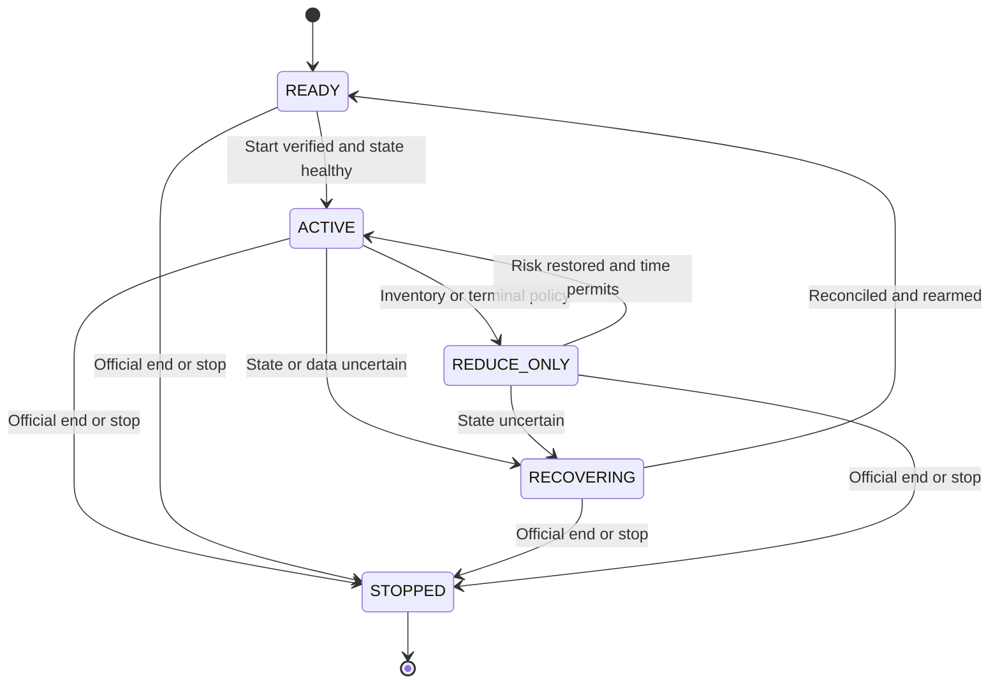

# Execution, Risk, Recovery, and the Final Round

## 1. What this chapter assumes—and what it does not

The supplied event material specifies eight instruments—`AMD`, `AVGO`, `CRWV`, `MU`, `NBIS`, `NVDA`, `SNDK`, and `VRT`—with a position limit of **100 lots long or short in each instrument**. The original rules slides confirm practice until approximately 21:00 local time, a final reset of positions **and PnL**, and a subsequent 20-minute competition. **The team is responsible for starting its algorithm after that reset.** Profit and loss, trading approach, amount of risk, and novelty matter; numerical weights are not stated. Treat the announced start and end signals as authoritative rather than starting an assumed timer at exactly 21:00. The slides also warn that practice includes regular resets. [Supplied event slides: IMG_3365, IMG_3367, IMG_3368]

The recovered environment notes specify `/opt/venv/bin/python`, automatic credentials in `Exchange()`, one connection for the team, polling for private trades and positions, and cancel-on-disconnect behavior. Disconnecting removes outstanding orders; it **does not close existing positions**. These are recovered event-context statements, not independently reverified live platform observations in this document.

The supplied event notebook, full synchronous API reference, and common-type source have been inspected. The method semantics below are grounded in those supplied snapshots. Their original web pages could not be fetched during this preparation; the installed client and organizers' current rules remain the authority if the running version differs. Actual rate limits, per-instrument tick sizes, current price bands, and final scoring treatment still need to be read from that environment or confirmed by the organizers. The generic Python interface accepting quantities between 1 and 100,000 does not permit a 100,000-lot position in this competition. A generic accepted price range likewise does not override an instrument's tick size or current price band.

No exact hedge, conversion, common settlement value, or fixed price relationship has been established between the eight symbols. A long position in one and a short position in another can reduce a measured factor exposure, but it does not cancel either instrument's position limit or guarantee a profitable round trip.

## 2. The operational objective

A strategy should produce decisions that can be executed, measured, stopped, and reproduced. A sophisticated signal running on an unreliable position ledger is not an improvement. The execution system's non-negotiable properties are:

1. It always knows which process is authorized to send orders.
2. Every potential fill is included in the appropriate risk scenario.
3. It distinguishes intent, acceptance, execution, and final cancellation.
4. It stops increasing exposure when account state or market data is uncertain.
5. A teammate can identify the running commit, configuration, mode, and account exposure immediately.

The proposed baseline architecture is one synchronous order-owning process, with bounded background logging and separate offline research. Do not add threads or asynchronous execution simply to appear sophisticated. First measure whether the basic implementation is actually too slow for the observed exchange.

## 3. One order owner, many contributors

Only the designated trader process should instantiate and connect the live `Exchange`. Research should operate on historical files, a historical loader that does not claim the live connection, or logs exported by the order owner. A second teammate opening a live notebook can disconnect the main process or create conflicting behavior.

In the recovered preparation files, `market_scout_source.py` opens an `Exchange` connection even though its analysis is read-only. Running it alongside the live trader can therefore interfere with the account. By contrast, the historical research script uses `HistoricalDataLoader` without a live `Exchange`. “Read-only” describes what a script intends to do, not whether connecting it can disturb another process. The event notebook also begins by connecting `Exchange`, so do not rerun its setup cell casually during a live run.

Use a process lock in the shared environment, a visible status file, and an explicit handover procedure. A local lock prevents duplicate processes on that host; it does not prevent a second machine from opening the same account. The team must coordinate ownership across machines. If a lead process becomes unreachable, do not automatically create another trader until the previous owner's status and the exchange's connection behavior are understood.

Recommended responsibilities:

| Component | Responsibility | Must not do |
|---|---|---|
| Exchange adapter | Normalize verified client responses, send approved requests, expose receipt times | Invent missing fills or silently retry an uncertain order |
| Account reconciler | Maintain positions, cash, private fills, live orders, and unresolved requests | Assume an accepted order has executed |
| Market-data cache | Store books, timestamps, validity, and local receipt age | Treat an unchanged book as proof of fresh data |
| Strategy | Propose target bid/ask prices and quantities | Call the exchange directly |
| Risk controller | Approve, shrink, or reject proposals against hard and internal limits | Offset possible buy fills against possible sell fills |
| Order manager | Compare target orders with current orders; enforce cancellation and rate budgets | Replace a live order without reserving the old order's remaining risk |
| Monitor | Report mode, PnL, limits, health, and failures | Block order handling with large file writes |

A small implementation can place these components in one process and a handful of functions. Logical separation matters more than a large class hierarchy.

### Exact API map from the supplied reference

The following are documented client methods, not pseudocode. Argument values must still be validated against the running instrument and account state.

| Method | Documented result or effect | Operational implication |
|---|---|---|
| `Exchange(...)` | Client object; `max_nr_trade_history=100` by default | Constructing a research client is unnecessary when the historical loader suffices |
| `connect()` | Connects; one connection per username | A shared team username has one connection owner |
| `is_connected()` | Boolean connection state | Connection state alone does not prove book or account freshness |
| `disconnect()` | Disconnects from the exchange | This method exists in the supplied API; do not infer otherwise from shortened FAQ wording |
| `get_instruments()` | Dictionary of all instrument definitions | Read the actual `tick_size` and type |
| `get_tradable_instruments()` | Definitions excluding paused or expired instruments | Do not quote a symbol solely because it appears in the full instrument list |
| `get_last_price_book(instrument_id)` | Last received `PriceBook` | It is a received state, not a guarantee that a fresh server snapshot has just been requested |
| `insert_order(instrument_id, *, price, volume, side, order_type='limit')` | `InsertOrderResponse(success, order_id, error_reason)` | `side` is `'bid'` for buy or `'ask'` for sell; supported types are `'limit'` and `'ioc'`; response has no executed-volume field |
| `get_outstanding_orders(instrument_id)` | Dictionary keyed by order ID containing own outstanding limit orders | Use it with reconciled fills and positions; an IOC remainder does not become a resting order |
| `amend_order(instrument_id, *, order_id, volume)` | `AmendOrderResponse(success, error_reason)` | No price argument is documented |
| `delete_order(instrument_id, *, order_id)` | `DeleteOrderResponse(success, error_reason)` | Check success and reconcile fills around cancellation |
| `delete_orders(instrument_id)` | Cancels all outstanding orders on that instrument; returns `None` | Do not treat a nonexistent bulk success flag as evidence; verify remaining account state |
| `get_positions()` | Instrument-to-integer-position dictionary | These are absolute positions, not position changes |
| `get_positions_and_cash()` | Per-instrument dictionary with `'volume'` and `'cash'` | Useful for per-instrument accounting; still reconcile orders separately |
| `get_cash()` | Total cash from previous trades | Cash alone is not PnL when inventory remains |
| `get_pnl(valuations=None)` | Cash plus inventory valuation; default reference is last public trade tick | Missing custom marks fall back to ticks; a nonzero position without either cannot be valued |
| `get_trade_history(instrument_id)` | Capped private trades since this client began | Does not recover the complete account history from before connection |
| `get_trade_tick_history(instrument_id)` | Capped public trades since this client began | Does not provide complete historical exchange data |
| `poll_new_trades(instrument_id)` | Private trades since this method's previous call for the instrument | One collector should consume and distribute these events |
| `poll_new_trade_ticks(instrument_id)` | Public ticks since this method's previous call for the instrument | A monitoring call can change what a later strategy poll receives |

Centralize each `poll_new_*` call and fan out the returned batch to strategy, ledger, and logs. Otherwise the logger may consume events before the strategy sees them. Default history capacity is small relative to a busy market; export the required data during the run rather than expecting to reconstruct everything later. The reference uses inconsistent parameter names in some history prose; the constructor's supplied signature is `max_nr_trade_history`, so inspect that actual signature before configuring it.

The supplied `OrderStatus` field descriptions contain generic “traded” wording even though `get_outstanding_orders` explicitly returns outstanding orders. Verify residual-volume behavior with a one-lot or partial-fill practice test instead of blindly treating a descriptive string as an execution record. `Trade` supplies `trade_id`, `order_id`, side, quantity, price, instrument, and timestamp; use private trade identities consistently to avoid duplicate ledger application.

The event notebook documents a separate `HistoricalDataLoader` with `get_trades_df(start, end)`, `get_orders_df(start, end)`, and `get_pricebooks_df(start, end)`, as well as typed-object alternatives. DataFrame timestamps are nanoseconds since epoch; book sides are JSON strings of `[price, volume]` pairs. A load call is limited to one day; longer ranges can be downloaded to cache with `download_all` and loaded day by day. These historical methods do not require the notebook's earlier live `Exchange` connection. [Supplied event notebook and synchronous API reference]

## 4. Position limits: the exact calculation

For an instrument with hard limit `L = 100`, define:

- `q`: the reconciled executed position.
- `B`: remaining quantity of every buy order that could still fill, including live orders and unresolved buy requests.
- `S`: remaining quantity of every sell order that could still fill, including live orders and unresolved sell requests.
- `x`: proposed additional buy quantity.
- `y`: proposed additional sell quantity.

The two independent worst-case conditions are:

```text
q + B + x <= L
q - S - y >= -L
```

Therefore:

```text
buy_capacity  = max(0, L - q - B)
sell_capacity = max(0, L + q - S)
```

Use integer lots and the smaller of hard capacity, internal risk capacity, strategy size, and valid order-size constraints. Do not net `B` against `S`: an adverse move may fill all your buys and none of your sells. Do not check only `abs(q) < 100`: that ignores the orders already in the market.

### Worked example

Suppose `q = +80`, with an outstanding 15-lot buy and a 30-lot sell. The maximum additional buy is `100 - 80 - 15 = 5`. The 30-lot sell creates no extra guaranteed buy capacity.

If five lots of the buy execute, the correct state becomes `q = +85` with ten lots remaining. The additional buy capacity is still five. The executed five lots must move from outstanding exposure to executed inventory. They must not remain in both categories in the stable reconciled state.

If the system requests cancellation of the remaining ten lots, those lots continue to count until cancellation is confirmed or authoritative terminal state establishes that they can no longer fill. Sending a new 15-lot buy immediately after the cancellation request can exceed the limit if the old order fills first.

### In-flight reservations and identity

Reserve risk **before** sending a request. Assign an internal request identifier and map it to the exchange's order identifier after acceptance. The reservation then becomes the live-order record; it is not an additional live order. Keep a lifecycle such as:

```text
RESERVED -> SENT -> LIVE/PARTIALLY_FILLED -> TERMINAL
                  -> REJECTED
                  -> UNKNOWN
```

`UNKNOWN` means the exchange may have received the request even if the local caller timed out. Preserve the risk reservation and reconcile before sending another order with the same intent. Unless verified idempotency exists, blind retrying can place two orders.

Cancellation changes a live order to `CANCEL_PENDING`; it does not immediately free capacity. A terminal order may still require fill reconciliation because a fill can occur immediately before the cancellation succeeds.

### Consistent snapshots matter

Positions and outstanding orders may be fetched at different instants. A position response from before a fill combined with an order response from after the fill can understate exposure. Prefer a consistent event ledger if the client supplies enough information. Otherwise reconcile repeatedly, sequence private-fill polling carefully, and pause new exposure if a coherent state cannot be established.

Use a single authoritative treatment of executed quantities. Do not both increment the position for a fill and then add a fresh absolute position response to it. Either reconcile the ledger against the absolute snapshot or set the position to that snapshot while tracking only events not yet included in it.

If an execution is ambiguous, a conservative temporary over-reservation is acceptable; an underestimated position is not. A more advanced implementation may represent uncertain inventory as `[q_min, q_max]`, approving buys against `q_max` and sells against `q_min`. This is safe only if the uncertainty interval and pending-order reservations cover each possible fill consistently. Do not introduce interval logic during the final minutes if the team cannot verify it.

## 5. Internal limits and portfolio exposure

The exchange's ±100 limit is a last boundary, not a target operating position. Choose an internal soft limit that leaves room for adverse fills, delayed observations, and controlled exits. Its value is a team configuration choice; it is not a recovered event rule.

For example, a deliberately small pilot might quote one lot on one validated instrument, then increase only after the team has verified fills, cancellation, reconciliation, and measured execution quality. A later 30-lot or 50-lot internal cap would still require empirical justification. Neither number is a recommendation to trade that size immediately.

Monitor exposure in several units:

```text
net_lots       = sum(q_i)                  # descriptive only across different assets
gross_notional = sum(abs(q_i) * mark_i * multiplier_i)
net_notional   = sum(q_i * mark_i * multiplier_i)
```

Verify contract multipliers rather than assuming them. Equal lots across symbols need not imply equal currency risk. A portfolio that is long eight related stocks can have a large common-factor exposure while respecting every individual limit. Estimate covariance or factor exposure only from suitable data, and remember that a 30-minute sample provides weak estimates of rare joint moves.

Keep distinct controls for each instrument's position, total risk, order message budget, and data health. A limit on gross notional cannot substitute for the exchange's individual lot limits.

## 6. Orders, fills, and cancellation semantics

An order request expresses an intent. An acceptance response means the exchange accepted that intent under its rules. Neither statement guarantees execution.

For a limit order, distinguish original quantity, cumulative filled quantity, and remaining quantity. For an immediate-or-cancel order, partial execution is possible. If a ten-lot IOC buys four lots and cancels the rest, inventory changes by four, not ten. Do not hedge ten lots on the assumption that the first request completely filled.

A successful IOC response may not itself contain all the information needed to reconcile the actual fill. Verify the installed client's response fields and use the account's private trades and positions. Public trades tell you that someone traded; they do not reliably establish your own executed quantity.

The supplied API defines `amend_order(instrument_id, *, order_id, volume)`: it changes volume and exposes no price parameter. Use the documented cancel-and-replace path to move a quote unless the installed version explicitly provides another supported operation. Reserve the old quote until terminal confirmation and account for the additional message cost and queue-priority consequences.

At the application layer, maintain one active target per side per instrument unless the team explicitly implements and tests multiple price levels. Otherwise a requoting loop can unintentionally accumulate a ladder of old orders.

Prevent your own bid and ask from crossing. If an aggressive exit would trade against your own resting order, cancel or adjust the conflicting order according to verified exchange behavior. Do not rely on undocumented self-trade prevention.

## 7. Validating prices and books

Before using a book, require valid instrument identity, finite positive prices, positive displayed depth, and a meaningful bid/ask relationship. An empty side does not support the usual midpoint, microprice, or passive two-sided quoting calculation. A locked or crossed book deserves a defined handling policy rather than a division or negative-spread accident.

Verify the instrument tick and round in tick units. For passive quotes:

```text
bid = floor(raw_bid / tick) * tick
ask = ceil(raw_ask / tick) * tick
```

After rounding, recheck spread, bounds, intended edge, and whether the order would cross. A floating-point representation such as `0.30000000000000004` should not create an off-tick request. Use integer ticks internally where practical.

For an aggressive exit, use a bounded executable limit derived from the book and the maximum acceptable slippage. Passive rounding rules alone are not an execution policy. A displayed top level may contain fewer lots than the intended exit size; inspect depth or send smaller controlled quantities. The visible book can change before the order arrives.

The supplied notebook contains an educational liquidation snippet with a sell limit of `0.10` and a buy limit of `100000.00`. Its own explanation warns that liquidation may be expensive and may fail to reach zero inventory. Do not adopt those broad limits as the final-round exit policy. Replace them with an instrument-valid, depth-aware price bound; reconcile each partial execution and any remaining exposure.

Track distinct times where available:

1. Exchange event timestamp.
2. Local receipt timestamp.
3. Decision timestamp.
4. Request submission and response timestamps.

Use monotonic local time for elapsed durations. Wall clocks can jump or disagree. An unchanged price does not establish that the feed is fresh; equality comparisons may omit timestamps. Conversely, no new exchange event can be legitimate in a quiet market. Define staleness using the source's actual update semantics and connection health, not an arbitrary assumption that every symbol must change every second.

If market-data or account freshness fails, stop opening new risk. Cancel existing quotes when feasible and route any deliberate inventory reduction through a policy that still has enough valid information to price it. “Kill switch” is not permission to send unbounded marketable orders into an unknown book.

## 8. Rate limits are a scarce execution resource

Read the actual event limit and its counting rules. Determine whether inserts, amendments, cancellations, and queries share a budget; whether the limit is rolling or fixed-window; and what happens when it is exceeded. Do not infer this event's limit from another Optibook competition.

Use a central request budget so independent strategies cannot each consume the entire allowance. Reserve operational capacity for cancellations and risk reduction. If the platform counts requests differently from the local budget, adjust using observed rejections and organizer guidance rather than increasing request frequency blindly.

Avoid changing a quote for every tiny midpoint move. A requote threshold can require a meaningful change in ticks, size, inventory, or data validity. Excessive cancel-and-replace consumes bandwidth and can sacrifice queue position. Too little requoting leaves stale prices exposed. Select this trade-off with fill quality and markouts, not message count alone.

Instrument selection is also an engineering choice: eight symbols with four operations per update may exhaust the budget. Compute the intended request rate before enabling all eight. Prioritize instruments supported by the best evidence and the most reliable execution.

## 9. A bounded control loop

The following is interface-neutral pseudocode. Names such as `reconcile_account` describe functions the team would implement; they are not asserted Optibook SDK methods.

```python
while mode != STOPPED:
    if operator_stop_requested() or official_round_has_ended():
        execute_documented_stop_protocol_and_record_unresolved_state()
        break

    account = reconcile_account_with_deadline()
    market = read_validated_cached_books()
    health = assess_health(account, market, request_budget)

    if health.requires_recovery:
        mode = RECOVERING
        request_cancellation_of_known_quotes_within_budget()
        preserve_all_unresolved_risk_reservations()
        bounded_wait()
        continue

    if final_round_has_not_been_verified_started():
        mode = READY
        bounded_wait()
        continue

    mode = ACTIVE
    targets = strategy_targets(market, account, frozen_configuration)
    targets = apply_internal_position_and_portfolio_policy(targets)
    actions = compare_targets_with_live_and_pending_orders(targets)

    for action in prioritize_cancels_risk_reduction_then_new_quotes(actions):
        if not request_budget.allows(action):
            continue
        if not risk_gate.approves(action, account, pending_ledger):
            continue
        reservation = reserve_potential_fill_before_sending(action)
        result = send_once_with_deadline(action)
        reconcile_request_result_without_blind_retry(reservation, result)

    emit_small_buffered_status_record()
    check_round_end_and_operator_commands()
```

Bound every wait, query, retry, and log buffer. A disconnected loop must not spin at full CPU or send an unbounded retry storm. An exception handler should preserve the error and transition to a defined state; `except: pass` hides both bugs and unresolved risk.

## 10. Modes and recovery



The diagram describes recommended application modes, not exchange-supported order flags. The official deadline applies in every mode.

Use visible modes with limited transitions:

| Mode | Behavior | Exit condition |
|---|---|---|
| `READY` | Connected only by the authorized owner; reconcile and observe; no new orders | Verified round start and healthy account |
| `ACTIVE` | Execute frozen strategy within all controls | Health failure, operator command, or terminal phase |
| `REDUCE_ONLY` | Reduce exposure under the chosen terminal or risk policy | Target exposure reached or information becomes unreliable |
| `RECOVERING` | Reconcile uncertain orders and positions; no new speculative exposure | A coherent authoritative state is restored |
| `STOPPED` | No new requests; outcome recorded | Explicit operator restart |

“Reduce only” describes the team's intent unless the exchange provides and documents a server-enforced reduce-only flag. Implement it against actual exposure and outstanding orders. A nominal sell can increase short exposure if intervening fills have already brought a long position through zero.

On reconnection, fetch current positions, outstanding orders, cash/PnL information, and available private trade history. Assume neither zero inventory nor that every pending request failed. Cancel-on-disconnect may clear old orders, but the exact disconnection moment and preceding fills still matter. Because trade buffers can be limited, historical completeness cannot be assumed. If the available history cannot reconstruct the ledger, use authoritative current account state and start a new reconciliation epoch rather than inventing missing trades.

## 11. PnL: scoreboard, economics, and execution

Keep three ideas separate:

1. **Official score:** whatever the organizers actually calculate.
2. **Marked PnL:** cash plus inventory valued using a specified reference.
3. **Executable liquidation value:** what the current inventory could plausibly realize against available prices and depth, before future price changes.

With multipliers incorporated consistently, marked equity is:

```text
equity(t) = cash(t) + sum(q_i(t) * mark_i(t) * multiplier_i)
PnL(t)    = equity(t) - equity(start)
```

Fees must be included exactly once—either already reflected in cash or explicitly subtracted. At a reset, record the new baseline; do not compare the final round against practice cash or positions.

The supplied event notebook and API describe `get_pnl()` using last public trade prices by default. The optional `valuations` dictionary can provide a different instrument value; any missing entry falls back to the last public tick. Without either value, a nonzero position cannot be valued. Treat an unavailable PnL as unavailable rather than displaying zero or formatting an absent value as a number. These client calculations do not establish every detail of the final ranking or terminal settlement. Passing custom marks to the client does not change the organizer's scoreboard.

For a small long position, a liquidation estimate uses bid-side prices; for a short position, it uses ask-side prices to cover. For larger quantities, walk the actual depth and expose any insufficient liquidity rather than multiplying every lot by the best price. Include fees and expected slippage. Report the gap between official marked PnL and this conservative estimate.

Example: buy ten lots at 100.00, then observe a last trade at 100.10 while the executable bid is 99.90. Last-trade marking shows +1.00 in price-currency units before multiplier and fees; selling immediately at 99.90 would realize −1.00. The difference can arise without any accounting bug. A team should understand it before presenting profits.

## 12. Metrics that explain performance

At minimum, capture a compact per-run summary:

| Metric | Why it matters |
|---|---|
| Official PnL and scoring window | Connects measurements to the actual competition |
| Conservative liquidation PnL | Reveals reliance on terminal inventory marks |
| Inventory by instrument, maximum absolute inventory | Shows risk and concentration |
| Gross and net notional | Reveals portfolio exposure across differently priced symbols |
| Fill count, volume, buy/sell balance | Shows whether the strategy actually trades and completes round trips |
| Fill price relative to arrival midpoint | Measures immediate spread capture or paid spread |
| Signed future markout at chosen horizons | Diagnoses adverse selection after fills |
| Maximum drawdown | Shows the worst observed deterioration during the run |
| Rejects, stale-data events, unknown requests | Exposes implementation and environment failures |
| Requests per second and cancellations per fill | Explains rate pressure and excessive quote churn |
| Uptime and time in each mode | Separates strategy performance from outages |
| Commit, configuration hash, start/end time | Makes comparison and rollback possible |

For a buy fill at price `p` with future midpoint `m(t+h)`, a simple signed markout is `m(t+h) - p`; for a sell it is `p - m(t+h)`. This includes the execution-price advantage or disadvantage. If measuring adverse movement relative to the contemporaneous midpoint instead, define that separately and use the same sign convention consistently. Do not compare two implementations that use different definitions under the same metric name.

Do not annualize a Sharpe ratio from one 20-minute round and present it as robust evidence. Report the observed distribution, assumptions, and sample size. Many rapid events are correlated and do not constitute independent experiments.

## 13. Failure response table

| Observation | Plausible cause | Immediate response | Evidence required before resuming |
|---|---|---|---|
| Position differs from expected fills | Partial execution, missed poll, delayed snapshot, duplicated ledger update | Pause new exposure; reconcile authoritative state | Stable positions and a consistent remaining-order ledger |
| Insert times out | Unknown network or exchange acceptance | Preserve reservation; do not resend blindly | Located order/fill or authoritative evidence of rejection |
| Cancel returns but inventory changes | Fill raced the cancellation | Reconcile fills; update position | Confirmed terminal order and current position |
| Repeated rate-limit errors | Too many symbols, quote churn, second process | Reduce request load; check owner; preserve cancellation budget | Measured request rate below the actual limit |
| Many fills followed by losses | Adverse selection, stale quotes, signal sign error | Reduce size or pause affected instrument | Correct timestamps/signs and improved out-of-sample markouts |
| PnL rises while inventory grows | Directional exposure or marking effect | Compare executable liquidation PnL and factor exposure | Evidence of actual edge beyond drift |
| Books stop updating | Quiet market or broken feed | Check source semantics and health; cancel if unsafe | Valid market and account freshness |
| Another teammate starts a notebook connection | Connection ownership violation | Stop the duplicate process and reconcile | One confirmed order owner |
| Reset occurs unexpectedly | Organizer restart or round boundary | Enter `READY`; invalidate old orders and baseline | New account state and official round status |
| Bot process crashes | Unhandled exception or resource exhaustion | Inspect exchange state; assume inventory remains | Verified cancellation state, positions, and restart configuration |

## 14. Verification before scaling

The meaningful tests exercise failures that can lose the round:

1. **Hard-limit boundary:** `q=80`, buy remaining 15, proposed buy 6 must be rejected or reduced to 5, even with many sells outstanding.
2. **Partial fill:** an original ten-lot order fills four; only six remain reserved and inventory changes by four.
3. **Cancel race:** old risk remains reserved until terminal state; an intervening fill updates inventory before replacement capacity is calculated.
4. **Unknown insertion:** a timeout retains risk and never triggers an automatic duplicate submission.
5. **Inconsistent account snapshots:** the system recognizes or safely bounds ambiguity rather than enabling new exposure.
6. **Empty or stale books:** invalid input produces no new speculative orders and no arithmetic exceptions.
7. **Rate pressure:** enough capacity remains for cancellation; strategies cannot bypass the central limiter.
8. **Disconnect/restart:** inventory is restored from the account instead of reset to zero locally.
9. **Round reset:** the old baseline and stale order identifiers are discarded only after reset is verified.
10. **Stop behavior:** the operator can identify what remains live and what inventory remains after shutdown.

Use controlled simulated responses and a tiny permitted practice order where appropriate. Never run stress or failure tests against a shared live competition account at large size. The platform's order-size validator passing a request is not a substitute for these tests.

## 15. Final-round runbook

### Before the organizer's reset

Freeze the best verified commit and configuration. Record the champion's evidence and why alternatives were rejected. Confirm the authorized operator and backup, the stop procedure, rate-limit settings, instruments enabled, and the fallback configuration. Finish installation and dependency changes now. Do not depend on downloading packages or training a new model during the final round.

Export small diagnostic summaries from practice. Ensure a teammate can describe the mechanism, control logic, and measured improvement in two minutes. The presentation should explain a coherent strategy rather than a catalogue of features.

### At reset

Stop issuing practice orders. Put the strategy behind an explicit restart gate. Wait for the organizer's official reset and final-start instruction; the slides specifically make the team responsible for starting after reset. Confirm the live account's positions, cash baseline, outstanding orders, and new round status. Reconcile any remaining exposure with staff if the reset did not produce the expected state. Do not keep an active order loop running through reset and infer that the next observed zero position means it may trade. Clear old signal state only where it is invalidated by the new market regime; do not silently carry a learned price level across a reset to a new price scale.

Record `t0` as the official competition start, the scoring window, the separate bot-launch time, and the exact configuration. A later launch or restart does not extend the official deadline. Connect through the single designated owner. Avoid a second monitoring connection unless organizers explicitly confirm it is supported.

### Initial stabilization

Verify that fresh books, private account state, rate budget, and mode transitions are functioning. Start with the already tested conservative configuration. If the round begins without useful history, use a valid fallback that does not depend on a full rolling window. Do not substitute fabricated zeros for missing volatility or signal estimates.

### Middle of the round

Monitor a small dashboard and keep one operator responsible for intervention. Changes should be limited to a documented emergency adjustment, such as disabling a failing instrument or reducing a cap. Do not edit signal logic because of a few bad trades. Live selection among many variants based on a few minutes of PnL creates another overfitting problem.

### Terminal phase

Choose inventory treatment from the confirmed scoring rule. If the rules penalize final positions or require flat inventory, begin controlled reduction early enough to complete it under realistic liquidity and message constraints. If inventory is marked without a flat requirement, reducing exposure can still reduce variance, but crossing spreads unnecessarily can harm PnL. The team must make that trade-off explicitly.

A possible configuration is a gradual tightening of soft limits followed by reduce-only behavior near the end. The actual timing should reflect observed liquidity and the organizer's settlement rule. Do not state that every team should liquidate in the final 30 seconds, and do not wait until the last instant to discover that the book cannot absorb the position.

### At the end

Follow the official stop instruction. Cancel outstanding orders where permitted and verify the final inventory and score. Retain the final commit, configuration, logs, score, and terminal positions. An orderly stop without liquidation may be correct if required by the rules; it must not be confused with a flat account.

## 16. Source and verification notes

- Original event slides supplied by Bernie and visually checked during preparation: `IMG_3365` confirms ±100 lots; `IMG_3367` confirms the final positions/PnL reset, team restart responsibility, 20-minute final round, and judging factors; `IMG_3368` advises quick iteration and warns of regular practice resets.
- Supplied event notebook, reviewed as `event_notebook.txt`: live-client setup, orders, public/private trades, accounting, historical loader, and educational liquidation example.
- Supplied full API snapshot, reviewed as `api_reference.txt`: exact synchronous method signatures, response fields, capped histories, and PnL behavior. Supplied expanded type source, reviewed as `common_types.txt`: instrument metadata, books, orders, and trades; book equality omits timestamp and default timestamps can be epoch placeholders.
- Event-specific official documentation URLs: [synchronous client](https://2026-bona-fide.optibook.net/docs/synchronous_client), [common types](https://2026-bona-fide.optibook.net/docs/common_types), and [FAQ](https://2026-bona-fide.optibook.net/faq). Web retrieval failed; claims above rely on the supplied snapshots, not an asserted successful live fetch.
- Independently retrieved Optiver primary-source background from another 2026 instance: [Intro Exercises to Optibook](https://2026-unsw.optibook.net/intro-exercises). It explicitly discusses position verification, outstanding-order management, last-trade PnL valuation, failure cases, and beginning with very small quantities. This source does not establish Delft's limits, API version, scoring rule, or timing.
- Independently retrieved Optiver platform background: [Optibook—UNSW 2026 instance](https://2026-unsw.optibook.net/). It describes the exchange, visualizer, simulation bots, Python environment, and participant-to-participant matching. Its environment details should not be imported into Delft without verification.

All architecture, formulas, workflows, examples, and configuration advice in this chapter are proposed engineering guidance. They are not claims about an existing completed implementation or measured profitability.
